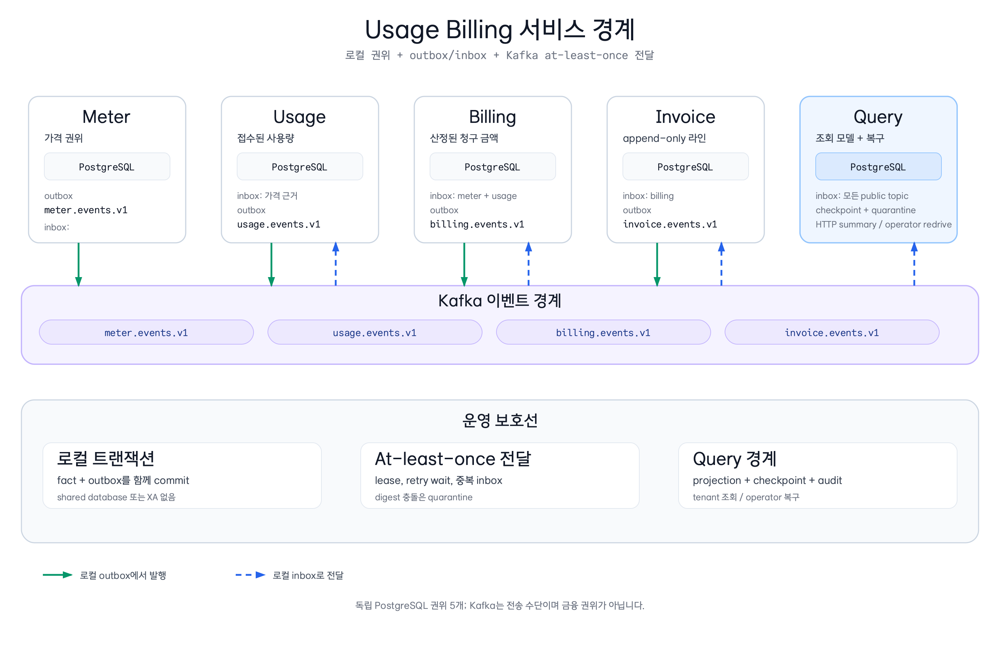

# Commerce 예제

[English](README.md) | 한국어

이 그룹은 서로 독립적으로 revision을 갖는 여러 aggregate, durable application
event, 운영자가 확인할 수 있는 복구 경계가 함께 필요한 end-to-end commerce
workflow를 다룹니다.

## 이 예제들이 필요한 이유

Commerce 장애는 하나의 CRUD 쓰기로 끝나지 않습니다. 주문은 결제 결과를
알 수 없는 상태에서 재고를 예약할 수 있고, 응답이 유실된 뒤 바우처 사용
요청이 재시도될 수 있으며, 적용 가격이 도착하기 전에 usage가 들어올 수
있습니다. 이 모듈들은 이런 업무 시나리오를 실행 가능한 예제로 만들고,
정상 경로 뒤에 숨은 실패 경계를 드러냅니다.

설계는 정확성의 기준 데이터와 처리량을 높이는 보조 수단을 분리합니다.
state machine, ledger, event-sourcing 예제에서는 PostgreSQL이 상태 전이의
기준 데이터이고, Redis·worker·SSE·Kafka 전달은 문서에 명시한 범위에서
보조 또는 재시도 가능한 경로입니다. 재시도 후에도 결과를 추적하고 안전하게
복구할 수 있도록 idempotency key, 불변 fact, inbox/outbox 기록, operator
복구 경계를 사용합니다. 이 예제들이 end-to-end exactly-once를 주장한다는
뜻은 아닙니다.

아래 모듈 표는 학습할 업무 장애에 맞는 가장 작은 workflow를 고르는
기준입니다. **실행**에 있는 모듈별 test 명령과
`scripts/smoke-validate.sh commerce`가 test-backed 검증 경로를 제공합니다.
이 검증은 적은 계약과 장애 시나리오를 확인하며 production 부하, credential,
외부 provider 가용성까지 증명하지는 않습니다.

## 업무를 처음 보는 독자를 위한 학습 순서

이 예제들을 controller 모음이 아니라 업무 계약으로 읽어야 합니다. 각
workflow를 볼 때 다음 네 가지 질문을 순서대로 던져 보세요. **잃어버리면
안 되는 업무 사실은 무엇인가? 그것을 결정할 권위 저장소는 무엇인가? 응답이나
의존성이 실패하면 어떻게 복구하는가? 그 규칙을 어떤 test가 증명하는가?**
framework class의 이름보다 이 답이 더 중요합니다.

| 업무 질문 | 먼저 볼 모듈 | 정확성 권위 | 실패·복구에서 배울 점 | 실행할 증거 |
|---|---|---|---|---|
| 두 고객이 같은 scarce seat/resource를 동시에 hold할 수 있는가? | [`reservation-control-plane`](reservation-control-plane/) | PostgreSQL row·revision·capacity transaction | command 재시도, durable expiry/waitlist 승격, Redis는 accelerator일 뿐임 | `ReservationWebIntegrationTest`, `LettuceReservationCoordinationIntegrationTest` |
| 유한한 voucher capacity를 campaign에서 정확히 한 번만 쓸 수 있는가? | [`promotion-voucher-campaign`](promotion-voucher-campaign/) | PostgreSQL campaign/voucher 상태와 idempotency record | 유실 응답, Redis outage, 늦은 review, reconciliation을 명시적 상태로 처리 | `VoucherEndToEndIntegrationTest`, `VoucherConcurrencyIntegrationTest` |
| 대량 pre-generated code pool을 import하고 안전하게 공개하려면? | [`pre-generated-voucher-pool`](pre-generated-voucher-pool/) | PostgreSQL entry reservation·revision·unique constraint | `FOR UPDATE SKIP LOCKED`, bounded ingest checkpoint, 일회 reveal replacement, key recovery | `VoucherPoolConcurrencyIntegrationTest`, `VoucherBatchIngestIntegrationTest` |
| order·payment·inventory·fulfillment를 하나의 status column으로 합치면 안 되는 이유는? | [`order-lifecycle-fulfillment`](order-lifecycle-fulfillment/) | aggregate별 PostgreSQL revision과 durable event publication | provider의 unknown/duplicate/out-of-order 결과를 replay와 operator review로 복구 | `OrderLifecycleIntegrationTest`, `OrderLifecycleWebIntegrationTest` |
| queue나 payment provider를 믿지 않고 flash sale에서 scarce ticket을 판매하려면? | [`concert-ticket-flash-sale`](concert-ticket-flash-sale/) | PostgreSQL sale·purchase·inventory·ticket-effect row | admission은 advisory, payment `UNKNOWN`·refund·ticket revoke·restock은 복구 가능한 workflow | `TicketEndToEndIntegrationTest`, `TicketHostileConcurrencyIntegrationTest` |
| append-only history의 비용을 projection/replay 이득과 바꿀 만한 때는? | [`event-sourced-promotion-voucher-campaign`](event-sourced-promotion-voucher-campaign/) | PostgreSQL event stream과 expected stream version | shadow projection rebuild, stale worker fencing, poison event quarantine, 설명 가능한 read | `EventStoreAppendIntegrationTest`, `ProjectionRebuildWorkerIntegrationTest` |
| usage와 price가 서로 다른 시점에 도착해도 billing period를 닫으려면? | [`usage-metering-billing-ledger`](usage-metering-billing-ledger/) | PostgreSQL normalized workflow와 immutable ledger/invoice fact | checkpoint 단위 close, crash 후 retry, 늦은 usage의 debit/credit adjustment append | `MeteringEndToEndIntegrationTest`, `BillingCloseStressTest` |
| event sourcing·upcasting·online read-model 교체를 함께 운영하려면? | [`usage-metering-billing-event-sourcing`](usage-metering-billing-event-sourcing/) | append-only event stream; projection은 rebuild 가능한 read model | hash 검증·replay/upcast·poison quarantine·fencing이 있는 generation switch | `EventStorePostgresIntegrationTest`, `ProjectionRecoveryPostgresIntegrationTest` |
| service를 분리했을 때 어떤 새로운 failure boundary가 생기는가? | [`usage-billing-microservices-composition-tests`](usage-billing-microservices-composition-tests/) | 서비스별 local PostgreSQL transaction | Kafka는 at-least-once이므로 outbox/inbox·digest conflict·ordering·quarantine·redrive가 retry를 안전하게 함 | `UsageBillingMicroserviceCompositionIntegrationTest`, `PoisonIntegrationTest` |

### 예제 전체에서 반복되는 용어

- **Aggregate와 revision**: aggregate는 invariant를 함께 바꿔야 하는 가장
  작은 업무 객체입니다. revision은 compare-and-set guard이므로 revision 4를
  읽은 command가 revision 5를 조용히 덮어쓰지 못합니다.
- **Idempotency**: timeout 뒤 caller가 같은 key로 재시도하는 상황입니다.
  server는 key와 request의 digest를 저장하고 같은 request면 원래 결과를
  replay하며, 다른 request면 conflict를 반환합니다. 업무 effect 중복은
  막지만 network exactly-once를 보장한다는 뜻은 아닙니다.
- **Outbox/inbox**: outbox는 local fact와 delivery 의도를 한 transaction에
  기록하고, inbox는 수신 event를 처리했다는 사실을 기록합니다. 둘 다
  at-least-once 전달을 위한 durable checkpoint이며 Kafka나 외부 provider와
  PostgreSQL이 하나의 transaction이라는 주장은 아닙니다.
- **Projection과 replay**: projection은 권위 fact에서 파생한 query용 복사본입니다.
  replay로 event부터 재생성하므로 projection이 늦거나 실패해도 source of
  truth가 되지 않습니다.
- **Reconciliation과 correction**: reconciliation은 서로 독립적인 fact를
  비교해 finding을 기록합니다. correction은 원래 payment·usage·ledger fact를
  수정하지 않고 새 debit/credit 또는 adjustment를 append합니다.

### Spec에서 코드로 읽는 순서

실행 가능한 module은 일반적인 CRUD tutorial이 아니라
`docs/superpowers/specs`의 설계 결정을 구현합니다. 먼저 대응하는 spec의
해당 section을 읽고, README의 architecture와 failure section, 마지막으로
이름이 나온 test를 읽으세요. 특히 spec은 Redis/Kafka가 왜 의도적으로
비권위인지, lock ordering을 왜 문서화했는지, operator recovery가 왜 업무
계약인지 설명합니다. 아래 command에 `--max-workers=1`을 붙인 이유는 공용
database fixture를 직렬화해 재현 가능한 correctness를 얻기 위해서이며,
성능 측정이라는 뜻은 아닙니다.

usage-billing 서비스 경계는 아래 그림과 같습니다. 각 서비스는 로컬
PostgreSQL 권위를 소유하고 Kafka topic으로 서비스 경계를 넘습니다. 이 그림은
처리량 chart가 아니라 소스 코드에 근거한 소유권 구조를 보여 줍니다.



[Architecture SVG source](../docs/images/readme-diagrams/usage-billing-service-boundaries-01.ko.svg)

## 모듈

| 모듈 | 초점 | 인프라 |
|------|------|--------|
| [`order-lifecycle-fulfillment`](order-lifecycle-fulfillment/) | 독립적인 주문, 결제, 재고, 배송, 환불 생명주기 | PostgreSQL (Testcontainers) |
| [`reservation-control-plane`](reservation-control-plane/) | PostgreSQL이 권위를 갖는 예약, 멱등 재시도, waitlist offer, expiry | PostgreSQL + Redis (Testcontainers) |
| [`shared`](shared/) | 바우처 호환성, payload digest·aggregate partition-key 계약과 예제 간 공용 fixture | 없음 |
| [`event-sourced-promotion-voucher-campaign`](event-sourced-promotion-voucher-campaign/) | Append-only campaign/claim stream, 기준 데이터, lease 기반 projection, fencing rebuild, position-aware HTTP/SSE | PostgreSQL (Testcontainers) |
| [`promotion-voucher-campaign`](promotion-voucher-campaign/) | 캠페인 수량, 바우처 할당/사용, review, SSE, reconciliation | PostgreSQL + Redis (Testcontainers) |
| [`pre-generated-voucher-pool`](pre-generated-voucher-pool/) | PostgreSQL이 권위를 갖는 사전 생성 바우처 예약, 일회 reveal/교체, revoke와 reconciliation | PostgreSQL + Redis (Testcontainers) |
| [`concert-ticket-flash-sale`](concert-ticket-flash-sale/) | 대기실 admission, USER/IP 구매 guard, 결제/환불 복구, 티켓 상태 기반 restock | PostgreSQL + Redis (Testcontainers) |
| [`usage-metering-billing-ledger`](usage-metering-billing-ledger/) | 멱등 usage, 시간 버전 가격, 재시작 가능한 close, 불변 ledger/invoice | PostgreSQL (Testcontainers) |
| [`usage-metering-billing-event-sourcing`](usage-metering-billing-event-sourcing/) | Event append/replay/upcast, 기준 데이터, fenced projection rebuild, correction/reconciliation | PostgreSQL (Testcontainers) |
| [`usage-billing-microservices`](usage-billing-microservices-composition-tests/) | local outbox/inbox와 명시적 Kafka delivery boundary를 가진 독립 Spring Boot 서비스 5개 | PostgreSQL + Kafka (Testcontainers) |
| [`usage-billing-meter-service`](usage-billing-meter-service/) | 불변 가격 버전, 멱등 활성화, `meter.events.v1` 발행 | PostgreSQL + Kafka |
| [`usage-billing-usage-service`](usage-billing-usage-service/) | 가격 근거 inbox, 멱등 사용량 접수, `usage.events.v1` 발행 | PostgreSQL + Kafka |
| [`usage-billing-billing-service`](usage-billing-billing-service/) | 복제된 가격 근거, 결정적 charge 산정, `billing.events.v1` 발행 | PostgreSQL + Kafka |
| [`usage-billing-invoice-service`](usage-billing-invoice-service/) | append-only invoice line, correction event, `invoice.events.v1` 발행 | PostgreSQL + Kafka |
| [`usage-billing-query-service`](usage-billing-query-service/) | 여러 topic projection, tenant summary, quarantine, operator redrive audit | PostgreSQL + Kafka |

각 모듈은 blocking Spring MVC와 Exposed JDBC 작업에 Java 25 virtual thread를
사용합니다. 요청 동시성은 virtual thread로 확장하지만, PostgreSQL 동시성은
HikariCP로 제한합니다.

## 실행

```bash
./gradlew :commerce-order-lifecycle-fulfillment:test --max-workers=1
./gradlew :commerce-reservation-control-plane:test --max-workers=1
./gradlew :commerce-shared:test --max-workers=1
./gradlew :commerce-event-sourced-promotion-voucher-campaign:integrationTest --max-workers=1
./gradlew :commerce-promotion-voucher-campaign:test --max-workers=1
./gradlew :commerce-pre-generated-voucher-pool:test --max-workers=1
./gradlew :commerce-concert-ticket-flash-sale:test --max-workers=1
./gradlew :commerce-usage-metering-billing-ledger:integrationTest --max-workers=1
./gradlew :commerce-usage-metering-billing-event-sourcing:integrationTest --max-workers=1
./gradlew :commerce-usage-metering-billing-event-sourcing:stressTest --max-workers=1
./gradlew :commerce-usage-billing-meter-service:test --max-workers=1
./gradlew :commerce-usage-billing-usage-service:test --max-workers=1
./gradlew :commerce-usage-billing-billing-service:test --max-workers=1
./gradlew :commerce-usage-billing-invoice-service:test --max-workers=1
./gradlew :commerce-usage-billing-query-service:test --max-workers=1
./gradlew :commerce-usage-billing-microservices-composition-tests:integrationTest --max-workers=1
./scripts/smoke-validate.sh commerce
```
