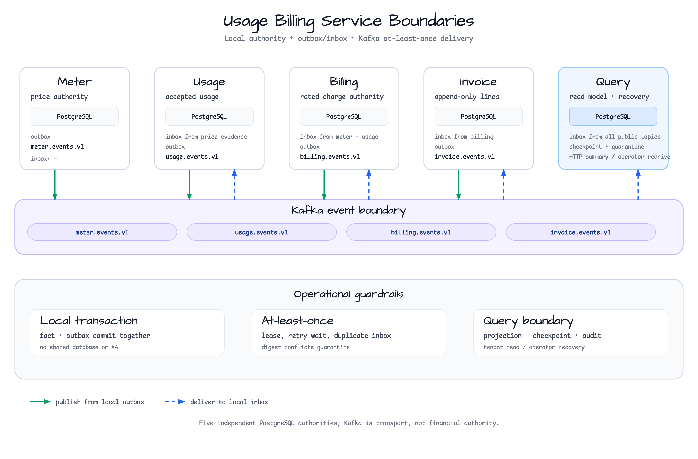

# Commerce Examples

[한국어](README.ko.md) | English

This group contains end-to-end commerce workflows whose correctness depends on
multiple independently versioned aggregates, durable application events, and
operator-visible recovery paths.

## Why these examples exist

Commerce failures rarely belong to one CRUD write: an order can reserve stock
while payment is still unknown, a voucher can be retried after a lost response,
and usage can arrive after the price that should rate it. These modules turn
those business stories into runnable examples where the failure boundary is
visible instead of hidden in a happy-path controller.

The design keeps the correctness authority separate from throughput helpers.
PostgreSQL owns state transitions in the state-machine, ledger, and event-sourced
examples; Redis, workers, SSE, and Kafka delivery remain advisory or retriable
at their documented boundary. Idempotency keys, immutable facts, inbox/outbox
records, and operator recovery are used because a retry must be inspectable and
safe, not because the examples claim end-to-end exactly-once execution.

The module table below is the selection guide: choose the smallest workflow
that matches the business failure you want to study. The module test commands
and `scripts/smoke-validate.sh commerce` in **Run** provide the test-backed
verification path; they prove the listed contracts and failure cases, not
production load, credentials, or external-provider availability.

## A newcomer-friendly learning path

Read these examples as business contracts, not as a collection of controllers.
For every workflow, ask four questions in this order: **what business fact must
not be lost, which store is allowed to decide it, what happens when a response
or dependency fails, and which test proves the rule?** The answer is more
important than the framework class that happens to implement it.

| Business question | Start here | Correctness authority | Failure or recovery lesson | Evidence to run |
|---|---|---|---|---|
| Can two customers hold the same scarce seat/resource? | [`reservation-control-plane`](reservation-control-plane/) | PostgreSQL row, revision, and capacity transaction | Retry the command; expiry and waitlist promotion are durable, while Redis is only an accelerator | `ReservationWebIntegrationTest`, `LettuceReservationCoordinationIntegrationTest` |
| How does a campaign spend a finite voucher capacity exactly once? | [`promotion-voucher-campaign`](promotion-voucher-campaign/) | PostgreSQL campaign/voucher state and idempotency record | Lost response, Redis outage, delayed review, and reconciliation are explicit states | `VoucherEndToEndIntegrationTest`, `VoucherConcurrencyIntegrationTest` |
| How is a large pre-generated code pool imported and revealed safely? | [`pre-generated-voucher-pool`](pre-generated-voucher-pool/) | PostgreSQL entry reservation, revision, and unique constraints | `FOR UPDATE SKIP LOCKED`, bounded ingest checkpoints, one-time reveal replacement, and key recovery | `VoucherPoolConcurrencyIntegrationTest`, `VoucherBatchIngestIntegrationTest` |
| Why are order, payment, inventory, and fulfillment not one status column? | [`order-lifecycle-fulfillment`](order-lifecycle-fulfillment/) | Each aggregate's PostgreSQL revision and durable event publication | Unknown/duplicate/out-of-order provider outcomes need replay and operator review | `OrderLifecycleIntegrationTest`, `OrderLifecycleWebIntegrationTest` |
| How can a flash sale sell scarce tickets without trusting a queue or payment provider? | [`concert-ticket-flash-sale`](concert-ticket-flash-sale/) | PostgreSQL sale, purchase, inventory, and ticket-effect rows | Admission is advisory; payment `UNKNOWN`, refund, ticket revoke, and restock are recoverable workflows | `TicketEndToEndIntegrationTest`, `TicketHostileConcurrencyIntegrationTest` |
| When is append-only history worth the projection/replay cost? | [`event-sourced-promotion-voucher-campaign`](event-sourced-promotion-voucher-campaign/) | PostgreSQL event stream and expected stream version | Rebuild a shadow projection, fence stale workers, quarantine poison events, and keep reads explainable | `EventStoreAppendIntegrationTest`, `ProjectionRebuildWorkerIntegrationTest` |
| How do we close a usage bill when usage and prices arrive at different times? | [`usage-metering-billing-ledger`](usage-metering-billing-ledger/) | PostgreSQL normalized workflow plus immutable ledger/invoice facts | Close by checkpoint, retry after a crash, and append late debit/credit adjustments | `MeteringEndToEndIntegrationTest`, `BillingCloseStressTest` |
| How do event sourcing, upcasting, and online read-model replacement work together? | [`usage-metering-billing-event-sourcing`](usage-metering-billing-event-sourcing/) | Append-only event streams; projections are rebuildable read models | Validate hashes, replay/upcast, quarantine poison events, and switch generations only with fencing | `EventStorePostgresIntegrationTest`, `ProjectionRecoveryPostgresIntegrationTest` |
| What new failure boundaries appear after service extraction? | [`usage-billing-microservices-composition-tests`](usage-billing-microservices-composition-tests/) | Each service's local PostgreSQL transaction | Kafka is at-least-once; outbox/inbox, digest conflict, ordering, quarantine, and redrive make retries safe | `UsageBillingMicroserviceCompositionIntegrationTest`, `PoisonIntegrationTest` |

### Terms that appear throughout the examples

- **Aggregate and revision**: an aggregate is the smallest business object
  whose invariants must change together. Its revision is a compare-and-set
  guard: a command that read revision 4 cannot silently overwrite revision 5.
- **Idempotency**: the caller sends the same key after a timeout. The server
  stores a digest of the key and request, then replays the original result for
  the same request or returns a conflict for a different request. It prevents
  duplicate business effects; it does not make a network exactly-once.
- **Outbox/inbox**: an outbox records a local fact and the delivery intent in
  one transaction. An inbox records that a received event was handled. Both
  are durable checkpoints for at-least-once delivery, not a claim that Kafka or
  an external provider is transactional with PostgreSQL.
- **Projection and replay**: a projection is a query-oriented copy derived
  from authoritative facts. Replay rebuilds it from events; therefore a
  projection may lag or fail without becoming the source of truth.
- **Reconciliation and correction**: reconciliation compares independent facts
  and records a finding. A correction appends a new debit/credit or adjustment;
  it never edits the original payment, usage, or ledger fact.

### Spec-to-code reading order

The runnable modules are implementations of the design decisions in
`docs/superpowers/specs`, not generic CRUD tutorials. Read the matching spec
section first, then the README's architecture and failure sections, then the
named test. In particular, the specs explain why Redis/Kafka are deliberately
non-authoritative, why lock ordering is documented, and why operator recovery
is part of the business contract. The command examples below intentionally use
`--max-workers=1` because the shared test fixtures serialize database-backed
examples; this is a reproducible correctness run, not a performance claim.

The usage-billing service boundaries are summarized below. Each service owns a
local PostgreSQL authority and crosses service boundaries through Kafka topics;
the diagram is a source-backed ownership view, not a throughput chart.



[Architecture SVG source](../docs/images/readme-diagrams/usage-billing-service-boundaries-01.svg)

## Modules

| Module | Focus | Infrastructure |
|--------|-------|----------------|
| [`order-lifecycle-fulfillment`](order-lifecycle-fulfillment/) | Independent order, payment, inventory, fulfillment, and refund lifecycles | PostgreSQL (Testcontainers) |
| [`reservation-control-plane`](reservation-control-plane/) | PostgreSQL-authoritative reservations, idempotent retries, waitlist offers, and expiry | PostgreSQL + Redis (Testcontainers) |
| [`shared`](shared/) | Voucher compatibility, payload digest, aggregate partition-key contracts, and cross-example fixtures | None |
| [`event-sourced-promotion-voucher-campaign`](event-sourced-promotion-voucher-campaign/) | Append-only campaign/claim streams, snapshots, leased projections, fenced rebuilds, and position-aware HTTP/SSE | PostgreSQL (Testcontainers) |
| [`promotion-voucher-campaign`](promotion-voucher-campaign/) | Campaign capacity, voucher allocation/redemption, review, SSE, and reconciliation | PostgreSQL + Redis (Testcontainers) |
| [`pre-generated-voucher-pool`](pre-generated-voucher-pool/) | PostgreSQL-authoritative pre-generated voucher reservation, one-time reveal/replacement, revoke, and reconciliation | PostgreSQL + Redis (Testcontainers) |
| [`concert-ticket-flash-sale`](concert-ticket-flash-sale/) | Waiting-room admission, USER/IP purchase guards, payment/refund recovery, and ticket-safe restock | PostgreSQL + Redis (Testcontainers) |
| [`usage-metering-billing-ledger`](usage-metering-billing-ledger/) | Idempotent usage, time-versioned pricing, restartable close, and immutable ledger/invoice | PostgreSQL (Testcontainers) |
| [`usage-metering-billing-event-sourcing`](usage-metering-billing-event-sourcing/) | Event append/replay/upcasting, snapshots, fenced projection rebuilds, correction, and reconciliation | PostgreSQL (Testcontainers) |
| [`usage-billing-microservices`](usage-billing-microservices-composition-tests/) | Five independently deployable Spring Boot services with local outbox/inbox and explicit Kafka delivery boundaries | PostgreSQL + Kafka (Testcontainers) |
| [`usage-billing-meter-service`](usage-billing-meter-service/) | Immutable price versions, idempotent activation, and `meter.events.v1` publication | PostgreSQL + Kafka |
| [`usage-billing-usage-service`](usage-billing-usage-service/) | Price-evidence inbox, idempotent usage acceptance, and `usage.events.v1` publication | PostgreSQL + Kafka |
| [`usage-billing-billing-service`](usage-billing-billing-service/) | Replicated pricing evidence, deterministic charge rating, and `billing.events.v1` publication | PostgreSQL + Kafka |
| [`usage-billing-invoice-service`](usage-billing-invoice-service/) | Append-only invoice lines, correction events, and `invoice.events.v1` publication | PostgreSQL + Kafka |
| [`usage-billing-query-service`](usage-billing-query-service/) | Multi-topic projection, tenant summary, quarantine, and operator redrive audit | PostgreSQL + Kafka |

The modules use Java 25 virtual threads for blocking Spring MVC and Exposed JDBC
work. Database concurrency remains bounded by HikariCP; virtual threads increase
request concurrency, not PostgreSQL capacity.

## Run

```bash
./gradlew :commerce-order-lifecycle-fulfillment:test --max-workers=1
./gradlew :commerce-reservation-control-plane:test --max-workers=1
./gradlew :commerce-shared:test --max-workers=1
./gradlew :commerce-event-sourced-promotion-voucher-campaign:integrationTest --max-workers=1
./gradlew :commerce-promotion-voucher-campaign:test --max-workers=1
./gradlew :commerce-pre-generated-voucher-pool:test --max-workers=1
./gradlew :commerce-concert-ticket-flash-sale:test --max-workers=1
./gradlew :commerce-usage-metering-billing-ledger:integrationTest --max-workers=1
./gradlew :commerce-usage-metering-billing-event-sourcing:integrationTest --max-workers=1
./gradlew :commerce-usage-metering-billing-event-sourcing:stressTest --max-workers=1
./gradlew :commerce-usage-billing-meter-service:test --max-workers=1
./gradlew :commerce-usage-billing-usage-service:test --max-workers=1
./gradlew :commerce-usage-billing-billing-service:test --max-workers=1
./gradlew :commerce-usage-billing-invoice-service:test --max-workers=1
./gradlew :commerce-usage-billing-query-service:test --max-workers=1
./gradlew :commerce-usage-billing-microservices-composition-tests:integrationTest --max-workers=1
./scripts/smoke-validate.sh commerce
```
