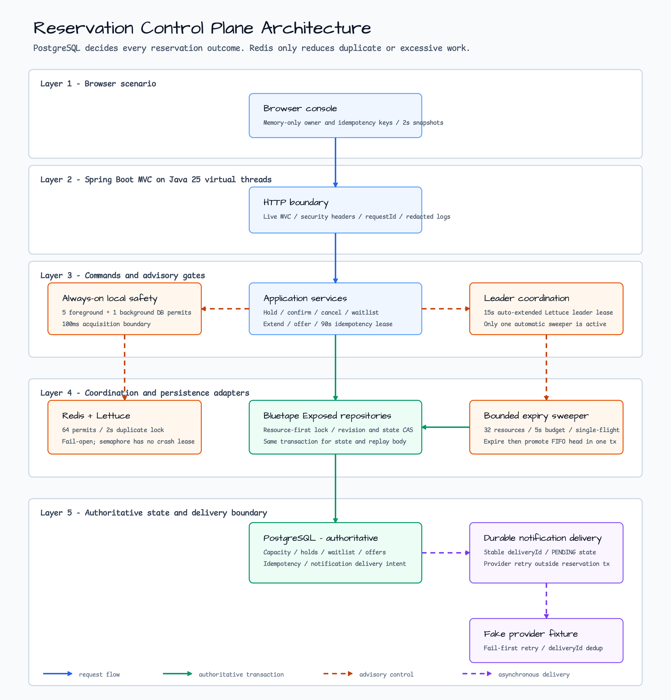
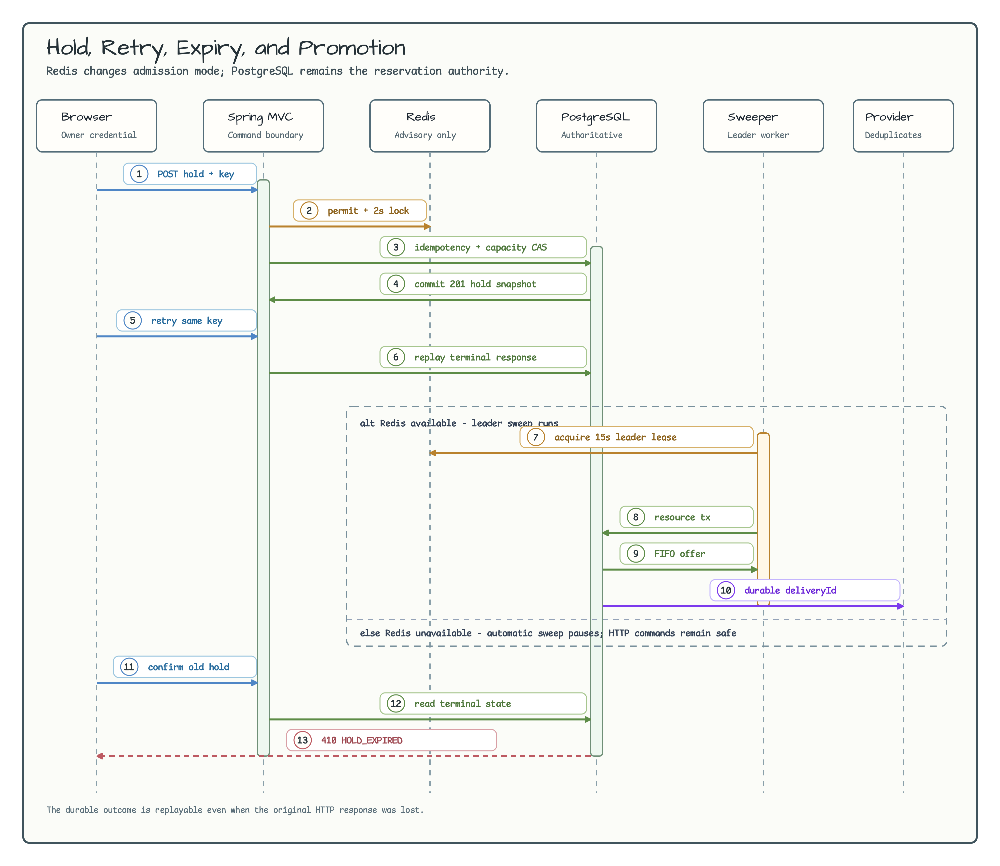

# Reservation Control Plane

[한국어](README.ko.md) | English

This Spring Boot example implements an application-owned reservation control plane for scarce capacity. PostgreSQL is the correctness authority; Redis only reduces duplicate work, coordinates the expiry sweeper, and provides best-effort admission control.

## Business requirements and design decisions

The business problem is not merely “insert a reservation.” A resource has a
finite capacity, a customer may retry after losing the response, and a hold can
expire while another request is trying to confirm it. The design turns those
risks into explicit requirements:

| Requirement | Design rule | What a newcomer should observe |
|---|---|---|
| Never oversell capacity | Lock the PostgreSQL resource row, validate `revision` and `policyVersion`, then update occupancy and hold state in one transaction | Redis admission can reject work early, but it cannot create a hold or decide whether capacity exists |
| Make a timeout safe | Store an owner-scoped request digest and response descriptor under `Idempotency-Key` | Same key and payload replays; same key with another owner/payload conflicts; an in-progress lease is retryable |
| Give the waitlist a fair chance | Keep FIFO sequence in PostgreSQL and turn released capacity into one bounded offer | `OFFERED` means the slot is reserved for that entry; a repeated expiry sweep must not promote twice |
| Recover abandoned work | A leader-guarded sweeper uses compare-and-set transitions and writes one durable notification delivery | Losing Redis pauses optimization/leader work, but a manual bounded sweep remains possible |
| Keep operators safe | Force-release and sweep endpoints require operator mode/key and expose bounded results | Recovery is an audited command, not an unbounded “fix everything” button |

The corresponding design specification is
`docs/superpowers/specs/2026-07-18-issue-533-reservation-control-plane-design.md`.
Read its authority boundary, state model, HTTP idempotency, and runbook
sections beside `ReservationCommandService`, `WaitlistCommandService`, and
`ReservationExpirySweeper`. The example deliberately excludes payment,
calendar billing, and a production identity provider; those are integration
boundaries rather than hidden assumptions.

## Scenarios

1. Open `http://localhost:8080` in two browsers and try to hold the same resource revision. PostgreSQL row locking and revision checks allow only a valid transition.
2. Create a hold, then confirm, extend, or cancel it with the same browser-owned credential.
3. Join a full resource's FIFO waitlist. Expiry or cancellation promotes the oldest waiting entry into a bounded offer that the same owner can accept.
4. Retry an ambiguous command with the same `Idempotency-Key`. The stored response is replayed; reusing the key with a different owner or payload returns a conflict.
5. Stop Redis while traffic continues. Local bulkheads and PostgreSQL invariants remain active, while Redis-backed optimization and leader-only sweeping degrade visibly.
6. Inspect each resource's local calendar time. DST gaps are rejected and overlapping local times require an explicit valid UTC offset, so the same input never resolves differently across nodes.
6. Enable the operator API to force-release a stuck hold or run one bounded manual sweep with an explicit operator key.

## Architecture



The authority boundary is deliberate:

- PostgreSQL transactions, row locks, revisions, capacity counts, ownership digests, idempotency records, offers, and durable notification deliveries decide correctness.
- The node-local bulkhead is always active and reserves five foreground permits plus one background permit for database work.
- Redis uses `bluetape4k-lettuce`, `LettuceSemaphore`, `LettuceLock`, and `bluetape4k-leader`. These paths are advisory and fail open to the local/PostgreSQL boundary.
- `LettuceSemaphore` in the resolved Bluetape release has no lease. A process crash can leak a permit until the Redis key is reset or Redis is restarted; this never changes reservation correctness.

## Hold and waitlist sequence



The expiry worker locks one resource, expires stale holds and offers with compare-and-set semantics, promotes the next FIFO entry or releases capacity, creates one durable notification delivery, and commits those changes in the same transaction. A repeated sweep sees the committed state and does not duplicate the promotion.

## Software stack

| Concern | Choice |
|---|---|
| Runtime | Java 25, Kotlin, virtual threads |
| Web | Spring Boot MVC, embedded Tomcat |
| Persistence | PostgreSQL, Exposed JDBC, `AbstractJdbcRepository` patterns |
| Test database | `PostgreSQLServer` from `bluetape4k-testcontainers` |
| Advisory coordination | Redis through Lettuce, `bluetape4k-leader` |
| Observability | `bluetape4k-logging`, Actuator health, Prometheus registry |
| Dependency authority | `bluetape4k-dependencies:2.1.0` only |

The module consumes `bluetape4k-exposed-jdbc`, `bluetape4k-exposed-jdbc-tests`, `bluetape4k-virtualthread-api`, and `bluetape4k-virtualthread-jdk25` through the root dependency platform. It does not import an individual Bluetape BOM or pin a Bluetape module version.

## Run

Start PostgreSQL and create the configured database, then run:

```bash
export RESERVATION_DATABASE_URL=jdbc:postgresql://localhost:5432/reservation_control_plane
export RESERVATION_DATABASE_USERNAME=reservations
export RESERVATION_DATABASE_PASSWORD=reservations
export RESERVATION_HMAC_SECRET='replace-with-at-least-32-random-bytes'
./gradlew :commerce-reservation-control-plane:bootRun
```

Redis is optional and disabled by default:

```bash
export RESERVATION_REDIS_ENABLED=true
export RESERVATION_REDIS_URI=redis://localhost:6379
./gradlew :commerce-reservation-control-plane:bootRun
```

The browser creates a 256-bit owner credential and idempotency keys in memory. It never writes them to `localStorage`, cookies, URLs, or the page DOM. A page reload intentionally creates a new owner.

## API contract

All user command endpoints require `X-Reservation-Owner` and `Idempotency-Key`. Query endpoints require the owner credential where the response is owner-specific.

| Method | Path | Purpose |
|---|---|---|
| `GET` | `/api/resources` | List resource snapshots |
| `POST` | `/api/resources/{id}/holds` | Create a time-bounded hold |
| `POST` | `/api/holds/{id}/confirm` | Confirm a held reservation |
| `POST` | `/api/holds/{id}/extend` | Extend a live hold |
| `POST` | `/api/holds/{id}/cancel` | Cancel and return capacity |
| `POST` | `/api/resources/{id}/waitlist` | Join the FIFO waitlist |
| `GET` | `/api/waitlist/{id}` | Read an owner-scoped waitlist entry |
| `POST` | `/api/waitlist/{id}/cancel` | Cancel a waitlist entry |
| `GET` | `/api/offers/{id}` | Read an owner-scoped offer |
| `POST` | `/api/offers/{id}/accept` | Accept a live offer |
| `POST` | `/api/operator/holds/{id}/force-release` | Force-release a hold when operator mode is enabled |
| `POST` | `/api/operator/sweep` | Run one bounded sweep when operator mode is enabled |

The same idempotency key and fingerprint replay the original status and body with `Idempotency-Replayed: true`. A different fingerprint returns `409 Conflict`. In-progress commands return a retryable response rather than running twice.

### Idempotency digest threat model

Production never persists the caller's raw idempotency key. The production
`keyDigest` is a keyed HMAC produced by `ReservationCredentialService`; that
credential boundary is unchanged. `IdempotencyFingerprint.request` is an
unkeyed SHA-256 checksum over a domain-separated, NUL-delimited operation and
canonical payload that already contains an owner digest. Its purpose is replay
conflict detection, not secrecy or authentication. The `key` helper is used by
tests and fixtures only. Both helpers now use
`Digesters.SHA256.digestHexUtf8` without changing field order, separators,
UTF-8 encoding, or lowercase 64-char storage.

An attacker with repository rows could enumerate low-entropy unkeyed inputs, so
raw credentials and guessable secrets must never enter the request fingerprint.
If future requirements place such values there, introduce a separately reviewed
keyed migration with key lifecycle, rotation, storage compatibility, and
backfill; do not silently replace the persisted digest format.

## Concurrency and timeout budget

Virtual threads remove the platform-thread-per-request cost, but they do not create database connections. Tomcat accepts up to 8,000 connections and keeps an 8,000-thread platform fallback, while Hikari remains intentionally bounded to eight connections with a 60-second acquisition timeout. Transactions also time out after 60 seconds. The local database bulkhead sheds excess work before requests monopolize Hikari.

Tune these separately instead of sizing the JDBC pool to the HTTP concurrency level:

- `RESERVATION_TOMCAT_MAX_CONNECTIONS`, `RESERVATION_TOMCAT_MAX_THREADS`
- `RESERVATION_DB_POOL_MAX`, `RESERVATION_DB_CONNECTION_TIMEOUT_MS`
- `RESERVATION_TRANSACTION_TIMEOUT`
- `RESERVATION_SWEEP_BATCH_SIZE`, `RESERVATION_SWEEP_DELAY`

## Operator mode

Operator endpoints do not exist unless explicitly enabled:

```bash
export RESERVATION_OPERATOR_ENABLED=true
export RESERVATION_OPERATOR_KEY='replace-with-at-least-32-random-bytes'
```

Send the key in `X-Operator-Key`. Comparisons are constant-time, and raw owner, idempotency, and operator credentials are never logged. Force release additionally requires an uppercase `reasonCode` such as `CUSTOMER_SUPPORT`.

## Runbook

| Symptom | Expected behavior | Action |
|---|---|---|
| PostgreSQL unavailable or pool exhausted | Commands fail; no Redis-only mutation is accepted | Restore PostgreSQL, inspect Hikari acquisition latency, and keep the pool bounded |
| Redis unavailable | Commands continue through the local bulkhead and PostgreSQL; leader-only automatic sweeping pauses | Restore Redis and confirm leader acquisition; if Redis was unavailable during application startup, restart this example to re-enable its optional Redis beans |
| Redis admission permits remain consumed after a process crash | Admission may degrade, but database correctness remains intact | Reset the reservation semaphore key or restart the dedicated Redis instance |
| Expired holds or offers accumulate | Capacity can remain temporarily unavailable | Check leader health and PostgreSQL, then invoke the bounded operator sweep |
| Notification delivery backlog grows | Reservation state remains committed; delivery is retried separately | Inspect durable delivery rows and provider failures before retrying |
| A hold is operationally stuck | Normal owner transitions may not recover it | Enable operator mode briefly and force-release with an auditable reason code |

The example persists notification delivery intent and tests retry/deduplication with a fake provider. It does not ship a production provider-specific worker.

## Verify

Integration tests start PostgreSQL with `PostgreSQLServer` and call the live HTTP server with `WebTestClient`.

```bash
./gradlew :commerce-reservation-control-plane:test
./gradlew :commerce-reservation-control-plane:build
./gradlew detekt
```
