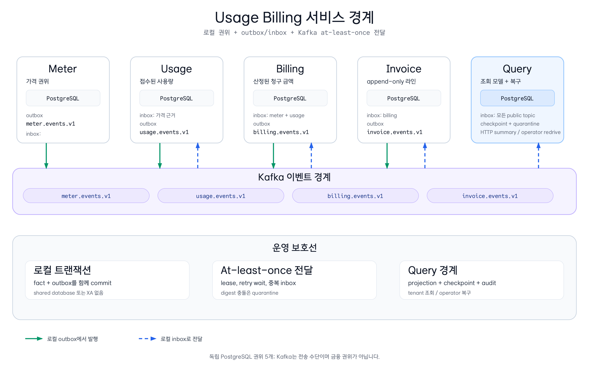

# Usage Billing Meter Service

[English](README.md) | 한국어

`usage-billing-meter-service`는 usage-billing 마이크로서비스 예제의 가격 권위입니다. 불변 가격 버전을 기록하고 `PriceActivated` integration event를 발행하며, Usage·Billing·Invoice·Query의 데이터베이스를 공유하지 않습니다.

## 이 서비스가 필요한 이유

Usage billing에는 단순해 보이지만 중요한 업무 질문이 있습니다. tenant의
usage가 접수된 순간 어떤 가격이 적용되었는가입니다. 이후 charge가 Meter
database를 실시간 조회하지 않아도 되도록 이 서비스는 가격 이력을 명시하고,
downstream 서비스가 로컬에 보관할 수 있는 근거를 발행합니다.

경계는 의도적으로 좁습니다. PostgreSQL은 불변 가격 version과 command
receipt를 저장하고, local outbox가 event를 발행합니다. shared database,
HTTP controller, 서비스 간 transaction은 없으며 Kafka 전송과 로컬 상태 갱신이
하나의 원자 연산이라고 주장하지 않습니다. process가 중단된 뒤에도 retry가
안전하도록 idempotency receipt와 lease를 확인하는 outbox를 선택했습니다.

**검증 실행**의 `test`와 `integrationTest` 명령이 test-backed 증거입니다.
첫 명령은 command·envelope·idempotency·publisher·repository 계약을 확인하고,
두 번째 명령은 PostgreSQL uniqueness와 로컬 효과의 원자성을 확인합니다.
broker 가용성이나 production 가격 정책까지 증명하지는 않습니다.



[Architecture SVG source](../../docs/images/readme-diagrams/usage-billing-service-boundaries-01.ko.svg)

## 업무 요구사항과 테스트 증거

Meter는 price authority입니다. 핵심 약속은 “현재 가격을 반환한다”가 아니라
“downstream service가 사용해도 되는 price version의 durable evidence를
발행한다”입니다. local fact와 `PENDING` outbox row를 함께 commit하고 Kafka
전달은 retry 가능하게 둡니다. `MeterServiceApplicationContractTest`는
command/envelope/idempotency 계약을, `MeterOutboxPostgresIntegrationTest`는
uniqueness·atomic local write·fenced publisher 완료를 증명합니다. 어느 test도
broker transaction을 증명하지는 않습니다.

## 책임

- tenant, meter, currency, unit price, effective time을 포함한
  `ActivatePriceCommand`를 받습니다.
- `(tenantId, idempotencyKey)`를 command identity로 취급합니다.
- 불변 `MeterPriceVersion`과 durable command receipt를 저장합니다.
- local outbox를 통해 `meter.events.v1`에 `PriceActivated`를 발행합니다.

이 모듈에는 HTTP controller가 없습니다. `MeterCommandService`가 contract, persistence, composition test가 사용하는 application 경계입니다.

## 활성화 contract

`MeterCommandService.activatePrice`는 비어 있지 않은 식별자와 양수
`unitPrice`를 검증합니다. command field를 SHA-256으로 hash한 뒤 다음을 기록합니다.

| 결과                                    | 동작                                                              |
|-----------------------------------------|-------------------------------------------------------------------|
| 첫 command                              | price version `1`, envelope schema `1`, `PENDING` outbox row 생성 |
| 같은 idempotency key와 같은 fingerprint | 두 번째 price version 없이 기존 결과 재생                         |
| 같은 idempotency key와 다른 fingerprint | `MeterIdempotencyConflict`로 거부                                 |

envelope에는 `meterCode`, `currency`, `unitPrice`와 독립적인 payload digest가 들어 있습니다. local transaction은 command receipt, price version, envelope, outbox row를 함께 commit합니다.

## 전달과 복구

`MeterOutboxPublisher`는 owner-and-lease 조건으로 row를 claim하고
`meter.events.v1`에 발행한 뒤 같은 ownership token으로 `markPublished`를 fencing합니다. durable state machine은 다음과 같습니다.

`PENDING → CLAIMED → PUBLISHED`

transport failure가 발생하면 claimed row는 `RETRY_WAIT`로 이동합니다. 시도 횟수를 소진했거나 유효하지 않은 record는 `QUARANTINED`가 될 수 있습니다. Kafka가 record를 받은 뒤 local status를 갱신하기 전에 process가 중단되어도, 수신 서비스가 중복 전달로 처리하므로 복구할 수 있습니다.

관련 source: [`MeterCommandService`](src/main/kotlin/io/bluetape4k/workshop/commerce/usagebilling/meter/application/MeterCommandService.kt),
[`MeterIntegrationEnvelope`](src/main/kotlin/io/bluetape4k/workshop/commerce/usagebilling/meter/integration/MeterIntegrationEnvelope.kt),
[`MeterOutboxPersistence`](src/main/kotlin/io/bluetape4k/workshop/commerce/usagebilling/meter/persistence/MeterOutboxPersistence.kt).

## Payload digest contract

Production 코드는
`io.bluetape4k.workshop.commerce.shared.integration.PayloadDigest`에
SHA-256 생성과 canonical 검증을 위임합니다. shared 계약은 UTF-8
payload의 lowercase 64자 hex 표현을 유지하므로 schema나 database
migration이 필요하지 않습니다. 이 값은 우발 손상과 contract drift를
탐지하는 비인증 checksum이며 적대적 변조에는 MAC 또는 signature가
필요합니다. Test는 production 호출을 그대로 반복하지 않도록 독립적인
JDK SHA-256 oracle을 유지합니다.

## 검증 실행

기본 test suite는 container 없이 실행합니다. PostgreSQL과 Kafka integration test는 Testcontainers를 사용하며 저장소의 `TestMutexService` 규칙에 따라 직렬로 실행해야 합니다.

```bash
./gradlew :commerce-usage-billing-meter-service:test --max-workers=1
./gradlew :commerce-usage-billing-meter-service:integrationTest --max-workers=1
```

## 관련 서비스

- [`usage-billing-usage-service`](../usage-billing-usage-service/)가 가격 근거를 소비하고 usage를 접수합니다.
- [`usage-billing-microservices-composition-tests`](../usage-billing-microservices-composition-tests/)
  가 다섯 서비스의 지연 발행, replay, 복구를 함께 검증합니다.
