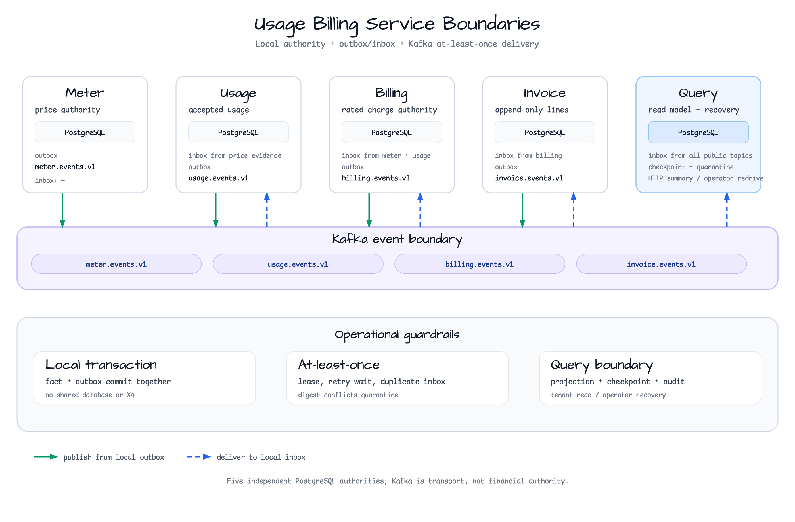

# Usage Billing Meter Service

[한국어](README.ko.md) | English

`usage-billing-meter-service` is the price authority in the usage-billing microservice reference. It records immutable price versions and publishes the
`PriceActivated` integration event without sharing a database with Usage, Billing, Invoice, or Query.

## Why this service exists

Usage billing needs one answer to a deceptively simple business question:
which price was active when a tenant's usage was accepted? A later charge must
not depend on a live read from the Meter database, so this service makes the
price history explicit and publishes the evidence that downstream services can
retain locally.

The boundary is intentionally narrow. PostgreSQL stores immutable price
versions and the command receipt; a local outbox publishes the event. There is
no shared database, HTTP controller, cross-service transaction, or claim that a
Kafka send and the local status update are one atomic operation. The
idempotency receipt and fenced outbox are the design choice that makes a retry
safe after a process crash.

The `test` and `integrationTest` commands in **Run the evidence** are the
test-backed proof: the first checks command, envelope, idempotency, publisher,
and repository contracts, while the second checks PostgreSQL uniqueness and
atomic local effects. They do not prove broker availability or production
pricing policy.



[Architecture SVG source](../../docs/images/readme-diagrams/usage-billing-service-boundaries-01.svg)

## Business requirements and test evidence

Meter is the price authority. Its core promise is not “return the current
price,” but “publish durable evidence of the price version that downstream
services are allowed to use.” The local fact and `PENDING` outbox row commit
together; Kafka delivery is retriable. `MeterServiceApplicationContractTest`
covers the command/envelope/idempotency contract, while
`MeterOutboxPostgresIntegrationTest` proves uniqueness, atomic local writes, and
fenced publisher completion. Neither test proves a broker transaction.

## Responsibility

- accept `ActivatePriceCommand` for a tenant, meter, currency, unit price, and effective time;
- treat `(tenantId, idempotencyKey)` as the command identity;
- persist an immutable `MeterPriceVersion` and a durable command receipt;
- publish `PriceActivated` on `meter.events.v1` through a local outbox.

This module has no HTTP controller. `MeterCommandService` is the application boundary used by the contract, persistence, and composition tests.

## Activation contract

`MeterCommandService.activatePrice` validates non-blank identifiers and a positive `unitPrice`. It hashes the command fields with SHA-256 before writing:

| Outcome                                        | Behavior                                                                  |
|------------------------------------------------|---------------------------------------------------------------------------|
| first command                                  | create price version `1`, envelope schema `1`, and a `PENDING` outbox row |
| same idempotency key and same fingerprint      | replay the existing result without a second price version                 |
| same idempotency key and different fingerprint | reject with `MeterIdempotencyConflict`                                    |

The envelope contains `meterCode`, `currency`, and `unitPrice`, plus an independent payload digest. The local transaction commits the command receipt, price version, envelope, and outbox row together.

## Delivery and recovery

`MeterOutboxPublisher` claims rows with an owner-and-lease predicate, publishes to `meter.events.v1`, and fences `markPublished` with the same ownership token. The durable state machine is:

`PENDING → CLAIMED → PUBLISHED`

Transport failures move a claimed row to `RETRY_WAIT`; exhausted or invalid records can be `QUARANTINED`. A crash after Kafka accepts a record but before the local status update is intentionally recovered as duplicate delivery by the receiving service.

Relevant source: [`MeterCommandService`](src/main/kotlin/io/bluetape4k/workshop/commerce/usagebilling/meter/application/MeterCommandService.kt),
[`MeterIntegrationEnvelope`](src/main/kotlin/io/bluetape4k/workshop/commerce/usagebilling/meter/integration/MeterIntegrationEnvelope.kt), and [`MeterOutboxPersistence`](src/main/kotlin/io/bluetape4k/workshop/commerce/usagebilling/meter/persistence/MeterOutboxPersistence.kt).

## Payload digest contract

Production code delegates SHA-256 generation and canonical verification to
`io.bluetape4k.workshop.commerce.shared.integration.PayloadDigest`. The shared
contract preserves the lowercase 64-character hex encoding of the UTF-8
payload, so no schema or database migration is required. This checksum detects
accidental corruption and contract drift, but is not authentication. Use a MAC
or signature when hostile tampering is in scope. Tests deliberately retain an
independent JDK SHA-256 oracle instead of reproducing the production call.

## Run the evidence

The default suite is container-free. PostgreSQL and Kafka integration tests use Testcontainers and must run serially with the repository's `TestMutexService`.

```bash
./gradlew :commerce-usage-billing-meter-service:test --max-workers=1
./gradlew :commerce-usage-billing-meter-service:integrationTest --max-workers=1
```

## Related services

- [`usage-billing-usage-service`](../usage-billing-usage-service/) consumes the price evidence and accepts usage.
- [`usage-billing-microservices-composition-tests`](../usage-billing-microservices-composition-tests/)
  exercises delayed publication, replay, and recovery across all five services.
