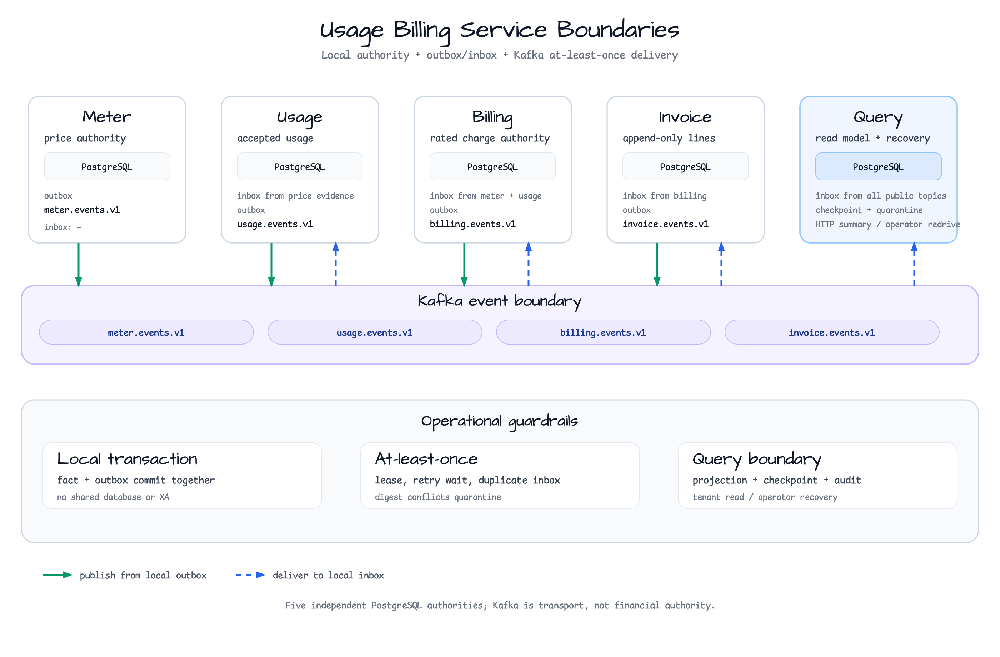

# Usage Billing Query Service

[한국어](README.ko.md) | English

`usage-billing-query-service` is the read boundary for the usage-billing
reference. It consumes all four public Kafka topics, builds a local projection,
and exposes tenant summaries plus operator recovery diagnostics. It never owns
a financial command or rewrites an original event.

## Why this service exists

Operators and tenants need a coherent view of usage, charges, and invoice
progress even though those facts arrive from separate services. This service
exists to answer that read-side question without turning a dashboard into a
hidden financial command path or a synchronous dependency on every producer.

Its local PostgreSQL projection is the read boundary; the source envelopes and
financial decisions remain elsewhere. Durable inbox decisions, checkpoints,
quarantine, and auditable redrive records are used because a poison event must
not stop unrelated facts, and recovery must not edit the original event. Tenant
authorization is enforced at the read endpoint, not inferred from projection
contents.

The `test` and `integrationTest` commands in **Run the evidence** are the
test-backed proof. They cover decoder compatibility, deduplication, metrics,
security, recovery audit, projection/checkpoint durability, and quarantine
persistence. They do not turn the projection into a financial source of truth.



[Architecture SVG source](../../docs/images/readme-diagrams/usage-billing-service-boundaries-01.svg)

## Business requirements and test evidence

Query is deliberately a read boundary: a poison event must not stop unrelated
facts, and a redrive must be auditable without editing the source event. Its
tests are split accordingly: `QueryServiceApplicationContractTest` covers
decoder/security/metrics contracts, while `QueryProjectionPostgresIntegrationTest`
proves durable checkpoint, deduplication, quarantine, and recovery audit. A
projection is never financial authority.

## Responsibility

- decode `PriceActivated`, `UsageAccepted`, `UsageCorrected`, `ChargeRated`,
  `AdjustmentPosted`, `InvoiceIssued`, and `InvoiceCorrectionIssued`;
- accept schema versions `1` and `2` only after verifying the payload digest;
- record a durable inbox decision, projection, and checkpoint per event;
- quarantine permanent contract failures while allowing unrelated valid events
  to continue;
- record an auditable redrive request without mutating the immutable source
  envelope.

The local PostgreSQL database owns the read model, inbox, checkpoints,
quarantine events, and redrive audits. Kafka offsets are committed only after a
durable inbox or quarantine decision.

## HTTP contract

The application uses stateless basic authentication and tenant/role authorities.

| Method and path | Authority | Result |
| --- | --- | --- |
| `GET /api/v1/tenants/{tenantId}/query/summary` | `TENANT_{tenantId}` | applied event count and checkpoint for the target tenant |
| `GET /api/v1/operator/query-recovery` | `OPERATOR` role | quarantine and recovery view |
| `POST /api/v1/operator/query-recovery/quarantine/{eventId}/redrive` | `OPERATOR` role plus `X-Correlation-Id` | auditable redrive request |
| `GET /actuator/health`, `GET /actuator/info` | public | health and build information |

`/actuator/metrics/**` and `/api/v1/operator/**` require `OPERATOR`. Tenant
endpoints are authenticated and target-tenant authorization is enforced; other
requests are denied. CSRF is disabled because the service is stateless.

## Projection and recovery

`QueryInboundEventDecoder` rejects unsupported event types, schema versions,
missing fields, and digest mismatches as `PermanentQueryInboundException`.
`QueryInboxService` deduplicates by event ID and applies the local projection.
`QueryRecoveryService.redrive` records the actor and correlation ID; it does
not edit or regenerate the original event. An operator must retrieve the
immutable envelope from its retained source before a separate replay operation.

Relevant source: [`QueryInboundEventDecoder`](src/main/kotlin/io/bluetape4k/workshop/commerce/usagebilling/query/messaging/QueryKafkaConsumer.kt),
[`QueryInboxService`](src/main/kotlin/io/bluetape4k/workshop/commerce/usagebilling/query/application/QueryInboxService.kt),
[`QueryRecoveryService`](src/main/kotlin/io/bluetape4k/workshop/commerce/usagebilling/query/application/QueryRecoveryService.kt),
and [`QueryControllers`](src/main/kotlin/io/bluetape4k/workshop/commerce/usagebilling/query/web/QueryControllers.kt).

## Payload digest contract

Production code delegates SHA-256 generation and canonical verification to
`io.bluetape4k.workshop.commerce.shared.integration.PayloadDigest`. The shared
contract preserves the lowercase 64-character hex encoding of the UTF-8
payload, so no schema or database migration is required. This checksum detects
accidental corruption and contract drift, but is not authentication. Use a MAC
or signature when hostile tampering is in scope. Tests deliberately retain an
independent JDK SHA-256 oracle instead of reproducing the production call.

## Run the evidence

```bash
./gradlew :commerce-usage-billing-query-service:test --max-workers=1
./gradlew :commerce-usage-billing-query-service:integrationTest --max-workers=1
```

The default suite is container-free and covers decoder compatibility, inbox
deduplication, metrics, recovery audit, security, and repository contracts.
The integration suite uses PostgreSQL to prove projection/checkpoint durability
and quarantine persistence.

## Related services

- [`usage-billing-meter-service`](../usage-billing-meter-service/),
  [`usage-billing-usage-service`](../usage-billing-usage-service/),
  [`usage-billing-billing-service`](../usage-billing-billing-service/), and
  [`usage-billing-invoice-service`](../usage-billing-invoice-service/) publish
  the topics projected here.
- [`usage-billing-microservices-composition-tests`](../usage-billing-microservices-composition-tests/)
  proves tenant isolation, poison-event quarantine, schema evolution, and
  operator redrive audit across the complete boundary.
