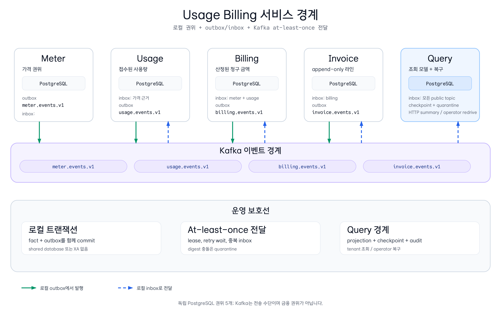

# Usage Billing Usage Service

[English](README.md) | 한국어

`usage-billing-usage-service`는 Meter 가격 근거가 로컬에 도착한 뒤 usage fact를 접수합니다. source event identity와 승인된 가격 provenance를 durable 하게 저장한 후 `usage.events.v1`에 `UsageAccepted`를 발행합니다.

## 이 서비스가 필요한 이유

Usage event는 나중에 source identity와 접수 당시 사용한 가격 근거를 복원할 수
있을 때만 청구 가능한 업무 fact가 됩니다. 이 서비스는 Meter 근거를 로컬에
받아 두고, 알 수 없는 가격을 추측하지 않고 거부하며, Kafka에 결과를 전달하기
전에 적용한 provenance를 저장합니다.

서비스는 로컬 PostgreSQL의 가격 근거와 usage 경계를 소유하며 Meter table을
동기 조회하지 않고 HTTP command 표면도 제공하지 않습니다. local inbox는 가격
event를 중복 제거하고 usage fact와 outbox row를 함께 commit합니다. 이 분리를
통해 at-least-once 전달과 process 중단을 재생 가능한 상태로 다루며, usage가
두 번 청구되거나 가격 근거가 사라지는 상황을 막습니다.

**검증 실행**의 `test`와 `integrationTest` 명령이 test-backed 증거입니다.
decoder·envelope·idempotency·publisher·repository와 PostgreSQL uniqueness,
로컬 가격 근거, usage/outbox 원자 쓰기, replay를 확인합니다. Kafka delivery가
exactly once라고 주장하는 검증은 아닙니다.



[Architecture SVG source](../../docs/images/readme-diagrams/usage-billing-service-boundaries-01.ko.svg)

## 업무 요구사항과 테스트 증거

Usage는 local price evidence를 확인한 뒤에만 외부 측정값을 billable fact로
받아들입니다. 누락된 가격을 추측하거나 Meter database를 동기 조회하지
않습니다. `UsageServiceApplicationContractTest`는 decoder·envelope·idempotency·
publisher 계약을 설명하고, `UsageAcceptancePostgresIntegrationTest`는
price-evidence inbox deduplication과 atomic usage/outbox persistence를
증명합니다. Kafka redelivery는 여전히 at-least-once 경계입니다.

## 책임

- `meter.events.v1`의 `PriceActivated`를 로컬 가격 근거로 소비합니다.
- `(tenantId, sourceSystem, sourceEventId)`로 usage를 deduplicate합니다.
- tenant, meter, currency가 일치하는 가격 근거가 있고 quantity가 양수인 경우만 접수합니다.
- usage fact와 `PENDING` outbox row를 하나의 PostgreSQL transaction으로 기록합니다.

HTTP controller는 없습니다. `UsageCommandService`가 application 경계이며, Kafka listener와 outbox publisher는 서로 분리된 전달 경계입니다.

## usage 접수

`AcceptUsageCommand`는 비어 있지 않은 tenant, source, event, meter, currency 식별자와 양수 quantity를 요구합니다. service는 로컬 `PriceEvidence`의 unit price를 기록하며 Meter 데이터베이스를 동기적으로 읽지 않습니다.

| 결과                                         | 동작                                                |
|----------------------------------------------|-----------------------------------------------------|
| 가격 근거가 있고 source event가 새 값인 경우 | `UsageRecord`, envelope schema `1`, outbox row 저장 |
| 같은 source identity와 같은 fingerprint      | 기존 접수를 replay 결과로 반환                      |
| 같은 source identity와 다른 fingerprint      | `UsageSourceConflict`로 거부                        |
| 로컬 가격 근거가 없음                        | `MissingPriceEvidence`로 거부                       |

발행하는 envelope에는 Billing이 자체 복제 근거로 rate할 수 있도록 승인된 가격 provenance가 들어 있습니다.

## 가격 근거 inbox

Meter listener는 local evidence를 저장하기 전에 event type `PriceActivated`, schema `1`, 필수 field와 payload digest를 검증합니다. 결과는 `APPLIED`,
`DUPLICATE`, `QUARANTINED`입니다. 중복 전달은 안전하게 처리하지만 digest 충돌이나 잘못된 contract를 조용히 적용하지 않습니다.

usage outbox는 `PENDING → CLAIMED → PUBLISHED` 상태를 따르며 transport failure는 `RETRY_WAIT`, 소진되었거나 유효하지 않은 record는 `QUARANTINED`로 이동합니다. publisher는 Kafka transport를 최대 5초 기다리고 lease로 최종 상태 갱신을 fencing합니다.

관련 source: [`UsageCommandService`](src/main/kotlin/io/bluetape4k/workshop/commerce/usagebilling/usage/application/UsageCommandService.kt),
[`PriceEvidenceService`](src/main/kotlin/io/bluetape4k/workshop/commerce/usagebilling/usage/application/PriceEvidenceService.kt),
[`UsageIntegrationEnvelope`](src/main/kotlin/io/bluetape4k/workshop/commerce/usagebilling/usage/integration/UsageIntegrationEnvelope.kt),
[`UsageOutboxPersistence`](src/main/kotlin/io/bluetape4k/workshop/commerce/usagebilling/usage/persistence/UsageOutboxPersistence.kt).

## Payload digest contract

Production 코드는
`io.bluetape4k.workshop.commerce.shared.integration.PayloadDigest`에
SHA-256 생성과 canonical 검증을 위임합니다. shared 계약은 UTF-8
payload의 lowercase 64자 hex 표현을 유지하므로 schema나 database
migration이 필요하지 않습니다. 이 값은 우발 손상과 contract drift를
탐지하는 비인증 checksum이며 적대적 변조에는 MAC 또는 signature가
필요합니다. Test는 production 호출을 그대로 반복하지 않도록 독립적인
JDK SHA-256 oracle을 유지합니다.

## 검증 실행

```bash
./gradlew :commerce-usage-billing-usage-service:test --max-workers=1
./gradlew :commerce-usage-billing-usage-service:integrationTest --max-workers=1
```

기본 suite는 container 없이 command, decoder, envelope, idempotency, publisher, repository contract를 검증합니다. integration suite는 PostgreSQL uniqueness, 로컬 evidence, usage/outbox 원자적 기록, replay를 검증합니다.

## 관련 서비스

- [`usage-billing-meter-service`](../usage-billing-meter-service/)가 이 서비스가 필요로 하는 가격 근거를 발행합니다.
- [`usage-billing-billing-service`](../usage-billing-billing-service/)가
  `UsageAccepted`를 소비하고 로컬에서 charge를 산정합니다.
