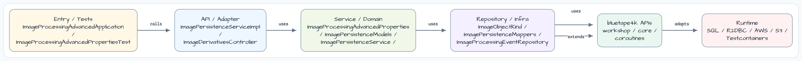
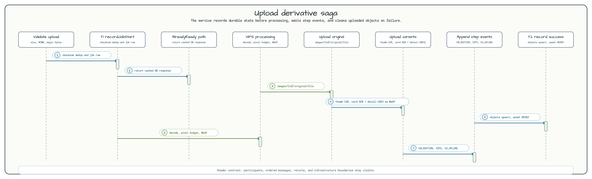
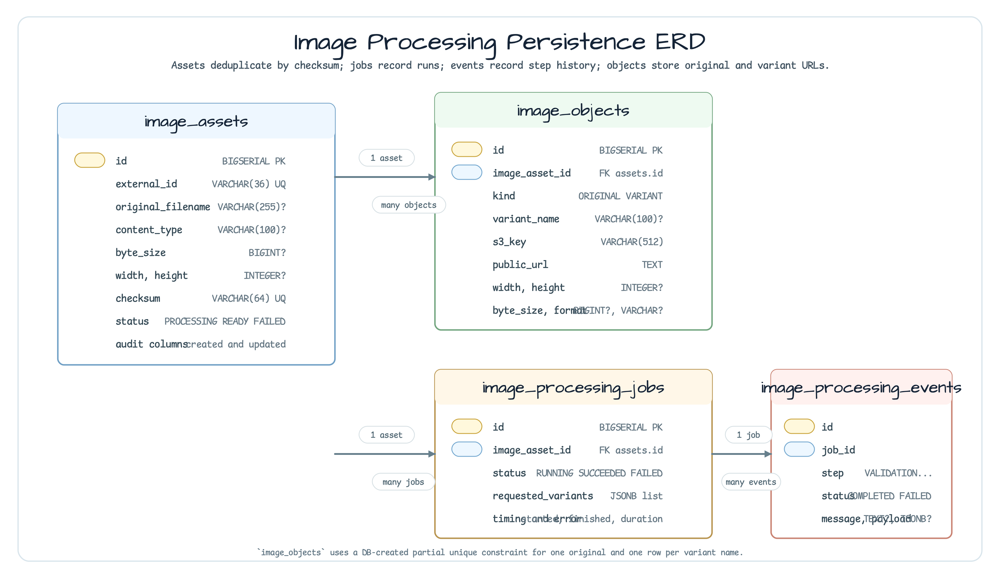

# image-processing-advanced-workflow

[English](README.md) | 한국어

## 이 예제가 필요한 이유

이미지 업로드는 multipart를 저장하는 일로 끝나지 않습니다. 안전하지 않은
입력을 거부하고, 같은 asset을 중복 처리하지 않고, 전달에 맞는 파생 이미지를
만들며, native 처리 실패 때 storage와 job 이력을 일관되게 남겨야 합니다.
이 예제는 local storage와 S3/CDN 배포 중 어떤 경계를 선택할지 확인할 수 있는
실행 가능한 업로드 workflow를 제공합니다.

해결 방향은 checksum을 사용하는 작은 saga입니다. validation과 pixel limit으로
비싼 native 작업을 조기에 차단하고, `ImageStorage`로 backend를 감추며,
partial upload를 정리하면서 job/event 상태를 기록합니다. 데모는 unsigned
public URL과 제한된 local concurrency를 사용하므로 private content, production
IAM, CDN policy, 무제한 처리량은 범위에 포함하지 않습니다.

**테스트**의 `test` 명령이 검증 경로입니다. 기본 실행은 결정적인 workflow
동작을 확인하고, opt-in 실행은 Java 25와 libvips가 있을 때 native VIPS
integration을 확인합니다. 이 테스트는 문서화된 계약을 증명하며 production
bucket의 정책이나 가용성까지 증명하지는 않습니다.

## 업무 시나리오와 학습 순서

상품 페이지에서 고객 사진을 받는 상황을 생각해 보세요. 브라우저는 원본
파일 하나를 보내지만 storefront는 작은 thumbnail, 카드용 이미지, 상세
페이지용 이미지를 각각 필요로 합니다. 동시에 운영자는 세 가지를 답할 수
있어야 합니다. *이 업로드를 수락했는가? 어떤 객체들이 이 업로드에 속하는가?
파생 이미지 생성 중 실패했다면 무엇이 정리되었는가?* 이 모듈은 queue
worker 안에 숨기기 쉬운 부분까지 포함해 이 작은 업무 흐름을 실행 가능한
형태로 보여줍니다.

처음 읽는 사람은 다음 순서로 따라가면 됩니다.

1. 아래 응답과 `POST /api/images/derivatives`부터 읽습니다. `imageId`는 하나의
   논리적인 asset을 가리키고, `original`과 `variants`는 저장된 객체를 가리킵니다.
2. **처리 시퀀스**와 **Persistence 모델**을 읽습니다. event step은 controller가
   임의로 만든 진행 문구가 아니라 저장되는 audit trail입니다.
3. 제한을 바꾸기 전 **검증과 제한**을 읽습니다. encoded bytes, decoded pixels,
   concurrency, timeout은 각각 다른 자원을 보호합니다.
4. 비공개 이미지를 다루기 전 **Object metadata 경계**와 **S3 Public URL 설정**을
   읽습니다. 이 workshop은 unsigned URL을 반환하므로 데모에는 편리하지만 접근
   제어 결정을 대신하지 않습니다.

## 업무 요구 사항과 코드·검증의 연결

| 요구 사항 | 설계 결정 | 코드와 테스트 근거 |
|---|---|---|
| native 작업 전에 위험하거나 비싼 업로드를 거부 | JPEG/PNG/WebP allowlist, MIME/magic byte 검사, byte/pixel 제한 | `UploadImageValidator`, `ImageProcessingAdvancedProperties`, `UploadImageValidatorTest` |
| 같은 content로 두 asset을 만들지 않기 | checksum을 저장하고 `READY` 중복을 short-circuit | `ImageDerivativeWorkflowService`, `ImageAssetRepositoryTest`, `ImageDerivativeWorkflowServiceTest` |
| 전달 용도의 객체를 예측 가능하게 만들기 | `thumb-128`, `card-320`, `detail-1024` WebP key 생성 | `ImageKeyFactory`, `FfmVipsDerivativeProcessor`, `FfmVipsDerivativeProcessorTest` |
| 부분 실패 뒤 storage와 DB 상태를 설명 가능하게 유지 | 각 step을 기록하고 이미 업로드한 객체를 삭제한 뒤 job 실패 처리 | `ImageProcessingEventStatus`, `ImagePersistenceServiceImplTest`, `ImageDerivativeWorkflowServiceTest` |
| local 개발과 S3/CDN 배포를 모두 지원 | `ImageStorage`에 의존하고 URL 해석을 persistence와 분리 | `ImageStorage`, `PublicImageUrlResolverTest`, `ImageProcessingAdvancedPropertiesTest` |
| 원본을 다시 다운로드하지 않고 객체 사실을 기록 | 선택적 `ImageObjectMetadataReader`를 사용하고 미지원 시 명시적으로 fallback | `ImageObjectMetadataReader`, `ImageDerivativeWorkflowServiceTest` metadata cases |

마지막 열까지가 설계의 일부입니다. README에 적힌 문장은 그 경계를
보호하는 class와 test를 독자가 찾을 수 있을 때 비로소 실제 요구 사항이 됩니다.

## 개요

**image-processing-advanced-workflow**는 이미지를 검증하고, checksum으로 중복을 판별하고,
Java 25 libvips로 WebP 파생 이미지를 생성하고, 모든 객체를 Bluetape4k `ImageStorage`로
저장한 뒤 job/event 이력을 영속화하는 Spring Boot 4 업로드 workflow입니다.

메인 경로는 unsigned public URL을 반환합니다. 운영에서는 S3 또는 CDN이 연결된 public
bucket을 사용하고, 개발 중에는 local storage backend를 사용하면 됩니다.

## 아키텍처



Controller는 업로드 작업 전체를 `ImageDerivativeWorkflowService`에 위임합니다. Workflow
service는 검증, libvips 파생 이미지 생성, object key 생성, `ImageStorage` 업로드, public
URL 해석, 선택적 object metadata 기준 정보, Micrometer metric, Exposed 기반 persistence를 조율합니다.

## 처리 시퀀스



이 workflow는 작은 saga로 동작합니다.

- `T1 recordJobStart`는 asset/job row를 만들거나 재사용하고, 이미 `READY`인 중복 이미지는 바로 응답합니다.
- 정상 경로는 validation, VIPS processing, upload, completion event를 기록합니다.
- 실패 시 업로드된 object를 정리한 뒤 `NonCancellable` IO block에서 job/asset 실패 상태를 기록합니다.

## Persistence 모델



## 사용한 Bluetape4k 기능

| 기능 | 모듈/artifact | 코드 위치 | 이점 |
|---|---|---|---|
| Java 25 VIPS runtime | `bluetape4k-images-vips-java25` | `FfmVipsDerivativeProcessor` | 픽셀 한도를 둔 빠른 native 썸네일 생성 |
| 공통 VIPS API | `bluetape4k-images-vips-api` | `VipsImage`, `VipsEncodeOptions`, `VipsImageFormat` | 백엔드 중립 resize/encode 계약 |
| 저장소 추상화 | `bluetape4k-images-spring-boot` | `ImageDerivativeWorkflowService`가 `ImageStorage` 주입 | 같은 workflow가 S3와 local storage에서 동작 |
| S3/local 자동 구성 | `bluetape4k-images-spring-boot` | `application.yml` `bluetape4k.images.storage.*` | 운영은 S3, 개발/테스트는 local fallback |
| 객체 key 검증 | `ImageKeyFactory` + `ImageObjectKey` | `ImageKeyFactory` | 파일명을 sanitize하고 검증된 object key 생성 |
| Validation helper | `bluetape4k-core` support helper | `ImageProcessingAdvancedProperties`, `PublicImageUrlResolver`, `FfmVipsDerivativeProcessor` | 설정, URL, pixel limit guard를 bluetape4k caller validation 방식으로 통일 |
| 업로드 검증 | `UploadOptions` | `UploadImageValidator` | 제한된 image content-type allowlist와 magic-byte 검사 적용 |
| 저장소 health/metrics | `images-spring-boot` health/metrics auto-config | Actuator endpoints | 별도 wrapper 없이 저장소 상태와 upload/download timing 확인 |
| Object metadata capability | `ImageObjectMetadataReader` | `ImageDerivativeWorkflowService` | body를 다운로드하지 않고 size/content type/ETag/수정 시각을 기준 정보로 읽고, 미지원 backend는 upload 결과로 명시적으로 fallback |
| Workflow metrics | Micrometer + `bluetape4k-micrometer` ecosystem | `ImageDerivativeWorkflowService` | 낮은 cardinality의 upload, duration, failure, variant counter |

## 사전 준비

이 모듈은 `bluetape4k-images-vips-java25`를 사용하므로 Java 25가 필요합니다.

```bash
# macOS
brew install vips

# Ubuntu/Debian
sudo apt-get install libvips-tools libvips-dev
```

Gradle test task는 `--enable-native-access=ALL-UNNAMED`를 추가합니다. 앱을 직접 실행할 때도 같은 JVM flag를 넣어야 합니다.

## 실행

```bash
./gradlew :image-processing-advanced-workflow:bootRun \
  --args='--workshop.images.advanced.public-base-url=http://localhost:8080/public-images'
```

이미지 업로드:

```bash
curl -F "file=@photo.jpg;type=image/jpeg" \
  http://localhost:8080/api/images/derivatives
```

## 응답 예시

```json
{
  "imageId": "2bb4f9c9-7133-46f2-bcc8-71a7e43ec1c4",
  "original": {
    "key": "images/2bb4f9c9-7133-46f2-bcc8-71a7e43ec1c4/original/photo.jpg",
    "url": "http://localhost:8080/public-images/images/2bb4f9c9-7133-46f2-bcc8-71a7e43ec1c4/original/photo.jpg",
    "width": 1600,
    "height": 1200,
    "contentType": "image/jpeg",
    "sizeBytes": 245763
  },
  "thumbnailUrl": "http://localhost:8080/public-images/images/2bb4f9c9-7133-46f2-bcc8-71a7e43ec1c4/variants/thumb-128.webp",
  "variants": [
    {
      "name": "thumb-128",
      "key": "images/2bb4f9c9-7133-46f2-bcc8-71a7e43ec1c4/variants/thumb-128.webp",
      "url": "http://localhost:8080/public-images/images/2bb4f9c9-7133-46f2-bcc8-71a7e43ec1c4/variants/thumb-128.webp",
      "width": 128,
      "height": 96,
      "contentType": "image/webp",
      "sizeBytes": 7612
    }
  ],
  "durationMillis": 84,
  "warnings": []
}
```

## 객체 이름 규칙

```text
images/{imageId}/original/{safeFilename}
images/{imageId}/variants/thumb-128.webp
images/{imageId}/variants/card-320.webp
images/{imageId}/variants/detail-1024.webp
```

## S3 Public URL 설정

메인 경로는 unsigned public URL을 반환합니다. S3 storage와 public bucket, S3 website endpoint, CDN domain을 설정합니다.

```yaml
bluetape4k:
  images:
    storage:
      backend: s3
      bucket: public-image-bucket
      key-prefix: workshop

workshop:
  images:
    advanced:
      public-base-url: https://cdn.example.com/workshop
```

Unsigned URL은 bucket/CDN policy와 object ownership 설정이 public read를 허용해야 합니다. 비공개 이미지나 사용자 민감 이미지는 이 public URL resolver 대신 `S3PreSignedUrlSigner` 또는 `CloudFrontUrlSigner`를 사용하세요.

## Object metadata 경계

`ImageStorage`의 기존 구현체 호환성을 유지하기 위해 metadata는 필수 메서드가 아닌
`ImageObjectMetadataReader` capability로 탐색합니다. capability를 제공하는 Local/S3
backend에서는 업로드 직후 한 번의 `stat`/`HEAD` 기준 정보를 읽어 영속화할 size와 content
type을 검증합니다. ETag과 수정 시각은 opaque 값으로 upload event payload에 기록하며,
backend가 capability를 제공하지 않으면 upload 결과를 사용하고 `metadataCapability=false`를
기록합니다. metadata key/size가 upload 결과와 불일치하거나 reader가 오류를 반환하면
이미 업로드한 object를 정리하고 job을 실패시켜 교체 경합을 성공으로 숨기지 않습니다.

```kotlin
val metadataReader = storage as? ImageObjectMetadataReader
val metadata = metadataReader?.readMetadata(key)
val sizeBytes = metadata?.sizeBytes ?: uploadResult.sizeBytes
val contentType = metadata?.contentType ?: uploadResult.contentType
```

이 경계는 `download`를 호출하지 않으므로 큰 원본을 다시 materialize하지 않습니다. metrics
decorator를 사용할 때는 `MetricImageStorageWithMetadata`를 통해 capability를 보존해야
하며, capability가 없는 구현체에 metadata를 지원한다고 표시해서는 안 됩니다.

## Before / After

Raw framework 방식은 object key 검증, S3 upload, 이미지 decode limit, WebP encoding, cleanup, metrics를 반복 구현하기 쉽습니다.

```kotlin
val key = "images/$id/variants/thumb-128.webp"
s3Client.putObject(request, RequestBody.fromBytes(bytes))
timer.recordCallable { resizeWithNativeLibrary(bytes) }
```

이 예제는 framework glue를 작게 유지하고 Bluetape4k 계약을 사용합니다.

```kotlin
val key = ImageObjectKey.of("images/$imageId/variants", "thumb-128.webp")
val variant = image.thumbnail(128).use { it.suspendToBytes(VipsImageFormat.WEBP, options) }
storage.upload(key, variant, UploadOptions(contentType = "image/webp"))
```

## 검증과 제한

지원 업로드 타입은 JPEG, PNG, WebP입니다. Validator는 지원하지 않는 MIME type과 선언된 content type에 맞지 않는 magic byte payload를 거부합니다.
설정값, public URL 구성 요소, variant WebP 계약, pixel limit은 value/range/equality/nullability
계약에 맞는 bluetape4k `require*` helper로 검증합니다.

| 제한 | 기본값 |
|---|---:|
| Multipart file size | 25 MB |
| Service input bytes | 25 MB |
| Pixel budget | 100,000,000 pixels |
| Concurrent requests | 2 |
| Concurrent variants per request | 2 |
| Processing timeout | 30 seconds |

## API 따라가기와 실패 의미

하나의 논리적 asset을 생성합니다.

```bash
curl -i -F "file=@photo.jpg;type=image/jpeg" \
  http://localhost:8080/api/images/derivatives
```

성공 응답에는 `imageId`, 원본 객체 metadata, 생성된 variant metadata가
포함됩니다. 같은 checksum으로 다시 업로드하면 기존 `READY` asset을 반환할
수 있습니다. 이것은 오류가 아니라 idempotency 동작입니다. 현재 asset은
`GET /api/images/{imageId}`, 실패를 설명하는 job/event 이력은 `GET
/api/images/{imageId}/history`로 확인합니다.

```bash
curl http://localhost:8080/api/images/2bb4f9c9-7133-46f2-bcc8-71a7e43ec1c4
curl http://localhost:8080/api/images/2bb4f9c9-7133-46f2-bcc8-71a7e43ec1c4/history
```

알 수 없는 `imageId`는 `404`이며 실패한 job과 혼동하면 안 됩니다. validation
문제는 storage/native processing 전에 거부되고, processing 또는 storage
오류는 partial object cleanup을 시도한 뒤 failed asset/job으로 기록됩니다.
이 예제에는 인증, signed URL, retry queue, production bucket policy가
없으므로 unsigned URL을 비공개 콘텐츠 제품에 그대로 복사하면 안 됩니다.

## 테스트

```bash
# Runs deterministic unit tests and explicitly skips native VIPS tests by default.
./gradlew :image-processing-advanced-workflow:test

# Runs VIPS integration tests when Java 25 and libvips are available.
./gradlew :image-processing-advanced-workflow:test -Dvips.enabled=true
```

Local storage 기본 위치는 `${java.io.tmpdir}/bluetape4k-workshop-images`입니다. 깨끗한 local 실행이 필요하면 이 디렉터리를 삭제하세요.

테스트는 happy path만이 아니라 업무 계약별로 구성되어 있습니다.

| 테스트 영역 | 처음 읽는 사람이 배울 점 |
|---|---|
| `UploadImageValidatorTest` | 선언된 content type, magic bytes, encoded size, decoded pixel limit은 서로 독립된 gate입니다. |
| `ImageKeyFactoryTest` | 사용자 파일명을 sanitize하고 object key는 안정적으로 만들지만 authorization 수단으로 사용하지 않습니다. |
| `ImageDerivativeWorkflowServiceTest` | checksum 중복은 idempotent하며 native/storage 실패 시 partial object를 정리하고 metadata capability/fallback을 명시합니다. |
| `ImagePersistenceServiceImplTest` / `ImageProcessingJobRepositoryTest` | saga step과 status가 transaction 경계를 넘어 보존되므로 이력이 원인을 설명할 수 있습니다. |
| `ImageDerivativesControllerTest` | HTTP upload, detail, history, not-found가 service 계약에 맞게 매핑됩니다. |
| `FfmVipsDerivativeProcessorTest` | native 경로가 제한된 WebP variant를 생성하며 `-Dvips.enabled=true`에서만 실행됩니다. |

먼저 deterministic suite를 실행하고, local runtime 전제 조건이 있을 때만
native test를 opt-in하세요. native test가 green이어도 S3 권한이나 CDN
policy까지 증명하는 것은 아닙니다.
