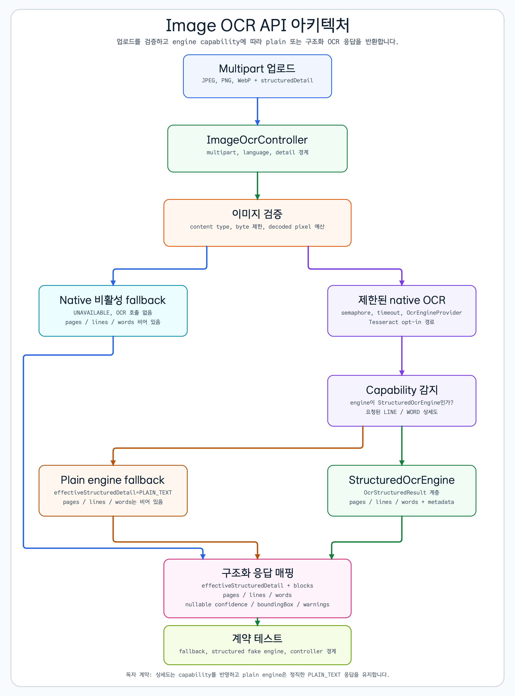
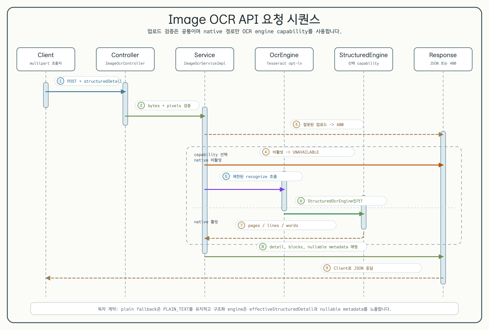

# image-processing-ocr-api

[English](README.md) | 한국어

## 이 예제가 필요한 이유

OCR을 단순히 engine을 한 번 호출하는 일로 보면 안 됩니다. 업로드 service는
text를 반환하기 전에 byte, decoded pixel, TIFF page, 결과 크기, native engine
가용성을 제한해야 합니다. 이 예제는 기본적인 “engine unavailable” 경로와
선택적인 native 경로에 같은 application response 계약을 제공합니다.

해결 방향은 validation, capability 확인, response mapping을 분리하는 것입니다.
plain engine은 plain text만 반환하고, structured engine은 실제로 제공하는
detail만 노출하며, TIFF page는 명시된 budget 안에서 입력 순서대로 처리합니다.
native Tesseract, persistence, authentication, PII 보존, production upload
hardening은 이 workshop의 경계 밖에 있습니다.

**테스트**에 적힌 smoke·fake-engine·native-option 테스트가 test-backed
검증입니다. sanitized error, fallback 의미, structured response mapping,
budget 적용을 증명하며, 로컬 native 실행은 설치된 Tesseract language pack에
의존합니다.

## 처음 읽는 사람을 위한 mental model

이 모듈은 비용이 큰 선택적 capability를 감싸는 경계입니다. 호출자는 bytes를
보내고 text를 요청하지만, service는 bytes를 받아도 되는지, 설정된 engine이
원하는 상세 수준을 제공하는지, 결과가 제한된 크기 안에 있는지를 판단합니다.
`COMPLETED`는 engine이 text를 반환했다는 뜻입니다. `UNAVAILABLE`은 입력은
유효하지만 native capability가 의도적으로 꺼져 있거나 사용할 수 없다는
뜻이며 malformed input과 다릅니다. `400`/`422` problem은 요청 또는 processing
budget을 수락할 수 없다는 의미입니다.

## 업무 요구 사항과 설계 결정

| 요구 사항 | 이 예제의 결정 | 읽어 볼 근거 |
|---|---|---|
| 제한되고 decode 가능한 입력만 수락 | MIME/magic byte, encoded size, decoded pixel, TIFF metadata를 OCR 전에 검증 | `ImageOcrServiceImpl`, `ImageOcrServiceImplTest` |
| CI나 개발 PC에 native dependency 없이 실행 | native OCR이 꺼져 있으면 결정적인 `UNAVAILABLE` 반환, 필요할 때만 명시적으로 활성화 | `NativeOcrDisabledContextTest`, `ImageOcrServiceImplTest` |
| 정밀도를 지어내지 않기 | `confidence`와 `boundingBox`의 nullable 상태 보존, 실제 반환 상세를 `effectiveStructuredDetail`에 기록 | `ImageOcrModels`, structured mapping tests |
| 서로 다른 engine에서도 구조화 결과를 유용하게 유지 | runtime capability가 있을 때만 `StructuredOcrEngine` 사용, 아니면 `PLAIN_TEXT` fallback | `ImageOcrServiceImplTest` capability cases |
| TIFF 페이지를 안전하게 처리 | structured capability를 요구하고 페이지 순서를 보존하며 page/total/result budget을 partial response 전에 검사 | `ImageOcrServiceImplTest` TIFF order/limit tests |
| native 오류나 사용자 data를 노출하지 않기 | `reason`, `phase`, 선택적 `pageIndex`만 sanitized mapping하고 bytes/OCR text는 log에 남기지 않음 | `ImageOcrControllerTest`, sanitized failure tests |

따라서 plain-text 경로는 호환성 계약이지 모든 engine이 box나 confidence를
제공한다는 약속이 아닙니다. Native Tesseract는 opt-in 구현 세부 사항이고,
그것이 없어도 HTTP response는 이해할 수 있는 형태를 유지합니다.

## 개요

**image-processing-ocr-api**는 `bluetape4k-images-ocr`를 Spring Boot 4
multipart API로 노출하는 예제입니다. JPEG, PNG, WebP와 bounded 다중 페이지 TIFF
업로드를 검증하고 구조화된 OCR 응답을 반환합니다. 단일 페이지는
`immutableImageOf`를 사용하고 TIFF는 metadata preflight 뒤
`TiffMultiPageOcr.suspendRecognize`를 사용합니다.
기본 경로는 native Tesseract 없이도 동작하도록 이미지를 검증한 다음
`UNAVAILABLE` fallback 응답을 돌려줍니다.

이 모듈은 OCR API 경계를 배우기 위한 워크숍 예제입니다. 운영용 업로드 서비스가
아닙니다.

## 아키텍처



흐름은 위에서 아래로 이어집니다. `ImageOcrController`가 multipart 입력을 받고,
`ImageOcrServiceImpl`이 metadata와 decoded pixel을 검증한 뒤 fallback 응답으로
short-circuit하거나 제한된 native `OcrEngine`을 호출합니다. Capability 분기에서
plain engine은 `PLAIN_TEXT`를 유지하고 `StructuredOcrEngine`은 `pages`, `lines`,
`words`를 매핑합니다. `confidence`와 `boundingBox`는 실제 engine metadata가 없으면
억지로 채우지 않고 nullable 상태를 보존합니다. TIFF 요청은 structured capability를
필수로 하며 입력 순서대로 페이지를 합산하고 page/pixel/metadata/result budget을
partial response 전에 모두 검사합니다.

## 요청 흐름



기본 smoke 경로는 실제로 decode 가능한 이미지를 검증하고 Tesseract 호출은 건너뛴
뒤 `UNAVAILABLE`을 반환합니다. Native OCR은 `workshop.ocr.native-enabled` 또는
`-Docr.enabled=true`로 명시적으로 켭니다.
설정과 decoded-pixel limit은 bluetape4k `require*` helper로 검증하고, HTTP 경계의
public upload error message는 명시적인 메시지를 유지합니다. 번호가 붙은 시퀀스는
잘못된 업로드의 `400`, native 비활성 응답, runtime capability 확인, 구조화 응답 매핑을
한 흐름으로 보여줍니다.

## 엔드포인트

```text
POST /api/images/ocr
Content-Type: multipart/form-data

file      필수 image/jpeg, image/png, image/webp, image/tiff
language  선택 반복 파라미터 또는 comma-separated Tesseract language code
structuredDetail 선택 PLAIN_TEXT, LINE, WORD (기본값 PLAIN_TEXT)
```

```bash
curl -F "file=@docs/images/readme-diagrams/image-ocr-api-readme-architecture-01.png;type=image/png" \
  -F "language=eng" \
  -F "structuredDetail=WORD" \
  http://localhost:8080/api/images/ocr
```

잘못된 업로드는 `400 Bad Request`입니다. 유효한 업로드지만 native OCR을 실행할 수
없는 경우에는 `status=UNAVAILABLE`인 구조화된 `200 OK` 응답을 반환합니다.

`structuredDetail=LINE` 또는 `WORD`는 설정된 engine이 `StructuredOcrEngine`을
구현한 경우에만 사용합니다. 기존 plain engine은 runtime에 capability를 확인한 뒤
text로 fallback하고, `effectiveStructuredDetail=PLAIN_TEXT`와 빈
`pages`, `lines`, `words` 목록을 반환합니다.

TIFF는 페이지별 structured capability를 사용합니다. validation 또는 processing
실패는 native cause, payload bytes, filesystem path를 노출하지 않고
`reason`, `phase`, 선택적 `pageIndex`를 담은 sanitized `ProblemDetail`로 반환합니다.

## Fallback 응답

```json
{
  "requestId": "ocr-sample-request",
  "status": "UNAVAILABLE",
  "engine": "disabled",
  "languages": ["eng"],
  "confidence": null,
  "text": "",
  "blocks": [],
  "effectiveStructuredDetail": "PLAIN_TEXT",
  "pages": [],
  "lines": [],
  "words": [],
  "warnings": [
    "Native OCR is disabled. Enable workshop.ocr.native-enabled=true or -Docr.enabled=true."
  ]
}
```

## 완료 응답

```json
{
  "requestId": "ocr-sample-request",
  "status": "COMPLETED",
  "engine": "tesseract",
  "languages": ["eng", "kor"],
  "confidence": null,
  "text": "Bluetape OCR\nSecond line",
  "blocks": [
    { "index": 0, "text": "Bluetape OCR", "confidence": null, "pageIndex": 0, "boundingBox": null },
    { "index": 1, "text": "Second line", "confidence": null, "pageIndex": 0, "boundingBox": null }
  ],
  "effectiveStructuredDetail": "WORD",
  "pages": [
    { "pageIndex": 0, "text": "Bluetape OCR\nSecond line", "confidence": null, "boundingBox": null }
  ],
  "lines": [
    { "pageIndex": 0, "text": "Bluetape OCR", "confidence": null, "boundingBox": null },
    { "pageIndex": 0, "text": "Second line", "confidence": null, "boundingBox": null }
  ],
  "words": [
    { "pageIndex": 0, "text": "Bluetape", "confidence": 88.0, "boundingBox": { "x": 1, "y": 2, "width": 16, "height": 12 } }
  ],
  "warnings": [
    "Top-level confidence is not aggregated; inspect structured elements."
  ]
}
```

`effectiveStructuredDetail`은 실제 반환한 상세 수준을 나타냅니다. `pages`, `lines`,
`words`는 `StructuredOcrEngine`이 반환한 계층을 보존하며, 각 element의 `confidence`와
`boundingBox`는 nullable일 수 있습니다. 이 예제의 top-level `confidence`는 항상 `null`이고
하위 값의 평균 등으로 합성하지 않습니다. 기존 plain-text consumer를 위해 `blocks`도
유지하며, 선택적으로 `pageIndex`와 `boundingBox` metadata를 포함합니다.

## 설정

| Property | 기본값 | 용도 |
|---|---:|---|
| `workshop.ocr.native-enabled` | `false` | native `TesseractOcrEngine` bean 활성화 |
| `workshop.ocr.max-upload-bytes` | `5242880` | service byte 제한 |
| `workshop.ocr.max-image-pixels` | `12000000` | decode된 이미지 pixel 예산 |
| `workshop.ocr.timeout` | `10s` | native OCR timeout |
| `workshop.ocr.languages` | `eng` | 기본 language 목록 |
| `workshop.ocr.tessdata-path` | empty | 선택 Tesseract trained-data 디렉터리 |
| `workshop.ocr.tiff.max-encoded-bytes` | `5242880` | TIFF encoded input budget |
| `workshop.ocr.tiff.max-pages` | `16` | 최대 TIFF page 수 |
| `workshop.ocr.tiff.max-pixels-per-page` | `12000000` | page별 pixel budget |
| `workshop.ocr.tiff.max-total-pixels` | `64000000` | 전체 pixel budget |
| `workshop.ocr.tiff.max-decoded-side` | `8192` | decode width/height 상한 |
| `workshop.ocr.tiff.max-metadata-bytes` | `2097152` | ImageIO metadata preflight budget |
| `workshop.ocr.tiff.max-result-text-chars` | `1000000` | 전체 OCR text budget |
| `workshop.ocr.tiff.max-result-entries` | `100000` | 전체 page/block/line/word budget |
| `spring.servlet.multipart.max-file-size` | `5MB` | container multipart 제한 |
| `spring.servlet.multipart.max-request-size` | `5MB` | container multipart request 제한 |

Spring multipart limit은 `workshop.ocr.max-upload-bytes`와 같은 수준으로 맞춰야 합니다.
`ImageOcrProperties` 생성 시 byte/pixel/time limit이 양수인지, 기본 language 목록이
비어 있지 않은지 검증합니다.

## 실행

기본 fallback 모드:

```bash
./gradlew :image-processing-ocr-api:bootRun
curl -F "file=@docs/images/readme-diagrams/image-ocr-api-readme-architecture-01.png;type=image/png" \
  http://localhost:8080/api/images/ocr
```

Native OCR 모드:

```bash
./gradlew :image-processing-ocr-api:bootRun \
  --args='--workshop.ocr.native-enabled=true --workshop.ocr.tessdata-path=/opt/homebrew/share/tessdata'
```

테스트나 앱 실행에 `-Docr.enabled=true`를 사용할 수도 있습니다. 다만 기본 테스트
모음은 완료 응답 검증에 fake engine을 사용합니다. 로컬에 Tesseract와 language pack이
설치되어 있을 때 수동 `bootRun` + curl 경로로 확인하세요.

## Native 사전 준비

```bash
# macOS
brew install tesseract
ls /opt/homebrew/share/tessdata/eng.traineddata

# Ubuntu/Debian
sudo apt-get update
sudo apt-get install -y tesseract-ocr tesseract-ocr-eng
ls /usr/share/tesseract-ocr/5/tessdata/eng.traineddata
```

Tesseract가 trained data를 기본 lookup path에서 찾지 못하면
`workshop.ocr.tessdata-path`를 지정하세요.

한국어 OCR을 확인하려면 `kor.traineddata`도 설치하고 확인한 뒤 curl 명령에
`-F "language=eng,kor"`를 추가하세요.

## Troubleshooting

| 증상 | 응답 | 확인할 것 |
|---|---|---|
| Tesseract library 또는 tessdata가 없음 | `200 OK`, `status=UNAVAILABLE` | Tesseract를 설치하고 필요하면 `workshop.ocr.tessdata-path`를 지정 |
| language pack이 없음 | `200 OK`, `status=UNAVAILABLE` 또는 낮은 품질의 text | `eng.traineddata`, `kor.traineddata` 등 요청한 pack 확인 |
| 빈 파일, 깨진 파일, 이미지가 아닌 bytes | `400 Bad Request` | 실제 JPEG, PNG, WebP, TIFF 파일 사용 |
| 선언한 type과 실제 bytes가 다름 | `400 Bad Request` | `;type=image/png`와 실제 파일 형식 맞추기 |
| GIF 같은 미지원 subtype | `400 Bad Request` | JPEG, PNG, WebP, TIFF로 변환 |
| TIFF page/pixel/metadata/result budget 초과 | `400 Bad Request` 및 sanitized `reason`/`phase`/`pageIndex` | 입력을 줄이거나 해당 `workshop.ocr.tiff.*` budget을 조정 |
| TIFF decoder 또는 OCR engine 실패 | `422 Unprocessable Entity` 및 sanitized `reason`/`phase`/`pageIndex` | TIFF reader, Tesseract, language pack 확인 |
| 이미지가 pixel budget을 초과 | `400 Bad Request` | `workshop.ocr.max-image-pixels`보다 작게 resize |

## 워크숍 경계

이 예제에는 인증, antivirus scanning, persistence, rate limiting, storage policy,
queueing, audit workflow, PII 관리, 운영용 upload hardening이 없습니다. OCR text에는
민감한 정보가 들어갈 수 있습니다. 이 서비스는 uploaded bytes나 OCR text를 로그에 남기지
않습니다. 운영 시스템에서는 별도의 redaction과 retention policy가 필요합니다.

## 테스트

```bash
# 결정적인 smoke 경로입니다. Native OCR은 꺼져 있습니다.
./gradlew :image-processing-ocr-api:test

# 로컬 opt-in 경로입니다. Native Tesseract와 language pack이 필요합니다.
./gradlew :image-processing-ocr-api:test -Docr.enabled=true
```

테스트는 완료 응답을 위해 fake `OcrEngine`과 `StructuredOcrEngine`을 주입하므로 native
Tesseract가 없어도 결정적으로 실행됩니다. 구조화 매핑, capability fallback, 3-page TIFF
순서, preflight/result budget, sanitized failure mapping, language normalization,
timeout, cancellation propagation을 검증합니다.

테스트를 실행 가능한 업무 문서로 읽을 수 있습니다.

| 테스트 영역 | 설명하는 경계 |
|---|---|
| `ImageOcrServiceImplTest` validation cases | bytes, subtype, pixel, TIFF budget이 잘못되면 native 작업 전에 upload를 거부합니다. |
| `ImageOcrServiceImplTest` capability cases | plain engine을 억지로 structured로 만들지 않고 response에 fallback을 기록합니다. |
| `ImageOcrServiceImplTest` TIFF cases | 세 페이지를 입력 순서로 반환하고 page/total/result 제한이 partial output을 막습니다. |
| `ImageOcrServiceImplTest` timeout/cancellation cases | timeout은 제한된 service 결과가 되지만 coroutine cancellation은 cancellation으로 남습니다. |
| `ImageOcrControllerTest` | multipart field와 sanitized `ProblemDetail` field를 HTTP 경계에서 확인합니다. |
| `NativeOcrDisabledContextTest` / `ImageOcrPropertiesTest` | 기본값은 Tesseract 없이 재현되고 잘못된 설정은 조기에 실패합니다. |

native-option 명령은 test이면서 환경 확인이기도 합니다. Tesseract와 요청한
trained data가 필요합니다. fake-engine test가 통과하면 portable 계약을 증명하고,
native test가 통과하면 여기에 local engine 설치까지 증명합니다.

## 의존성 메모

이 모듈은 root `bluetape4k-dependencies` BOM을 사용합니다. 개별 `bluetape4k-image`
BOM이나 하드코딩된 OCR artifact version을 추가하지 않습니다.
