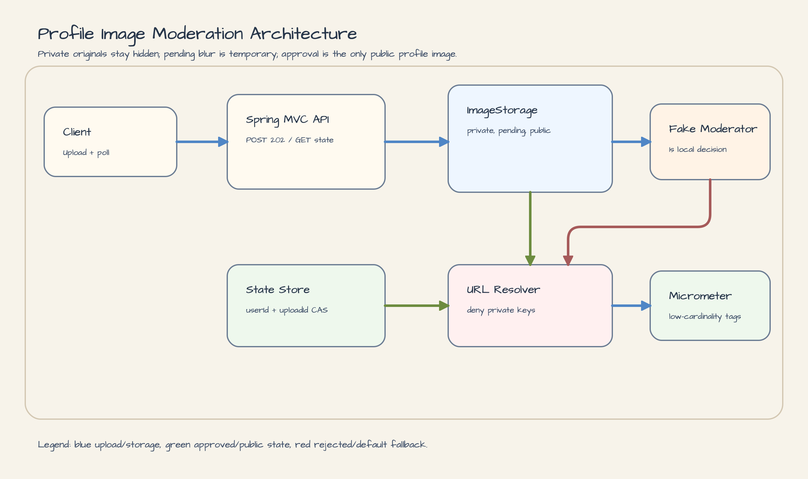
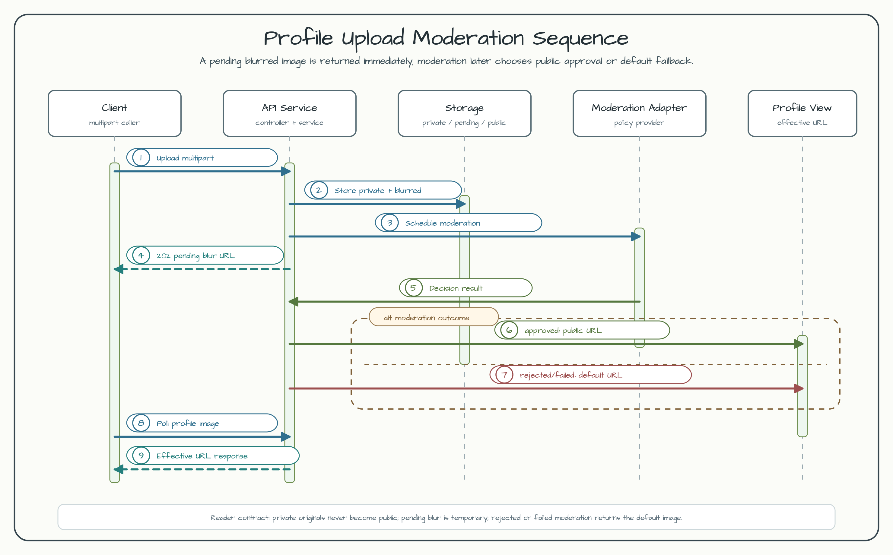

# Profile Image Moderation

[English](README.md) | 한국어

이 예제는 운영 환경에 가까운 사용자 프로필 이미지 흐름을 보여줍니다.

1. 사용자 프로필 이미지를 업로드합니다.
2. 원본은 private object key 아래에 저장합니다.
3. moderation이 끝나기 전에는 작은 blurred JPEG를 임시로 공개합니다.
4. 승인되면 공개 프로필 이미지로 전환하고, 반려되거나 실패하면 기본 이미지로 되돌립니다.

## 이 예제가 필요한 이유

Profile image는 사용자에게 보이는 asset이면서 safety decision의 대상입니다.
제품은 moderation이 끝날 때까지 표시할 결과가 필요하고, 원본은 private으로
보관하며, moderation이나 storage가 실패하면 안전한 기본 이미지로 돌아가야
합니다. 이 예제는 moderation을 upload row 옆의 비동기 boolean으로 취급하지
않고 상태 전이로 드러냅니다.

설계는 private source storage, privacy-safe derivative, 결정적인 moderation
adapter, public URL state machine을 분리합니다. local moderator와 filename
marker는 데모 전용이며 cloud moderation, authentication, retention, rate
limiting, production object policy는 integration 경계로 남깁니다. 따라서
아래 테스트는 외부 moderation model의 품질이 아니라 상태 전이와 privacy
guard를 검증합니다.

모듈 test 명령이 이 업무 흐름의 test-backed 검증입니다. pending/approved/
rejected/failed/no-image 상태, stale completion, private URL 거부, cleanup,
metadata redaction, payload 안전성, metrics를 확인합니다.

## 업무 요구 사항과 상태 머신

제품의 요구 사항은 단순히 “이미지를 moderation한다”가 아닙니다. 항상
사용자에게 안전한 effective image를 보여 주고, 원본은 절대 공개하지 않으며,
이전 upload의 moderation job이 늦게 끝나도 최신 upload가 이기게 해야 합니다.
API status는 profile page가 바로 사용할 수 있는 답입니다.

| Status | 제품에서의 의미 | Effective URL |
|---|---|---|
| `NO_IMAGE` | 사용자가 아직 이미지를 올리지 않음 | 안정적인 기본 이미지 |
| `PENDING_MODERATION` | 현재 upload를 저장했고 판정을 기다림 | public blurred derivative, local mode에서는 `Cache-Control: no-store` |
| `APPROVED` | 현재 `userId + uploadId`가 policy 통과 | public approved derivative |
| `REJECTED` | policy가 금지 콘텐츠를 발견 | 안정적인 기본 이미지, reason은 안전하고 제한된 text |
| `MODERATION_FAILED` | provider, timeout, derivative processing이 실패 | 안정적인 기본 이미지 |

허용된 전이는 `NO_IMAGE → PENDING_MODERATION → APPROVED`, `REJECTED`, 또는
`MODERATION_FAILED`입니다. `userId + uploadId`에 대한 compare-and-set이 있어
오래된 worker가 최신 upload 뒤에 이전 upload를 공개하지 못합니다. Pending
image는 빠른 UX를 위한 절충일 뿐 안전하다는 증거가 아닙니다. 원본은 모든
상태에서 private으로 남습니다.

## 처음 읽는 사람을 위한 업로드 생명주기

1. `POST /api/users/{userId}/profile-image`가 storage 전에 multipart image를
   검증합니다. 잘못된 입력은 `400`이고 moderation job을 만들지 않습니다.
2. Service가 `private/original/*`에 원본을 저장하고 privacy-safe derivative를
   만든 뒤 `PENDING_MODERATION`과 함께 `202 Accepted`를 반환합니다. 응답의
   `effectiveUrl`은 blurred derivative이며 원본 key가 아닙니다.
3. `ProfileImageModerationRunner`가 제한된 concurrency로 policy adapter를
   호출합니다. 운영에서는 같은 seam 뒤에 cloud provider를 둘 수 있고,
   filename-marker provider는 이 workshop을 결정적으로 실행하기 위한 데모입니다.
4. 완료 결과는 현재 `userId + uploadId`일 때만 반영됩니다. 승인하면 approved
   derivative를 공개하고, 반려나 실패면 기본 이미지로 가리키며 storage 경계에
   따라 객체를 정리합니다.
5. `GET /api/users/{userId}/profile-image`를 안전하게 polling할 수 있습니다.
   private storage 세부 정보가 아니라 현재 status와 effective URL만 반환합니다.

이 순서 때문에 `202`가 유용합니다. upload는 접수되었지만 moderation 완료로
잘못 표현하지 않기 때문입니다.





## Bluetape4k 기능

| 관심사 | Bluetape4k 기능 | 위치 |
|---|---|---|
| Object storage | `ImageStorage`, `ImageObjectKey`, `UploadOptions` | `ProfileImageService`, `ProfileImageKeyFactory` |
| 안전한 검증 | `require*` helper와 안정적인 ProblemDetail mapping | `UploadImageValidator`, `ProfileImageExceptionHandler` |
| 코루틴 | 제한된 background moderation runner | `ProfileImageModerationRunner` |
| Moderation policy | profile content policy adapter | `ProfileImageModerationPolicyProvider` |
| Metrics | 낮은 cardinality의 Micrometer counter/timer | `ProfileImageMetrics` |
| ID 생성 | Base58 upload id | `ProfileImageService` |
| Privacy derivative | strict metadata/GPS 제거, orientation normalization, redaction report | `ProfileImageProcessor`, `PrivacyDerivativePipeline` |
| Privacy payload 영속화 | defensive derivative bytes와 bounded report 기준 정보를 stable JSON envelope로 보존 | `ProcessedProfileImage`, `PrivacyDerivativeJackson` |

## API

앱을 실행합니다.

```bash
./gradlew :image-processing-profile-image-moderation:bootRun
```

안전한 이미지를 업로드합니다. API는 moderation 완료 전에 `202 Accepted`와 pending blurred URL을 반환합니다.

```bash
curl -i -F file=@safe.jpg http://localhost:8080/api/users/alice/profile-image
```

Pending 응답:

```json
{
  "userId": "alice",
  "status": "PENDING_MODERATION",
  "uploadId": "upload-a",
  "effectiveUrl": "http://localhost:8080/public-images/profile-images/alice/upload-a/pending/blurred.jpg",
  "pendingUrl": "http://localhost:8080/public-images/profile-images/alice/upload-a/pending/blurred.jpg",
  "approvedUrl": null,
  "defaultImageUrl": "http://localhost:8080/public-images/profile-images/default/default-profile.jpg",
  "reason": null
}
```

## Privacy-safe Derivatives

Pending blurred JPEG와 승인된 public JPEG는 모두 workshop의
`bluetape4k-dependencies:2.1.0` BOM이 제공하는 bluetape4k-images `1.1.0`
`PrivacyDerivativePipeline`으로 다시 인코딩합니다. 기본 정책은 EXIF, GPS, XMP, IPTC, ICC metadata를 제거하고 EXIF orientation을
정규화한 뒤 output을 strict하게 다시 읽어 storage 전에 검증합니다. 소비자 adapter는
`ProfileImageProcessor.processPrivacySafe`입니다. 제한된
`PrivacyDerivativeReport`에는 요청/잔존 category와 적용한 redaction geometry만 기록하며
raw metadata나 image bytes는 포함하지 않습니다. metadata reader failure 또는 category
잔존은 fail-closed로 처리하므로 public derivative를 업로드하지 않고 private 원본과
moderation state machine은 변경하지 않습니다.

`ProcessedProfileImage`는 runtime report를 transient로 유지하고, 재시작 또는 messaging
경계에 사용할 `PrivacyDerivativePayload` 기준 정보를 저장합니다. 각 payload에는 derivative
bytes의 defensive copy와 생성된 upload id를 opaque `sourceId`로 기록한 bounded report
기준 정보가 들어갑니다. `PrivacyDerivativeJackson.encodePayload`와 `decodePayload`는 stable
`schemaVersion`/`kind` envelope 및 stable codec reason code를 사용합니다. 이 예제의 영속화
경계는 byte-array API이며, stream helper는 호출자가 소유한 stream을 닫지 않으므로 호출자가
직접 닫아야 합니다.

Storage 계약을 바꾸지 않고 정책을 조정할 수 있습니다.

```yaml
workshop:
  profile-image-moderation:
    privacy:
      strip-metadata: true
      remove-gps: true
      normalize-orientation: true
      max-metadata-bytes: 5242880
```

현재 프로필 이미지를 조회합니다.

```bash
curl http://localhost:8080/api/users/alice/profile-image
```

승인 응답:

```json
{
  "status": "APPROVED",
  "effectiveUrl": "http://localhost:8080/public-images/profile-images/alice/upload-a/public/approved.jpg"
}
```

반려된 업로드는 기본 프로필 이미지를 사용합니다. 데모 fake moderator는 파일명에 `reject`가 포함되면 반려합니다.

```bash
curl -i -F file=@reject.jpg http://localhost:8080/api/users/alice/profile-image
```

```json
{
  "status": "REJECTED",
  "effectiveUrl": "http://localhost:8080/public-images/profile-images/default/default-profile.jpg",
  "reason": "demo filename marker matched"
}
```

Moderation provider가 timeout 또는 실패를 내면 상태는 `MODERATION_FAILED`가 되고 effective URL도 기본 이미지가 됩니다. 업로드가 없는 사용자는 `NO_IMAGE`와 같은 기본 URL을 반환합니다.

잘못된 업로드는 RFC 9457 ProblemDetail JSON을 반환합니다.

```json
{
  "type": "about:blank",
  "title": "Bad Request",
  "status": 400,
  "detail": "unsupported image contentType: text/plain"
}
```

## Privacy and Storage Boundaries

- `private/original/*` key는 effective URL로 반환하지 않으며 local public controller도 private path에 `404`를 반환합니다.
- `pending/blurred.jpg`는 workshop UX를 위해 의도적으로 공개하지만, 여전히 사용자 콘텐츠에서 파생된 이미지입니다. Local mode에서는 `Cache-Control: no-store`로 제공합니다.
- `public/approved.jpg`는 현재 `userId + uploadId` 상태가 승인된 뒤에만 노출합니다.
- S3/CDN 배포에서는 `profile-images/*/*/private/**` public read를 차단하고 pending cache TTL을 짧게 하거나 비활성화하세요.

## Moderation Provider

기본 provider는 cloud credential 없이 실행되는 deterministic local 구현입니다. `workshop.profile-image-moderation.decision-delay`만큼 대기하고(기본 1초), `nazi`, `rising-sun`, `rising-sun-flag`, `욱일기`, `旭日旗`, `hate-text`, `reject` 같은 파일명 marker를 금지된 profile-content detection으로 변환합니다. 이후 local policy가 금지된 hate symbol 또는 hate-expression text를 reject합니다. 운영 코드에서는 demo detection 단계를 [AWS Rekognition `DetectModerationLabels`](https://docs.aws.amazon.com/rekognition/latest/dg/moderation-api.html)가 제공하는 Nazi Party 같은 hate-symbol label, 필요 시 욱일기(Rising Sun Flag, 旭日旗) 등 로컬 정책 상징을 위한 Custom Labels model, 이미지 내 문구를 위한 OCR/text moderation으로 교체해야 합니다. 이후 dependency train에 최신 bluetape4k-image moderation policy artifact가 들어오면 이 adapter가 backend detection을 공유 policy model로 매핑하는 seam이 됩니다. 파일명 marker는 데모 전용이며 실제 안전 판정에 사용하면 안 됩니다.

## TODO

- bluetape4k-images release train에서 최신 moderation policy artifact가 배포되면 `ProfileImageModerationPolicyProvider`의 local demo policy mapping을 공유 bluetape4k-image moderation policy model 기반으로 교체합니다. S3/Rekognition/Custom Labels/OCR adapter seam과 금지 profile-content 테스트는 유지합니다.

## Operations

Health와 metrics를 확인합니다.

```bash
curl http://localhost:8080/actuator/health
curl http://localhost:8080/actuator/metrics/workshop.profile.images.upload.accepted
curl http://localhost:8080/actuator/metrics/workshop.profile.images.moderation.duration
```

Local storage 기본 경로는 `${java.io.tmpdir}/bluetape4k-profile-images`입니다. Workshop object를 초기화하려면 이 디렉터리를 삭제하세요. 기본 이미지 URL은 사용자 업로드가 없어도 안정적으로 반환됩니다.

## Tests

```bash
./gradlew :image-processing-profile-image-moderation:test
```

테스트는 pending/approved/rejected/failed/no-image 상태, stale moderation completion, private URL denial, storage failure cleanup, strict privacy metadata verification, orientation/redaction report geometry, payload round trip과 defensive copy, stable codec failure, caller-owned stream, source-reader fail-closed 처리, JPEG derivative signature, pending 응답의 no-store cache, low-cardinality metrics를 검증합니다.

테스트는 회귀 확인이면서 업무 계약 문서이기도 합니다.

| 테스트 영역 | 증명하는 경계 |
|---|---|
| `ProfileImageServiceTest` state cases | pending, approval, rejection, provider failure, timeout, no-image 응답이 올바른 effective URL을 선택합니다. |
| `ProfileImageServiceTest` stale/cleanup cases | 이전 upload의 완료가 현재 upload를 덮지 못하고 partial storage가 정리됩니다. |
| `ProfileImageProcessorTest` | public derivative를 다시 encode하고 orientation을 정규화하며 금지 metadata를 제거하고, reader 오류에서는 fail-closed합니다. |
| `PublicProfileImageControllerTest` | private original key는 공개로 읽을 수 없고 pending 응답은 `no-store`를 가집니다. |
| `ProfileImageMetricsTest` | metric label이 user id나 원본 provider text가 아닌 제한된 낮은 cardinality를 사용합니다. |
| `ProfileImageModerationPolicyProviderTest` | 데모 policy mapping이 결정적이며 filename marker가 운영 moderation 보장이 아님을 전제로 합니다. |

테스트 모음은 이 상태 머신과 privacy 경계를 증명합니다. 의도적으로 범위 밖에
둔 cloud moderation model의 정밀도/재현율, S3 bucket policy, authentication
규칙까지 증명하지는 않습니다.
