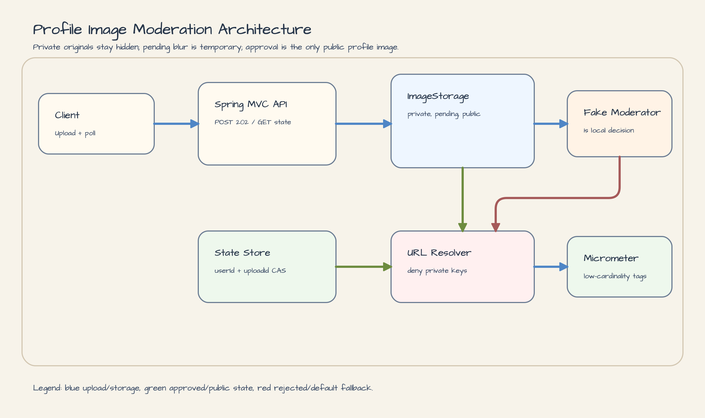
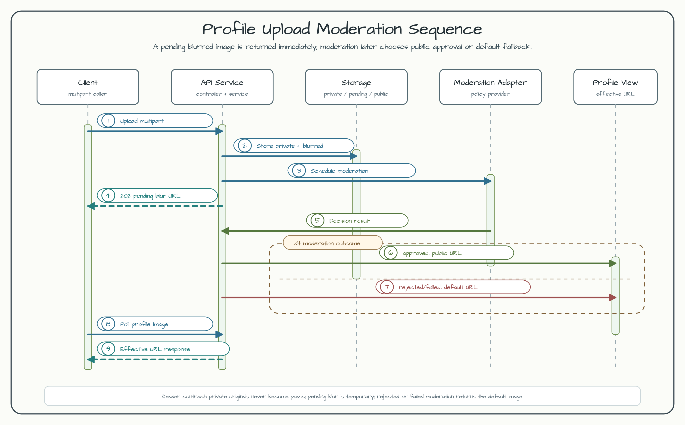

# Profile Image Moderation

[한국어](README.ko.md) | English

This example demonstrates a production-shaped profile image flow:

1. upload a user profile image;
2. store the original under a private object key;
3. publish a small blurred JPEG while moderation is pending;
4. approve the upload into a public profile image, or reject/fail it back to the default image.

## Why this example exists

A profile image is both a user-facing asset and a safety decision. The product
needs something useful to display while moderation is pending, must keep the
original private, and must return to a safe default when moderation or storage
fails. This example makes those states explicit instead of treating moderation
as an asynchronous boolean beside an upload row.

The design separates private source storage, privacy-safe derivatives, a
deterministic moderation adapter, and the public URL state machine. The local
moderator and filename markers are demo-only; cloud moderation, authentication,
retention, rate limiting, and production object policy remain integration
boundaries. The tests below therefore verify state transitions and privacy
guards, not the quality of an external moderation model.

The module test command is the test-backed verification for this story. It
covers pending/approved/rejected/failed/no-image states, stale completion,
private URL denial, cleanup, metadata redaction, payload safety, and metrics.

## Business requirements and state machine

The product requirement is not simply “moderate an image.” It is: always show
the user a safe effective image, never publish the original, and let a newer
upload win even if an older moderation job finishes later. The state returned
by the API is the answer a profile page can act on:

| Status | Meaning for the product | Effective URL |
|---|---|---|
| `NO_IMAGE` | The user has not uploaded an image | Stable default image |
| `PENDING_MODERATION` | The current upload is stored and awaiting a decision | Public blurred derivative, with `Cache-Control: no-store` in local mode |
| `APPROVED` | The current `userId + uploadId` passed policy | Public approved derivative |
| `REJECTED` | The policy found banned content | Stable default image; reason is safe, bounded text |
| `MODERATION_FAILED` | Provider, timeout, or derivative processing failed | Stable default image |

The permitted transition is `NO_IMAGE → PENDING_MODERATION → APPROVED`,
`REJECTED`, or `MODERATION_FAILED`. A compare-and-set on `userId + uploadId`
prevents a stale worker from publishing an older upload after a newer one has
become current. The pending image is a UX compromise for responsiveness; it is
not evidence that the content is safe. The original remains private in every
state.

## Upload lifecycle for a newcomer

1. `POST /api/users/{userId}/profile-image` validates the multipart image before
   storage. Invalid input returns `400` and does not create a moderation job.
2. The service stores `private/original/*`, creates privacy-safe derivatives,
   and returns `202 Accepted` with `PENDING_MODERATION`. The response's
   `effectiveUrl` is the blurred derivative, never the original key.
3. `ProfileImageModerationRunner` calls the policy adapter with bounded
   concurrency. A real deployment would put the cloud provider behind the same
   seam; the filename-marker provider exists only to make this workshop
   deterministic.
4. The completion is accepted only for the current `userId + uploadId`.
   Approval publishes the approved derivative; rejection or failure points to
   the default image and cleans up objects according to the storage boundary.
5. `GET /api/users/{userId}/profile-image` is safe to poll. It returns the
   current status and effective URL, not private storage details.

This ordering explains why a `202` response is useful: the upload is accepted,
but moderation is not being misrepresented as complete.





## Bluetape4k Features

| Concern | Bluetape4k feature | Where to look |
|---|---|---|
| Object storage | `ImageStorage`, `ImageObjectKey`, `UploadOptions` | `ProfileImageService`, `ProfileImageKeyFactory` |
| Safe validation | `require*` helpers and stable ProblemDetail mapping | `UploadImageValidator`, `ProfileImageExceptionHandler` |
| Coroutines | bounded background moderation runner | `ProfileImageModerationRunner` |
| Moderation policy | profile content policy adapter | `ProfileImageModerationPolicyProvider` |
| Metrics | low-cardinality Micrometer counters/timers | `ProfileImageMetrics` |
| ID generation | Base58 upload ids | `ProfileImageService` |
| Privacy derivatives | strict metadata/GPS removal, orientation normalization, and redaction reports | `ProfileImageProcessor`, `PrivacyDerivativePipeline` |
| Privacy payload persistence | defensive derivative bytes and bounded report snapshots with a stable JSON envelope | `ProcessedProfileImage`, `PrivacyDerivativeJackson` |

## API

Start the app:

```bash
./gradlew :image-processing-profile-image-moderation:bootRun
```

Upload a safe image. The API responds with `202 Accepted` and a pending blurred URL before moderation completes.

```bash
curl -i -F file=@safe.jpg http://localhost:8080/api/users/alice/profile-image
```

Pending response:

```json
{
  "userId": "alice",
  "status": "PENDING_MODERATION",
  "uploadId": "upload-a",
  "effectiveUrl": "http://localhost:8080/public-images/profile-images/alice/upload-a/pending/blurred.jpg",
  "pendingUrl": "http://localhost:8080/public-images/profile-images/alice/upload-a/pending/blurred.jpg",
  "approvedUrl": null,
  "defaultImageUrl": "http://localhost:8080/public-images/profile-images/default/default-profile.jpg",
  "reason": null
}
```

Poll the current profile image:

```bash
curl http://localhost:8080/api/users/alice/profile-image
```

Approved response:

```json
{
  "status": "APPROVED",
  "effectiveUrl": "http://localhost:8080/public-images/profile-images/alice/upload-a/public/approved.jpg"
}
```

Rejected uploads use the default profile image. The demo fake moderator rejects filenames containing `reject`.

```bash
curl -i -F file=@reject.jpg http://localhost:8080/api/users/alice/profile-image
```

```json
{
  "status": "REJECTED",
  "effectiveUrl": "http://localhost:8080/public-images/profile-images/default/default-profile.jpg",
  "reason": "demo filename marker matched"
}
```

If the moderation provider times out or fails, the status becomes `MODERATION_FAILED` and the effective URL is also the default image. A user with no upload returns `NO_IMAGE` and the same default URL.

Invalid uploads return RFC 9457 ProblemDetail JSON:

```json
{
  "type": "about:blank",
  "title": "Bad Request",
  "status": 400,
  "detail": "unsupported image contentType: text/plain"
}
```

## Privacy-safe Derivatives

Both the pending blurred JPEG and the approved public JPEG are re-encoded through the
bluetape4k-images `1.1.0` `PrivacyDerivativePipeline`, resolved by the workshop's
`bluetape4k-dependencies:2.1.0` BOM. The default policy strips EXIF, GPS, XMP, IPTC, and ICC
metadata, normalizes EXIF orientation, and strictly re-reads the output before storage.
The consumer adapter is `ProfileImageProcessor.processPrivacySafe`.
The bounded `PrivacyDerivativeReport` records requested/remaining categories and applied
redaction geometry without raw metadata or image bytes. A metadata reader failure or a
remaining category fails closed, so no public derivative is uploaded; the private original
and moderation state machine are unchanged.

`ProcessedProfileImage` keeps the runtime reports transient and stores
`PrivacyDerivativePayload` snapshots for persistence or messaging boundaries. Each payload
contains a defensive copy of the derivative bytes and a bounded report snapshot whose opaque
`sourceId` is the generated upload id. `PrivacyDerivativeJackson.encodePayload` and
`decodePayload` use the stable `schemaVersion`/`kind` envelope and stable codec reason codes.
The byte-array APIs are the persistence boundary in this example. Stream helpers leave
caller-owned streams open; callers remain responsible for closing them.

The policy can be tuned without changing the example's storage contract:

```yaml
workshop:
  profile-image-moderation:
    privacy:
      strip-metadata: true
      remove-gps: true
      normalize-orientation: true
      max-metadata-bytes: 5242880
```

## Privacy and Storage Boundaries

- `private/original/*` keys are never returned as effective URLs and the local public controller returns `404` for private paths.
- `pending/blurred.jpg` is intentionally public for the workshop UX, but it is still derived from user content. It is served with `Cache-Control: no-store` in local mode.
- `public/approved.jpg` is exposed only after moderation approves the current `userId + uploadId` state.
- For S3/CDN deployment, deny public reads for `profile-images/*/*/private/**` and keep pending cache TTL short or disabled.

## Moderation Provider

The default provider is deterministic and local so the example can run without cloud credentials: it waits for `workshop.profile-image-moderation.decision-delay` (1 second by default) and maps filename markers such as `nazi`, `rising-sun`, `rising-sun-flag`, `욱일기`, `旭日旗`, `hate-text`, and `reject` into banned profile-content detections. The local policy then rejects banned hate symbols or hate-expression text. Production code should replace the demo detection step with [AWS Rekognition `DetectModerationLabels`](https://docs.aws.amazon.com/rekognition/latest/dg/moderation-api.html) for supported hate-symbol labels such as Nazi Party, a Custom Labels model for local policy symbols such as Rising Sun Flag / 욱일기 imagery when required, and OCR/text moderation for embedded hate expressions. When the newer bluetape4k-image moderation policy artifacts are available in the dependency train, this adapter is the seam that should map backend detections into those shared policy models. Filename markers are demo-only and must not be used for real safety decisions.

## TODO

- After the bluetape4k-images release train publishes the newer moderation policy artifacts, replace the local demo policy mapping in `ProfileImageModerationPolicyProvider` with the shared bluetape4k-image moderation policy models. Keep the S3/Rekognition/Custom Labels/OCR adapter seam and the banned profile-content tests.

## Operations

Health and metrics:

```bash
curl http://localhost:8080/actuator/health
curl http://localhost:8080/actuator/metrics/workshop.profile.images.upload.accepted
curl http://localhost:8080/actuator/metrics/workshop.profile.images.moderation.duration
```

Local storage defaults to `${java.io.tmpdir}/bluetape4k-profile-images`. Remove that directory to clean workshop objects between runs. The default image URL is stable even when no user upload exists.

## Tests

```bash
./gradlew :image-processing-profile-image-moderation:test
```

The tests cover pending/approved/rejected/failed/no-image states, stale moderation completion, private URL denial, cleanup after storage failure, strict privacy metadata verification, orientation/redaction report geometry, payload round trips and defensive copies, stable codec failures, caller-owned streams, source-reader fail-closed handling, JPEG derivative signatures, no-store pending responses, and low-cardinality metrics.

The tests are business-contract documentation as well as regression checks:

| Test area | Boundary it proves |
|---|---|
| `ProfileImageServiceTest` state cases | Pending, approval, rejection, provider failure, timeout, and no-image responses choose the correct effective URL. |
| `ProfileImageServiceTest` stale/cleanup cases | A completion for an older upload cannot overwrite the current upload, and partial storage is cleaned up. |
| `ProfileImageProcessorTest` | Public derivatives are re-encoded, orientation-normalized, and stripped of disallowed metadata; a reader failure fails closed. |
| `PublicProfileImageControllerTest` | Private original keys are not publicly readable and pending responses carry `no-store`. |
| `ProfileImageMetricsTest` | Metrics use bounded, low-cardinality labels rather than user ids or raw provider text. |
| `ProfileImageModerationPolicyProviderTest` | The demo policy mapping is deterministic and its filename markers are not a production moderation guarantee. |

The test suite proves this state machine and privacy boundary. It cannot prove
the recall/precision of a cloud moderation model, an S3 bucket policy, or an
authentication rule that is intentionally outside the workshop module.
