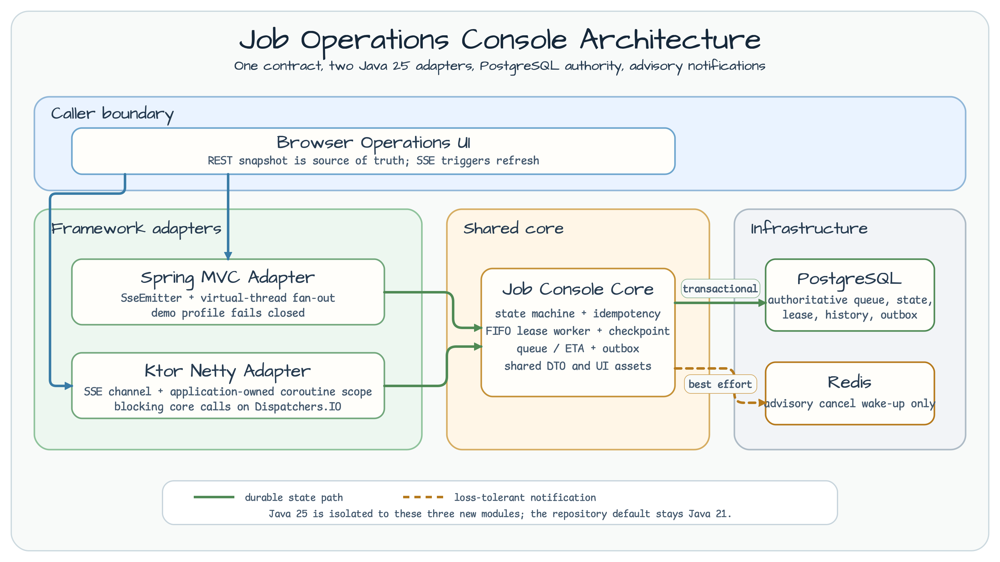
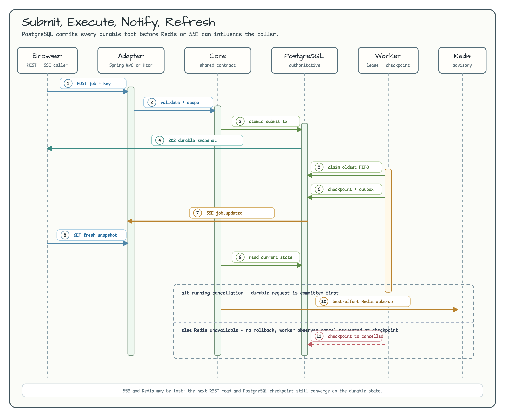
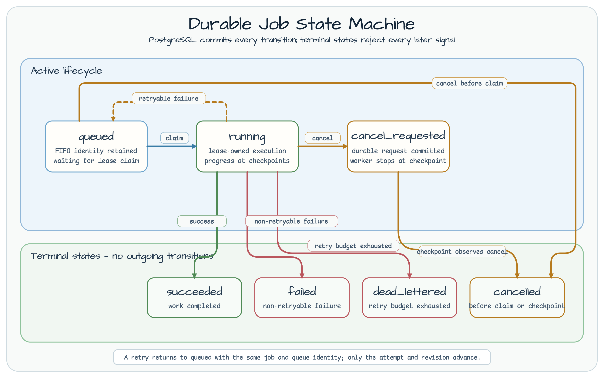

# 작업 운영 콘솔

[English](README.md) | 한국어

이 예제는 하나의 내구성 있는 백그라운드 작업 계약을 Spring MVC와 Ktor로
각각 노출합니다. 정확성의 유일한 권위는 PostgreSQL입니다. Redis와 SSE는
알림 지연을 줄일 수 있지만, 어느 쪽을 잃어도 작업 상태나 다음 REST
스냅샷의 유효성은 바뀌지 않습니다.

## 이 예제가 업무 예제인 이유

고객이 큰 문서 export를 요청하고 운영자가 대기열을 확인하거나 멈춘 요청을
취소해야 하는 상황을 생각해 보세요. HTTP 요청은 빠르게 끝나야 하고,
worker가 재시작되어도 export는 이어져야 하며, 브라우저가 연결을 잃거나 첫
응답이 유실되어 고객이 같은 요청을 다시 보내도 중복 작업이 생기면 안 됩니다.
이 예제는 이런 요구를 framework별 controller 코드가 아니라 내구성 있는
업무 규칙으로 모델링합니다.

학습 목표는 작업 제출부터 종료 상태까지의 흐름을 따라가며 각 단계의
권위를 구분하는 것입니다.

1. 호출자가 멱등성 key가 있는 결정론적 request를 제출합니다.
2. PostgreSQL이 job, queue 위치, history, outbox event를 하나의 transaction으로
   기록합니다.
3. worker가 lease를 얻고 진행 상황을 checkpoint로 저장합니다.
4. retry, 취소, lease 만료를 상태 전이로 기록합니다.
5. UI는 알림만 받고 매번 권위 있는 REST snapshot을 다시 조회합니다.

단순 CRUD 예제가 아니라 중복 request, worker crash, Redis 장애, SSE 유실에도
고객에게 보이는 결과가 어떻게 일관성을 유지하는지 설명하는 실무형 예제입니다.

## 업무 요구 사항과 설계 방향

| 요구 사항 | 설계 결정 | 학습자가 확인할 내용 |
|---|---|---|
| 유실된 HTTP 응답이 두 번째 job을 만들면 안 됨 | PostgreSQL 소유 idempotency row와 canonical request digest 사용 | 같은 key·같은 request는 저장 snapshot을 재생하고, 다른 request는 `409` 반환 |
| worker 재시작 뒤에도 작업이 이어져야 함 | lease, fencing token, checkpoint를 job과 함께 저장 | 만료된 worker는 새 worker가 reclaim한 뒤 checkpoint를 쓸 수 없음 |
| retry가 tenant queue 순서를 바꾸면 안 됨 | 기존 job을 `queued`로 돌리고 enqueue identity 유지 | 다음 claim에서 원래 queue 위치를 유지하고 attempt/revision만 증가 |
| 취소가 반드시 보존되어야 함 | Redis 알림보다 먼저 PostgreSQL에 `cancel_requested` commit | Redis를 잃어도 다음 checkpoint에서 `cancelled`로 수렴 |
| 브라우저 event 유실을 허용해야 함 | SSE는 refresh 힌트만 전달하고 payload는 전달하지 않음 | event와 reconnect 뒤에 REST snapshot을 다시 조회 |
| 운영자는 제한되고 안전한 조회가 필요함 | opaque cursor, 100행 상한, redaction 적용 | 다른 호출자의 payload·identity가 응답에 나오지 않음 |
| ETA가 약속처럼 보이면 안 됨 | 범위·confidence·sample size·freshness를 함께 제공 | 표본이 없으면 임의 시각 대신 `insufficient_data` 반환 |

범위도 의도적으로 제한했습니다. production identity provider, exactly-once
실행, distributed leader, replay 가능한 SSE history는 구현하지 않습니다. 이
기능을 섞으면 이 워크숍이 보여 주려는 queue와 transaction 경계가 흐려집니다.

## 처음 읽는 사람을 위한 용어

- **Job**: 문서 export처럼 저장해야 하는 업무 요청입니다.
- **Queue identity**: 제출 시 부여된 tenant 내부 순서입니다. retry에서도
  유지되어 오래된 요청을 추월하지 않습니다.
- **Lease**: 한 worker가 일정 시간 동안 보유하는 작업 권한입니다. lease
  token이 만료된 worker를 차단합니다.
- **Checkpoint**: 현재 lease로 완료한 마지막 work unit과 progress입니다.
- **Outbox**: 상태 변경 알림을 다시 발행할 수 있게 PostgreSQL에 남기는 row입니다.
- **SSE**: Server-Sent Events입니다. 이 예제에서는 알림 경로일 뿐이며 REST
  snapshot이 권위입니다.

## 호출자 전체 흐름

아래 순서대로 요청하면 제출·재생·조회·취소·알림 경계를 직접 확인할 수
있습니다. 첫 응답의 `jobId`를 `<job-id>`에 넣으세요.

```bash
# 1. 결정론적 export를 하나 제출합니다.
curl -i -X POST http://localhost:8080/v1/jobs \
  -H 'Content-Type: application/json' \
  -H 'X-Demo-Tenant: tenant-a' \
  -H 'X-Demo-Submitter: submitter-a' \
  -H 'Idempotency-Key: export-2026-001' \
  -d '{"jobType":"document_export","workUnits":3,"failureMode":"none"}'

# 2. 응답을 잃었으면 같은 key와 완전히 같은 request로 재생합니다.
curl -i -X POST http://localhost:8080/v1/jobs \
  -H 'Content-Type: application/json' \
  -H 'X-Demo-Tenant: tenant-a' \
  -H 'X-Demo-Submitter: submitter-a' \
  -H 'Idempotency-Key: export-2026-001' \
  -d '{"jobType":"document_export","workUnits":3,"failureMode":"none"}'

# 3. SSE event나 reconnect 뒤에 현재 권위 상태를 조회합니다.
curl -s http://localhost:8080/v1/jobs/<job-id> \
  -H 'X-Demo-Tenant: tenant-a' -H 'X-Demo-Submitter: submitter-a'

# 4. 취소를 commit합니다. Redis는 속도만 높이는 보조 경로입니다.
curl -i -X POST http://localhost:8080/v1/jobs/<job-id>/cancel \
  -H 'X-Demo-Tenant: tenant-a' -H 'X-Demo-Submitter: submitter-a'

# 5. 알림을 구독하되 event 내용 대신 REST를 다시 읽습니다.
curl -N http://localhost:8080/v1/jobs/<job-id>/events \
  -H 'X-Demo-Tenant: tenant-a' -H 'X-Demo-Submitter: submitter-a'
```

응답에는 `tenantId`, `submitterId`, idempotency key, payload, stack trace를
포함하지 않습니다. `202` replay는 “내구성 있는 request가 이미 존재한다”는
뜻이지 “작업이 exactly-once로 실행됐다”는 뜻이 아닙니다.

## 장애·복구 실습

외부 provider 없이 `failureMode`로 각 규칙을 재현할 수 있습니다.

| 실습 | 관찰 결과 | 복구에서 배우는 점 |
|---|---|---|
| `retry_once` | 첫 시도는 `queued`로 돌아가고 두 번째 시도는 성공 | attempt/revision만 바뀌고 job·queue identity는 유지 |
| `always_retryable` | retry 예산이 끝나면 `dead_lettered` | 무한 retry loop를 상한으로 차단 |
| `non_retryable` | 첫 실패가 곧 `failed` | 일반 terminal failure와 retry 소진을 구분 |
| queued 상태 취소 | worker가 claim하기 전에 `cancelled` | 취소와 claim race의 권위 결과를 하나로 수렴 |
| running 상태 취소 | checkpoint 경계에서 중단 후 종료 | 취소를 안전한 commit 경계에서 관찰 |
| lease 만료 | 새 worker가 reclaim하고 오래된 token은 거부 | fencing으로 오래된 worker의 overwrite 차단 |
| SSE 연결 종료 또는 Redis 손실 | REST는 계속 읽히고 같은 상태로 수렴 | 알림은 지연을 줄일 뿐 correctness를 정의하지 않음 |
| 같은 outbox row 중복 발행 | stable event id로 상태가 중복 반영되지 않음 | at-least-once delivery도 멱등 consumer라면 안전 |

## 테스트가 증명하는 계약

작은 테스트부터 읽은 뒤 PostgreSQL/Testcontainers 통합 테스트로 이동하세요.
테스트 이름을 업무 문장으로 작성해 assertion을 요구 사항처럼 읽을 수 있게
했습니다.

| 계약 | 대표 테스트 |
|---|---|
| 상태 전이, terminal 상태, stale revision | `JobTransitionsTest` |
| redacted JSON과 안정적인 problem code | `JobApiModelsTest`, `JobConsoleSubmissionOutcomeTest` |
| 같은 key replay와 내구성 row 중복 방지 | `JobSubmissionIdempotencyRepositoryTest`, `JobIdempotencyConcurrencyTest` |
| tenant FIFO와 active job 단일성 | `JobClaimConcurrencyTest`, `QueueProjectionServiceTest` |
| retry, dead-letter, 취소, lease fencing | `JobFailureMatrixIntegrationTest`, `JobRetryExhaustionTest`, `JobLeaseRecoveryTest`, `JobCancellationRaceTest` |
| outbox 재전송과 SSE 수렴 | `JobOutboxRepositoryTest`, `JobEventFanoutTest`, 어댑터 live contract test |
| Spring/Ktor 입력 parsing parity | `JobConsoleSpringSubmissionHttpTest`, `JobConsoleKtorSubmissionHttpTest`, bounded-wait conformance test |
| shutdown, virtual thread, coroutine 취소 | `JobConsoleSpringLifecycleTest`, `JobConsoleKtorHttpTest`, 어댑터 lifecycle test |

고경합 profile은 correctness stress harness이지 capacity benchmark가 아닙니다.
barrier, 여러 worker, Redis fault 상황에서도 같은 불변식을 유지하는지 확인하며
local-reference report를 production throughput으로 해석하지 않습니다.

## 사양 추적성과 읽는 순서

설계와 acceptance 기준은
[`2026-07-21-issue-520-job-operations-console-design.md`](../docs/superpowers/specs/2026-07-21-issue-520-job-operations-console-design.md)에
기록되어 있습니다. 후속 설계
[`2026-11-18-issue-1052-operations-exposed-design.md`](../docs/superpowers/specs/2026-11-18-issue-1052-operations-exposed-design.md)는
일반 repository/count assertion을 typed Exposed mapping으로 통일하고,
migration·`EXPLAIN`·lock·backup/restore·compatibility probe는 의도적인 raw SQL
검증 경계로 남긴 이유를 설명합니다.

처음에는 `job-console-core`의 state·persistence·worker를 읽고,
`job-console-spring` 또는 `job-console-ktor` 중 하나의 adapter를 선택하세요.
마지막으로 공용 contract/conformance test를 읽으면 업무 규칙을 framework
배선보다 먼저 이해할 수 있습니다.

## 모듈

| 모듈 | 책임 | 런타임 |
|---|---|---|
| [`job-console-core`](job-console-core/) | 상태 머신, PostgreSQL 큐, lease, checkpoint, 재시도 예산, ETA, outbox, 공유 fixture | Java 25 |
| [`job-console-spring`](job-console-spring/) | Spring MVC REST/SSE 어댑터와 데모 UI | Java 25 |
| [`job-console-ktor`](job-console-ktor/) | Ktor Netty REST/SSE 어댑터와 데모 UI | Java 25 |

이 모듈들은 저장소 전체의 기본 Java 25 toolchain을 사용합니다.

## 아키텍처



두 어댑터는 같은 core 계약을 사용합니다. 제출, 멱등성, 큐 순서, lease,
상태 이력, outbox row의 권위는 PostgreSQL에 있습니다. Redis는 취소를 빨리
알리는 보조 wake-up 경로일 뿐입니다.

## 요청 시퀀스



API는 응답이나 알림보다 먼저 내구성 있는 사실을 commit합니다. SSE 이벤트는
안정적인 event id와 새로고침 힌트만 전달하며, 클라이언트는 이벤트를 받을
때마다 현재 REST 스냅샷을 다시 읽습니다.

## 상태 머신



재시도 가능한 실패는 동일한 작업과 큐 identity를 `queued`로 돌려보내고
attempt와 revision만 증가시킵니다. `succeeded`, `failed`,
`dead_lettered`, `cancelled`는 종료 상태이며 이후 전이를 거부합니다.

## API 계약

| 메서드 | 경로 | 목적 |
|---|---|---|
| `POST` | `/v1/jobs` | 멱등한 결정론적 작업 제출 |
| `GET` | `/v1/jobs/{jobId}` | 권위 있는 redacted 스냅샷 조회 |
| `POST` | `/v1/jobs/{jobId}/cancel` | 내구성 있는 취소 요청 commit |
| `GET` | `/v1/jobs/{jobId}/events` | 알림 전용 SSE 이벤트 수신 |
| `GET` | `/v1/queues/me` | 호출자 범위의 제한된 큐 페이지 조회 |
| `GET` | `/v1/tenants/{tenantId}/queue` | 운영자 범위의 제한된 큐 페이지 조회 |
| `GET` | `/healthz` | 프로세스 liveness |
| `GET` | `/readyz` | PostgreSQL 권위 readiness와 Redis 저하 상세 |

제출에는 `X-Demo-Tenant`, `X-Demo-Submitter`, `Idempotency-Key`가
필요합니다. 운영자 큐에는 `X-Demo-Operator: true`도 필요합니다. 이 신뢰
헤더는 워크숍을 단순하게 만드는 데모 fixture입니다. **운영 환경의 인증이나
인가가 아닙니다.**

큐 조회는 최대 100개 row로 제한되며 opaque cursor를 사용합니다. ETA는
confidence와 sample size가 붙은 표본 범위이지 SLA가 아닙니다. 표본이
부족하면 가짜 추정치를 만들지 않습니다.

## Spring MVC 실행

PostgreSQL을 시작한 뒤 데모 profile을 명시적으로 활성화합니다.

```bash
export SPRING_DATASOURCE_URL=jdbc:postgresql://localhost:5432/postgres
export SPRING_DATASOURCE_USERNAME=postgres
export SPRING_DATASOURCE_PASSWORD=postgres
export SPRING_PROFILES_ACTIVE=demo
./gradlew :operations-job-console-spring:bootRun
```

`http://localhost:8080`을 엽니다. `demo` profile이 없으면 데모 UI와 API
route를 등록하지 않습니다.

## Ktor 실행

PostgreSQL을 시작한 뒤 데모 route 사용을 명시합니다.

```bash
export POSTGRES_JDBC_URL=jdbc:postgresql://localhost:5432/postgres
export POSTGRES_USERNAME=postgres
export POSTGRES_PASSWORD=postgres
export JOB_CONSOLE_DEMO=true
./gradlew :operations-job-console-ktor:run
```

`http://localhost:8080`을 엽니다. `JOB_CONSOLE_DEMO=false`이면 애플리케이션은
데모 route를 노출하지 않습니다.

## 장애 fixture

`failureMode`는 `none`, `retry_once`, `non_retryable`,
`always_retryable`을 지원합니다. 결정론적 worker는 외부 provider 없이 성공
재시도, 즉시 종료 실패, 재시도 소진, lease 복구, 취소 race, Redis 손실,
outbox 재전송을 검증합니다.

## 운영 경계

- PostgreSQL 장애: readiness가 실패하며 Redis만으로 mutation을 수락하지 않습니다.
- Redis 장애: readiness에 저하를 표시하지만 PostgreSQL 기반 작업은 ready와 correct 상태를 유지합니다.
- SSE 연결 종료 또는 지연: 제한된 fan-out이 subscriber를 제거하며 REST가 계속 source of truth입니다.
- worker crash: 만료된 lease가 실행 가능한 작업을 내구성 큐로 되돌립니다.
- 롤백: 어댑터를 중지하고 PostgreSQL은 조사용으로 보존한 뒤 배포에서 `operations-job-console-*` 세 모듈을 제거합니다. 다른 워크숍 모듈은 이 모듈들에 의존하지 않습니다.

## 검증

```bash
./gradlew :operations-job-console-core:test
./gradlew :operations-job-console-core:integrationTest --max-workers=1
./gradlew :operations-job-console-spring:integrationTest --max-workers=1
./gradlew :operations-job-console-ktor:integrationTest --max-workers=1
./scripts/smoke-validate.sh operations
```
