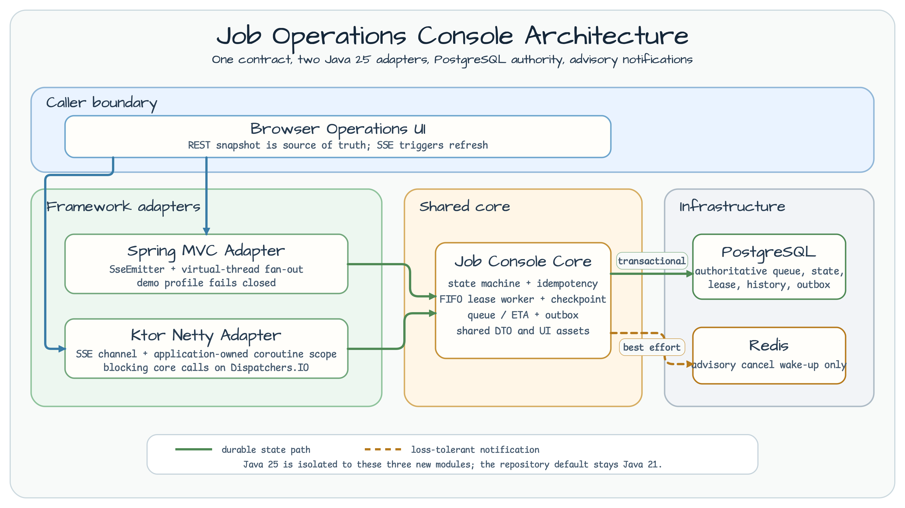
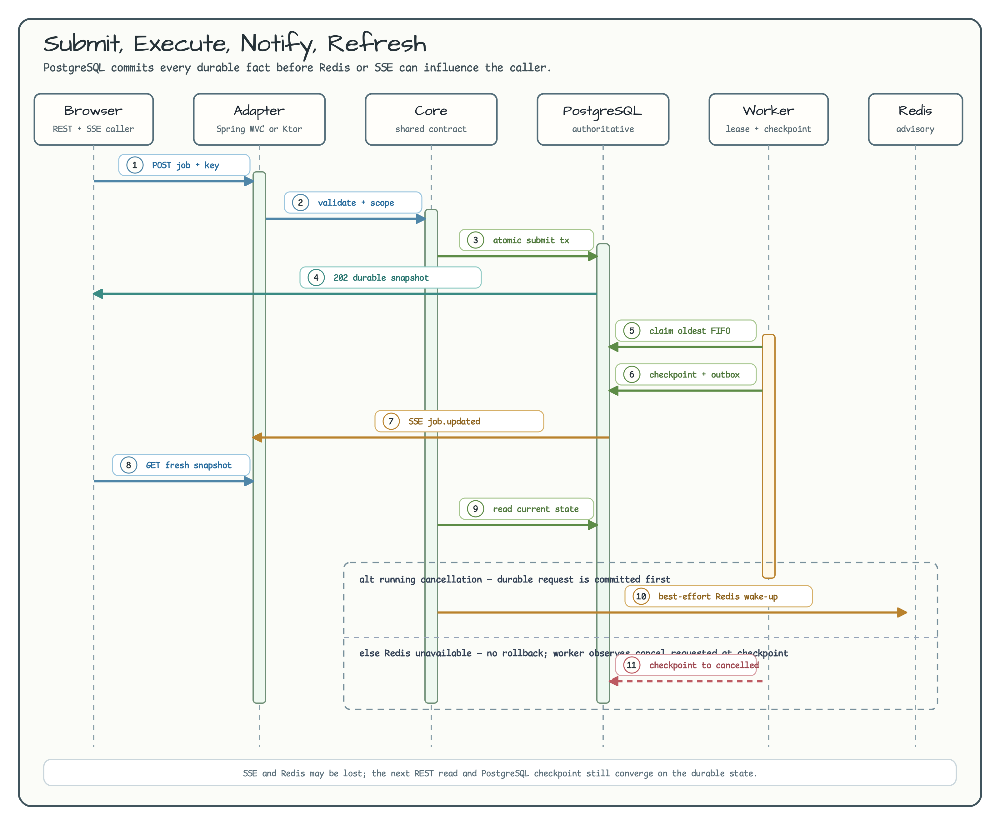
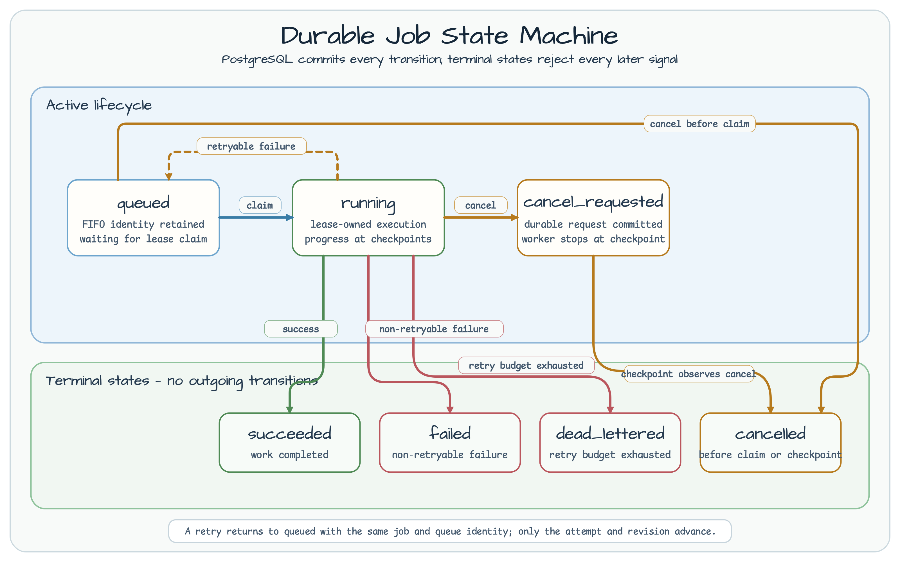

# Job Operations Console

[한국어](README.ko.md) | English

This example builds one durable background-job contract and exposes it through
Spring MVC and Ktor. PostgreSQL is the only correctness authority. Redis and
SSE can reduce notification latency, but losing either one never changes job
state or invalidates the next REST snapshot.

## Why this is a business example

Imagine a customer requests a large document export while an operator needs to
see the backlog and cancel a stuck request. The HTTP request must finish quickly,
the export must continue after a worker restart, a browser may disconnect, and a
customer may send the same request again because the first response was lost.
The example treats those requirements as durable business rules rather than as
framework-specific controller code.

The learning goal is to follow one job from submission to terminal outcome and
to see which fact is authoritative at each step:

1. the caller submits a deterministic request with an idempotency key;
2. PostgreSQL records the job, queue position, history, and outbox event in one
   transaction;
3. a worker claims the job with a lease and records progress checkpoints;
4. a retry, cancellation, or lease expiry is represented as a state transition;
5. the UI receives only a notification and reads the authoritative REST
   snapshot again.

This is intentionally more than a CRUD sample. It demonstrates how to keep a
customer-visible answer correct when requests are duplicated, workers crash,
Redis is unavailable, or SSE delivery is incomplete.

## Business requirements and design decisions

| Requirement | Design decision | What a learner should verify |
|---|---|---|
| A lost HTTP response must not create a second job | PostgreSQL-owned idempotency row and canonical request digest | Same key and same request return the saved snapshot; same key and different request return `409` |
| Work must survive a worker restart | A lease, fencing token, and checkpoint are stored with the job | An expired worker cannot write a checkpoint after another worker reclaims the job |
| Retry must not reorder a tenant's queue | Retry returns the existing job to `queued` and preserves its enqueue identity | The next claim sees the original queue position and increments only attempt/revision |
| Cancellation must be durable | `cancel_requested` is committed in PostgreSQL before Redis notification | Redis loss still converges to `cancelled` at the next checkpoint |
| A browser event is allowed to be lost | SSE carries a refresh hint, not the job payload | Reconnect and every event lead to a fresh REST snapshot |
| Operators need bounded, safe views | Queue pages use an opaque cursor, a 100-row cap, and redaction | Operator responses never expose another caller's payload or identity |
| ETA must not look like a promise | Projection includes range, confidence, sample size, and freshness | No historical sample produces `insufficient_data`, not a fabricated timestamp |

The scope is deliberately bounded. The module does not implement a production
identity provider, exactly-once execution, a distributed leader, or replayable
SSE history. Those are separate concerns that would hide the queue and
transaction boundaries this workshop is intended to teach.

## Vocabulary for first-time readers

- **Job**: the durable business request, such as exporting a document.
- **Queue identity**: the tenant-local ordering fact assigned at submission;
  retries keep it so a retry cannot jump ahead of an older request.
- **Lease**: a time-limited claim held by one worker. The lease token fences a
  stale worker after expiry.
- **Checkpoint**: the last completed work unit and progress percentage committed
  with the current lease.
- **Outbox**: a PostgreSQL row recording a notification that can be published
  again without changing the job state.
- **SSE**: Server-Sent Events. Here it is an advisory notification channel; the
  REST snapshot is the source of truth.

## A complete caller walkthrough

The following requests use the demo headers and show the intended order. Replace
`<job-id>` with the `jobId` from the first response.

```bash
# 1. Submit one deterministic export.
curl -i -X POST http://localhost:8080/v1/jobs \
  -H 'Content-Type: application/json' \
  -H 'X-Demo-Tenant: tenant-a' \
  -H 'X-Demo-Submitter: submitter-a' \
  -H 'Idempotency-Key: export-2026-001' \
  -d '{"jobType":"document_export","workUnits":3,"failureMode":"none"}'

# 2. If the response was lost, replay the exact request with the same key.
curl -i -X POST http://localhost:8080/v1/jobs \
  -H 'Content-Type: application/json' \
  -H 'X-Demo-Tenant: tenant-a' \
  -H 'X-Demo-Submitter: submitter-a' \
  -H 'Idempotency-Key: export-2026-001' \
  -d '{"jobType":"document_export","workUnits":3,"failureMode":"none"}'

# 3. Read the current authoritative state after an SSE event or reconnect.
curl -s http://localhost:8080/v1/jobs/<job-id> \
  -H 'X-Demo-Tenant: tenant-a' -H 'X-Demo-Submitter: submitter-a'

# 4. Commit cancellation; Redis is only an acceleration path.
curl -i -X POST http://localhost:8080/v1/jobs/<job-id>/cancel \
  -H 'X-Demo-Tenant: tenant-a' -H 'X-Demo-Submitter: submitter-a'

# 5. Subscribe to notifications, then refresh REST rather than trusting event data.
curl -N http://localhost:8080/v1/jobs/<job-id>/events \
  -H 'X-Demo-Tenant: tenant-a' -H 'X-Demo-Submitter: submitter-a'
```

The response deliberately omits `tenantId`, `submitterId`, the idempotency key,
payload, and stack traces. A `202` replay means “the durable request already
exists”, not “the work executed exactly once”.

## Failure and recovery exercises

Use `failureMode` to make each rule observable without an external provider:

| Exercise | Expected observation | Recovery lesson |
|---|---|---|
| `retry_once` | First attempt returns to `queued`, second attempt succeeds | Retry changes attempt/revision, not job or queue identity |
| `always_retryable` | Retry budget ends in `dead_lettered` | A bounded budget prevents an infinite retry loop |
| `non_retryable` | The first failure becomes `failed` | Caller-visible terminal failure is different from retry exhaustion |
| Cancel while queued | The job becomes `cancelled` without a worker claim | The durable command wins the claim race |
| Cancel while running | The worker stops at a checkpoint and then terminates | Cancellation is observed at a safe, committed boundary |
| Expire a lease | A new worker reclaims the job; the stale token is rejected | Fencing prevents an old worker from overwriting newer state |
| Disconnect SSE or lose Redis | REST remains readable and converges on the same state | Notifications improve latency but never define correctness |
| Publish the same outbox row twice | The stable event id prevents duplicate state application | At-least-once delivery is safe when consumers are idempotent |

## Which test proves which contract?

Start with the small tests, then move to PostgreSQL/Testcontainers tests. The
test name is intentionally a business sentence so the assertion can be read as
a requirement:

| Contract | Representative test |
|---|---|
| State transitions, terminal states, and stale revisions | `JobTransitionsTest` |
| Stable redacted JSON and problem codes | `JobApiModelsTest` and `JobConsoleSubmissionOutcomeTest` |
| Same-key replay and no duplicate durable rows | `JobSubmissionIdempotencyRepositoryTest`, `JobIdempotencyConcurrencyTest` |
| Tenant FIFO and active-job exclusivity | `JobClaimConcurrencyTest`, `QueueProjectionServiceTest` |
| Retry, dead-letter, cancellation, and lease fencing | `JobFailureMatrixIntegrationTest`, `JobRetryExhaustionTest`, `JobLeaseRecoveryTest`, `JobCancellationRaceTest` |
| Outbox redelivery and SSE convergence | `JobOutboxRepositoryTest`, `JobEventFanoutTest`, adapter live contract tests |
| Spring/Ktor request parsing parity | `JobConsoleSpringSubmissionHttpTest`, `JobConsoleKtorSubmissionHttpTest`, and bounded-wait conformance tests |
| Shutdown, virtual threads, and coroutine cancellation | `JobConsoleSpringLifecycleTest`, `JobConsoleKtorHttpTest`, and adapter lifecycle tests |

The high-contention profile is a correctness stress harness, not a capacity
benchmark. It checks that the same invariants hold under barriers, multiple
workers, and Redis faults; its local-reference report must not be read as a
production throughput claim.

## Specification traceability and reading order

The design and acceptance criteria are recorded in
[`2026-07-21-issue-520-job-operations-console-design.md`](../docs/superpowers/specs/2026-07-21-issue-520-job-operations-console-design.md).
The follow-up
[`2026-11-18-issue-1052-operations-exposed-design.md`](../docs/superpowers/specs/2026-11-18-issue-1052-operations-exposed-design.md)
explains why ordinary repository/count assertions use typed Exposed mappings
while migration, `EXPLAIN`, lock, backup/restore, and compatibility probes retain
raw SQL as an intentional verification boundary.

For a guided tour, read `job-console-core` first (state, persistence, worker),
then choose one adapter (`job-console-spring` or `job-console-ktor`), and finish
with the shared contract/conformance tests. This order keeps business rules
visible before framework plumbing.

## Modules

| Module | Responsibility | Runtime |
|---|---|---|
| [`job-console-core`](job-console-core/) | State machine, PostgreSQL queue, leases, checkpoints, retry budget, ETA, outbox, and shared fixtures | Java 25 |
| [`job-console-spring`](job-console-spring/) | Spring MVC REST/SSE adapter and demo UI | Java 25 |
| [`job-console-ktor`](job-console-ktor/) | Ktor Netty REST/SSE adapter and demo UI | Java 25 |

These modules use the repository-wide Java 25 default.

## Architecture



Both adapters consume the same core contract. PostgreSQL owns submission,
idempotency, queue ordering, leases, state history, and outbox rows. Redis is an
advisory cancellation wake-up path only.

## Request sequence



The API commits a durable fact before returning or notifying. SSE events carry
only a stable event identifier and refresh hint; clients read the current REST
snapshot after every event.

## State machine



A retryable failure returns the same job and queue identity to `queued` while
advancing its attempt and revision. `succeeded`, `failed`, `dead_lettered`, and
`cancelled` are terminal and reject later transitions.

## API contract

| Method | Path | Purpose |
|---|---|---|
| `POST` | `/v1/jobs` | Submit an idempotent deterministic job |
| `GET` | `/v1/jobs/{jobId}` | Read the authoritative redacted snapshot |
| `POST` | `/v1/jobs/{jobId}/cancel` | Commit a durable cancellation request |
| `GET` | `/v1/jobs/{jobId}/events` | Receive notification-only SSE events |
| `GET` | `/v1/queues/me` | Read a bounded caller queue page |
| `GET` | `/v1/tenants/{tenantId}/queue` | Read a bounded operator queue page |
| `GET` | `/healthz` | Process liveness |
| `GET` | `/readyz` | PostgreSQL-authoritative readiness with Redis degradation detail |

Submission requires `X-Demo-Tenant`, `X-Demo-Submitter`, and
`Idempotency-Key`. Operator queue access also requires
`X-Demo-Operator: true`. These trusted demo headers are intentionally simple
workshop fixtures. They are **not production authentication or authorization**.

The queue view is capped at 100 rows and uses an opaque cursor. ETA is a sampled
range with confidence and sample size, not an SLA; insufficient samples produce
no fabricated estimate.

## Run Spring MVC

Start PostgreSQL, then enable the demo profile explicitly:

```bash
export SPRING_DATASOURCE_URL=jdbc:postgresql://localhost:5432/postgres
export SPRING_DATASOURCE_USERNAME=postgres
export SPRING_DATASOURCE_PASSWORD=postgres
export SPRING_PROFILES_ACTIVE=demo
./gradlew :operations-job-console-spring:bootRun
```

Open `http://localhost:8080`. Without the `demo` profile, the demo UI and API
routes are not registered.

## Run Ktor

Start PostgreSQL, then opt in to the demo routes:

```bash
export POSTGRES_JDBC_URL=jdbc:postgresql://localhost:5432/postgres
export POSTGRES_USERNAME=postgres
export POSTGRES_PASSWORD=postgres
export JOB_CONSOLE_DEMO=true
./gradlew :operations-job-console-ktor:run
```

Open `http://localhost:8080`. With `JOB_CONSOLE_DEMO=false`, the application
does not expose the demo routes.

## Failure fixtures

`failureMode` supports `none`, `retry_once`, `non_retryable`, and
`always_retryable`. The deterministic worker proves successful retry, immediate
terminal failure, retry exhaustion, lease recovery, cancellation races, Redis
loss, and outbox redelivery without a third-party provider.

## Operational boundaries

- PostgreSQL unavailable: readiness fails and no Redis-only mutation is accepted.
- Redis unavailable: readiness reports degradation, while PostgreSQL-backed work remains ready and correct.
- SSE disconnected or slow: the bounded fan-out evicts the subscriber; REST remains the source of truth.
- Worker crash: an expired lease returns eligible work to the durable queue.
- Rollback: stop either adapter, preserve PostgreSQL for inspection, and remove the three `operations-job-console-*` modules from deployment. No other workshop module depends on them.

## Verify

```bash
./gradlew :operations-job-console-core:test
./gradlew :operations-job-console-core:integrationTest --max-workers=1
./gradlew :operations-job-console-spring:integrationTest --max-workers=1
./gradlew :operations-job-console-ktor:integrationTest --max-workers=1
./scripts/smoke-validate.sh operations
```
