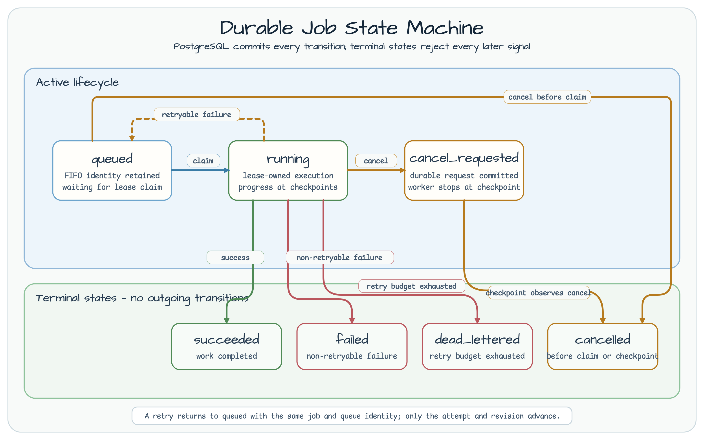
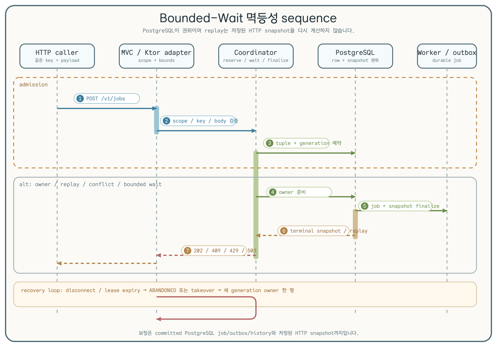

# 작업 콘솔 Core

[English](README.md) | 한국어

Java 25 core는 프레임워크에 독립적인 작업 계약, PostgreSQL migration, FIFO
큐, lease, checkpoint, 종료 전이, 제한된 ETA projection, outbox polling,
취소 signal, 어댑터 공용 test fixture를 담당합니다.

## Core가 해결하는 문제

Core는 두 HTTP adapter 뒤의 업무 계층입니다. 고객은 긴 export를 실행하면서
HTTP 연결을 계속 유지할 필요가 없어야 하고, 운영자는 worker가 재시작된
뒤에도 대기 순서·진행률·ETA·최종 결과를 설명할 수 있어야 합니다. 따라서
job row, enqueue 순서, revision, lease, checkpoint, history, idempotency
request, outbox row처럼 process와 framework가 바뀌어도 보존해야 하는 사실을
core가 소유합니다.

어댑터는 header, JSON, HTTP status, SSE만 이 계약으로 변환합니다. Core를 먼저
읽으면 Redis나 브라우저 event가 correctness를 결정할 수 없는 이유가
명확해집니다.

## 계약 지도

| 업무 규칙 | Core 소유자 | 내구성 있는 증거 |
|---|---|---|
| 중복 제출은 하나의 request여야 함 | `JobSubmissionIdempotencyCoordinator`와 repository | canonical request digest와 저장 response snapshot |
| tenant 내부 FIFO 보장 | `JobRepository`, `QueueProjectionService` | enqueue sequence와 제한된 queue projection |
| 현재 worker만 기록 가능 | `JobLease`, lease token, revision 검사 | 조건부 checkpoint/terminal update |
| retry와 취소는 명시적 전이 | `JobTransitions`, `JobWorkerEngine` | state history와 attempt/revision |
| 알림은 재시도 가능해야 함 | `JobOutboxRepository`, `JobOutboxPoller` | stable logical event id와 published marker |
| ETA는 추정치여야 함 | `EtaEstimator` | duration sample, confidence, sample size |

Core는 authentication, production policy engine, exactly-once 실행을 담당하지
않습니다. 이 경계는 Core를 사용하는 application이 소유합니다.

## 최소 API 예제

framework 없이도 request와 outcome 계약을 직접 실행할 수 있습니다.

```kotlin
val request = SubmitJobRequest(
    jobType = JobType.DOCUMENT_EXPORT,
    workUnits = 3,
    failureMode = FailureMode.RETRY_ONCE,
)
val first = service.submit(DemoCallerScope("tenant-a", "submitter-a"), "export-1", request)
val replay = service.submit(DemoCallerScope("tenant-a", "submitter-a"), "export-1", request)

check(first is JobSubmissionOutcome.OwnerCompleted)
check(replay is JobSubmissionOutcome.Replayed)
check(first.snapshot == replay.snapshot)
```

`OwnerCompleted`와 `Replayed`는 의도적으로 같은 snapshot을 전달하고,
HTTP 계층은 `Idempotency-Replayed` header만 추가합니다. 호출자는 첫 response를
저장하고 중단하거나 timeout 뒤 완전히 같은 request를 안전하게 재시도할 수
있습니다.

## 테스트가 계약을 증명하는 순서

다음 순서로 읽으면 요구 사항과 assertion을 연결하기 쉽습니다.

1. `JobTransitionsTest` — 닫힌 상태 전이표와 stale revision 거부.
2. `JobApiModelsTest`, `JobConsoleSubmissionOutcomeTest` — redacted wire 형태,
   stable problem code, replay header, retry 안내.
3. `JobSubmissionIdempotencyRepositoryTest`, `JobIdempotencyConcurrencyTest` —
   replay와 동시 owner 상황에서 하나의 내구성 request row.
4. `JobClaimConcurrencyTest`, `JobLeaseRecoveryTest`, `JobCancellationRaceTest` —
   FIFO, fencing, checkpoint, 취소 race.
5. `JobFailureMatrixIntegrationTest`, `JobRetryExhaustionTest` — retryable,
   non-retryable, dead-letter 결과.
6. `JobOutboxRepositoryTest`, `JobEventFanoutTest`, 어댑터 conformance fixture —
   REST 권위를 바꾸지 않는 at-least-once 알림.

Container 기반 테스트는 PostgreSQL/Redis 자원을 공유하므로 순차 실행합니다.
고경합 profile은 barrier와 여러 worker scheduling을 추가하지만, 결과는
production capacity 수치가 아니라 불변식 보존 증거입니다.

## 권위 경계

PostgreSQL이 권위를 갖습니다. Redis 취소 publish와 SSE fan-out은 best
effort입니다. 보조 publish 실패는 commit된 `cancel_requested`를 rollback하지
않으며, 느린 subscriber는 outbox 진행을 막지 않습니다.

## 상태 머신



닫힌 전이표는 stale revision과 종료 상태에서 들어오는 모든 signal을
거부합니다. 재시도 가능한 실패는 작업 및 큐 identity를 바꾸지 않고
`queued`로 돌아갑니다.

## 제한된 대기 HTTP 멱등성



`POST /v1/jobs`는 PostgreSQL이 소유하는 request row를 사용합니다. 기본
rollout은 비활성화(`job-console.bounded-wait.enabled=false`)되어 있으며 모든
인스턴스가 같은 policy fingerprint를 사용할 때만 활성화합니다. 기본값은
waiter deadline 2초, key별 waiter 2개, terminal retention 1시간, request/replay
body 64KiB, idempotency key 255바이트이며 timeout에는 `Retry-After: 1`,
waiter overflow에는 `Retry-After: 2`를 사용합니다.

처음 승인된 owner는 job, outbox, history와 HTTP snapshot을 하나의 transaction으로
commit합니다. replay는 저장된 snapshot을 반환하며 response를 다시 계산하지
않습니다. legacy(rollout 비활성) replay도 V001 호환 terminal 경로를 사용합니다.
이는 idempotent HTTP 계약을 갖는 at-least-once 처리이며 exactly-once 실행을
보장하지 않습니다.

| 결과 | 상태 | 호출자 동작 |
| --- | ---: | --- |
| 최초 owner 또는 replay | `202` | response를 저장하고 재시도 중단 |
| 같은 key, 다른 request | `409` | idempotency key와 payload 수정 |
| in-flight deadline | `409` + `Retry-After: 1` | 같은 key로 재시도 |
| waiter cap 초과 | `429` + `Retry-After: 2` | backoff 후 같은 key로 재시도 |
| owner abandoned / dependency unavailable | `503` | backoff를 두고 같은 key 재시도 |
| 잘못된 request / body 초과 | `400` / `413` | request 수정, 무조건 재시도하지 않음 |

Shutdown은 먼저 admission을 닫고 active submission을 최대 5초 drain한 뒤,
남은 owner를 abandon하여 lease recovery가 takeover하도록 합니다. Readiness는
PostgreSQL, Redis, policy fingerprint, bounded-wait 상태와 `postgres` 또는
`policy` reason을 표시합니다. Redis는 보조 경로이므로 ready를 해제하지 않습니다.
test-only conformance host는 운영 route가 아닙니다.

## 테스트 fixture

`testFixtures` source set은 PostgreSQL/Redis container fixture, barrier,
결정론적 clock, HTTP driver, event probe, 두 어댑터가 함께 사용하는 black-box
계약을 제공합니다.

## 검증

```bash
./gradlew :operations-job-console-core:test
./gradlew :operations-job-console-core:integrationTest --max-workers=1
```

## 고경합 증거


Docker daemon이 실행 중이고 JDK 25를 사용하며 Gradle과 container가 사용할
수 있는 메모리가 최소 4 GiB인 환경에서 저장소 전체 profile을 실행합니다.

```bash
CI_RUN_ID=developer-ci-001
REFERENCE_RUN_ID=developer-reference-001
./gradlew highContentionCi -PhighContentionRunId="$CI_RUN_ID" --max-workers=1
./gradlew highContentionLocalReference -PhighContentionRunId="$REFERENCE_RUN_ID" --max-workers=1
```

정확성 게이트는 `highContentionCi`입니다. `highContentionLocalReference`는
해당 환경의 실행 관찰값을 기록할 뿐이며, 프레임워크 순위를 매기지 않는다.
또한 운영 용량을 입증하지 않는다. Canonical report는
`build/reports/high-contention/<run-id>/` 아래에 기록됩니다. 명령마다 새 run
ID를 사용해야 하며 local-reference 실행에는 clean worktree도 필요합니다.

P3 authority-query 비용은 별도 opt-in 관찰로 확인할 수 있습니다.

```bash
./gradlew :operations-job-console-core:performanceObservation \
  --no-configuration-cache --max-workers=1
```

이 probe는 PostgreSQL fixture에 512/2,048/5,000행을 만들고
`duplicateOutboxLogicalEventCount`와 `burstQueueViolationCount`의 warm-up 후
median/p95 및 정합성 결과를
`operations/job-console-core/build/reports/job-console-authority-queries/`
`p3-observation.json`에 run ID와 실행 환경 메타데이터와 함께 기록합니다.
이는 개발 환경의 query-observation이며 운영 용량이나 프레임워크 순위를
주장하지 않습니다.

Lease, fencing, checkpoint, deduplication, 종료 상태의 권위는 PostgreSQL이
계속 가집니다. Toxiproxy는 기존 connection과 새 connection을 포함한 Redis
경로의 단절·복구에만 사용하며 PostgreSQL 권위나 database failover를
대체하지 않습니다.

## 사양 추적성

전체 업무 요구 사항, 상태 머신, 장애 매트릭스, adapter parity, acceptance
기준은
[`2026-07-21-issue-520-job-operations-console-design.md`](../../docs/superpowers/specs/2026-07-21-issue-520-job-operations-console-design.md)에
있습니다. 후속
[`2026-11-18-issue-1052-operations-exposed-design.md`](../../docs/superpowers/specs/2026-11-18-issue-1052-operations-exposed-design.md)는
일반 typed query와 migration·`EXPLAIN`·lock·retention·backup/restore·compatibility
probe처럼 SQL 자체가 검증 대상인 raw 경계를 구분합니다.
