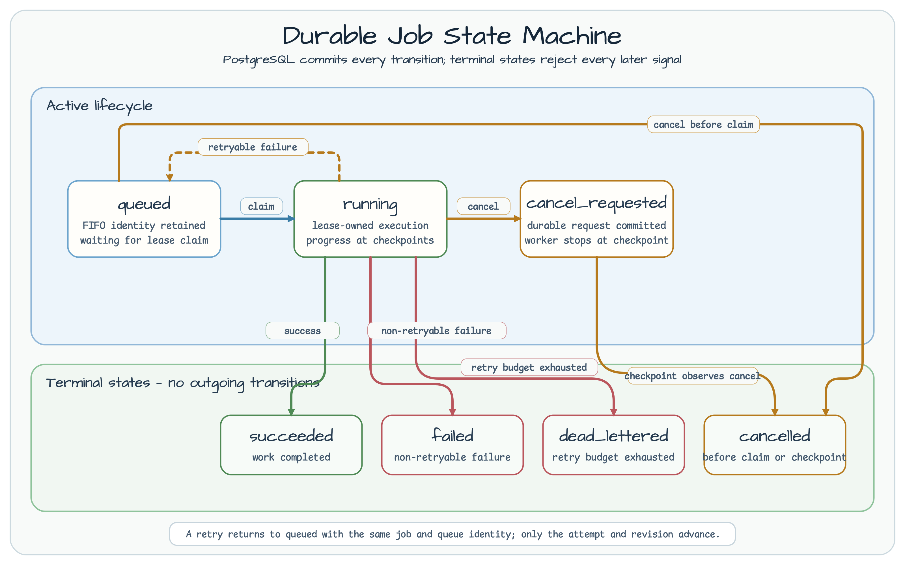
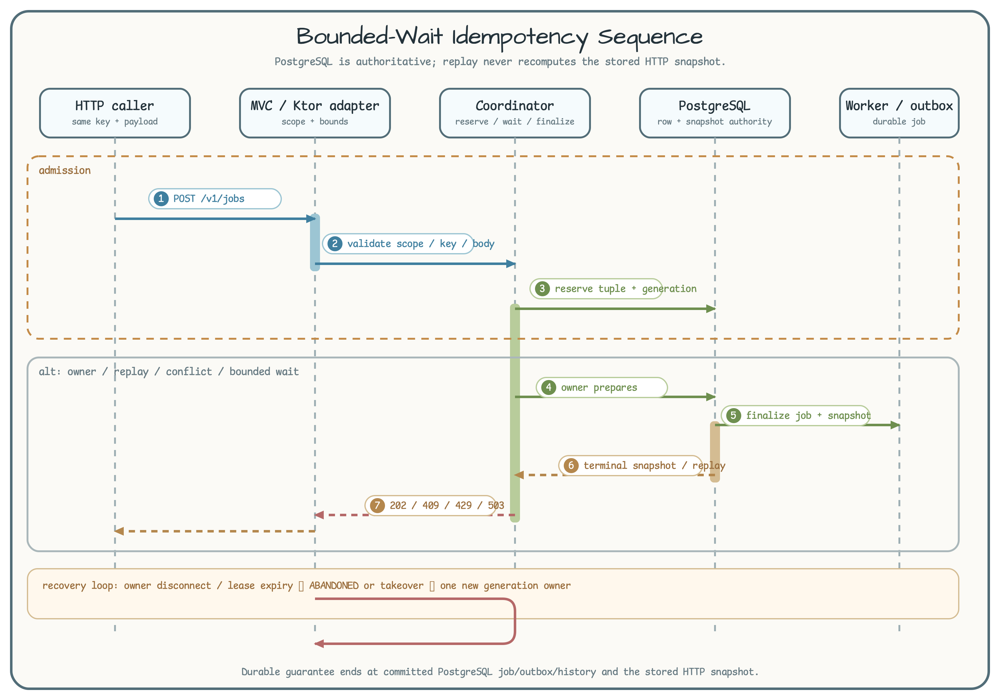
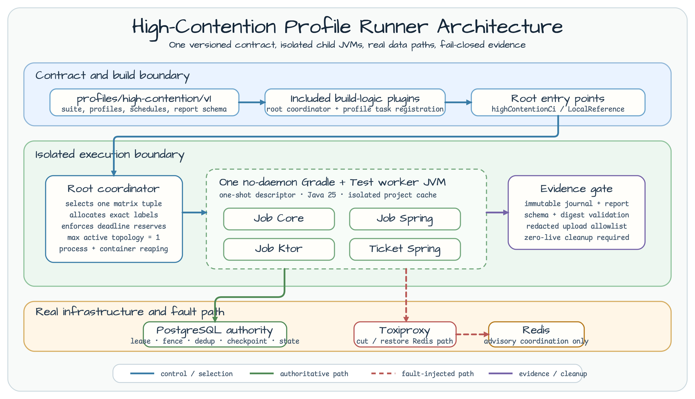

# Job Console Core

[한국어](README.ko.md) | English

The Java 25 core owns the framework-neutral job contract, PostgreSQL migration,
FIFO queue, leases, checkpoints, terminal transitions, bounded ETA projection,
outbox polling, cancellation signaling, and cross-adapter test fixtures.

## What problem the core solves

The core is the business layer behind both HTTP adapters. A customer should be
able to submit a long-running export without holding an HTTP connection open,
while an operator can still explain its position, progress, ETA, and final
outcome after a worker restart. The core therefore owns facts that must survive
processes and framework changes: the job row, enqueue order, revision, lease,
checkpoint, history, idempotency request, and outbox record.

The adapters only translate headers, JSON, HTTP status, and SSE into this
contract. Reading the core first makes it clear why Redis and a browser event
cannot be allowed to decide correctness.

## Contract map

| Business rule | Core owner | Durable evidence |
|---|---|---|
| duplicate submit is one request | `JobSubmissionIdempotencyCoordinator` and repository | canonical request digest + stored response snapshot |
| one tenant follows FIFO | `JobRepository` and `QueueProjectionService` | enqueue sequence and bounded queue projection |
| only the current worker may write | `JobLease`, lease token, and revision checks | conditional checkpoint/terminal update |
| retry and cancel are explicit | `JobTransitions` and `JobWorkerEngine` | state history and attempt/revision |
| notifications can be retried | `JobOutboxRepository` and `JobOutboxPoller` | stable logical event id + published marker |
| ETA is an estimate | `EtaEstimator` | duration samples, confidence, and sample size |

The core deliberately does not own authentication, a production policy engine,
or exactly-once execution. Those boundaries belong to the application that
embeds it.

## Minimal API example

The framework-neutral request and outcome can be exercised without a web server:

```kotlin
val request = SubmitJobRequest(
    jobType = JobType.DOCUMENT_EXPORT,
    workUnits = 3,
    failureMode = FailureMode.RETRY_ONCE,
)
val first = service.submit(DemoCallerScope("tenant-a", "submitter-a"), "export-1", request)
val replay = service.submit(DemoCallerScope("tenant-a", "submitter-a"), "export-1", request)

check(first is JobSubmissionOutcome.OwnerCompleted)
check(replay is JobSubmissionOutcome.Replayed)
check(first.snapshot == replay.snapshot)
```

`OwnerCompleted` and `Replayed` intentionally carry the same snapshot; the
HTTP layer adds only the `Idempotency-Replayed` header. A caller can safely save
the first response and stop retrying, or retry the exact request after a timeout.

## Test-to-contract guide

The core tests are the executable version of the requirements. Read them in this
order when learning the module:

1. `JobTransitionsTest` — closed state transitions and stale revision rejection.
2. `JobApiModelsTest` and `JobConsoleSubmissionOutcomeTest` — redacted wire
   shape, stable problem codes, replay headers, and retry advice.
3. `JobSubmissionIdempotencyRepositoryTest` and
   `JobIdempotencyConcurrencyTest` — one durable request row under replay and
   concurrent owners.
4. `JobClaimConcurrencyTest`, `JobLeaseRecoveryTest`, and
   `JobCancellationRaceTest` — FIFO, fencing, checkpoint, and cancel races.
5. `JobFailureMatrixIntegrationTest` and `JobRetryExhaustionTest` — retryable,
   non-retryable, and dead-letter outcomes.
6. `JobOutboxRepositoryTest`, `JobEventFanoutTest`, and adapter conformance
   fixtures — at-least-once notification without changing REST authority.

Container-backed tests are intentionally sequential because they share
PostgreSQL/Redis resources. The high-contention profile adds barriers and
multi-worker scheduling; its report proves invariant preservation, not a
production capacity number.

## Authority boundary

PostgreSQL is authoritative. Redis cancellation publish and SSE fan-out are
best effort. A failed advisory publish never rolls back the committed
`cancel_requested` state, and a slow subscriber never blocks outbox progress.

## State machine



The closed transition table rejects stale revisions and every signal from a
terminal state. Retryable failure returns to `queued` without changing the job
or queue identity.

## Bounded-wait HTTP idempotency



`POST /v1/jobs` uses a PostgreSQL-owned request row. The default rollout is
disabled (`job-console.bounded-wait.enabled=false`); enable it only when every
instance uses the same policy fingerprint. Defaults are a 2s waiter deadline,
two waiters per key, a 1h terminal retention window, 64KiB request/replay
bodies, a 255-byte idempotency key, and `Retry-After: 1` for timeout or `2` for
waiter overflow.

The first accepted owner commits the job, outbox, history, and HTTP snapshot in
one transaction. A replay returns that stored snapshot and never recomputes the
response. A legacy (disabled rollout) replay still uses the V001-compatible
terminal path. This is at-least-once processing with an idempotent HTTP
contract, not exactly-once execution.

| Outcome | Status | Caller action |
| --- | ---: | --- |
| first owner or replay | `202` | persist the response and stop retrying |
| same key, different request | `409` | fix the idempotency key/payload |
| in-flight deadline | `409` + `Retry-After: 1` | retry the same key |
| waiter cap | `429` + `Retry-After: 2` | back off and retry the same key |
| owner abandoned / dependency unavailable | `503` | retry the same key with backoff |
| invalid request / body too large | `400` / `413` | correct the request; do not retry blindly |

Shutdown closes admission first, drains active submissions for at most five
seconds, then abandons any remaining owner so lease recovery can take over.
Readiness reports PostgreSQL, Redis, policy fingerprint, bounded-wait state,
and a `postgres` or `policy` reason. Redis is advisory and does not make the
service unready. The test-only conformance host is not a production route.

## Test fixtures

The `testFixtures` source set provides the PostgreSQL/Redis container fixture,
barriers, a deterministic clock, HTTP driver, event probe, and the shared
black-box contract used by both adapters.

## Verify

```bash
./gradlew :operations-job-console-core:test
./gradlew :operations-job-console-core:integrationTest --max-workers=1
```

## High-contention evidence



Run the repository-wide profiles with a running Docker daemon, JDK 25, and at
least 4 GiB of memory available to Gradle and the containers:

```bash
CI_RUN_ID=developer-ci-001
REFERENCE_RUN_ID=developer-reference-001
./gradlew highContentionCi -PhighContentionRunId="$CI_RUN_ID" --max-workers=1
./gradlew highContentionLocalReference -PhighContentionRunId="$REFERENCE_RUN_ID" --max-workers=1
```

The correctness gate is `highContentionCi`. `highContentionLocalReference`
records environment-specific execution observations; it does not rank
frameworks and does not establish production capacity. Canonical reports are
written under `build/reports/high-contention/<run-id>/`. Use a new run ID for
every command; local-reference execution also requires a clean worktree.

P3 authority-query cost can be observed with the opt-in probe:

```bash
./gradlew :operations-job-console-core:performanceObservation \
  --no-configuration-cache --max-workers=1
```

The probe seeds 512, 2,048, and 5,000 rows in a PostgreSQL fixture, then records
warm-up-adjusted median/p95 timings and correctness results for
`duplicateOutboxLogicalEventCount` and `burstQueueViolationCount` in
`operations/job-console-core/build/reports/job-console-authority-queries/`
`p3-observation.json`, together with a run ID and runtime metadata. This is a
developer-environment query observation, not a production-capacity or framework
ranking claim.

PostgreSQL remains the authority for leases, fencing, checkpoints, deduplication,
and terminal state. Toxiproxy is limited to cutting and restoring the Redis path,
including old and newly opened connections; it does not simulate PostgreSQL
authority or database failover.

## Specification traceability

The full business requirements, state machine, failure matrix, adapter parity,
and acceptance criteria are in
[`2026-07-21-issue-520-job-operations-console-design.md`](../../docs/superpowers/specs/2026-07-21-issue-520-job-operations-console-design.md).
The Exposed follow-up
[`2026-11-18-issue-1052-operations-exposed-design.md`](../../docs/superpowers/specs/2026-11-18-issue-1052-operations-exposed-design.md)
defines the boundary between ordinary typed queries and SQL that remains raw
because SQL itself is the subject under test (migration, `EXPLAIN`, lock,
retention, backup/restore, and compatibility probes).
