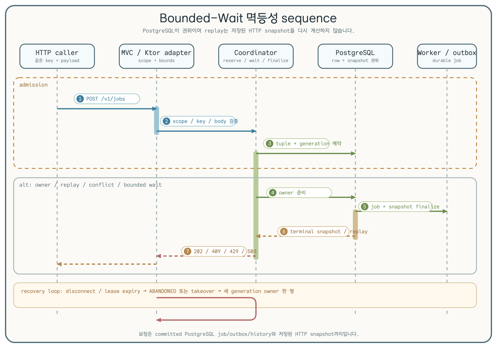

# Ktor 작업 콘솔 어댑터

[English](README.md) | 한국어

이 Java 25 어댑터는 Ktor Netty, Ktor SSE, 애플리케이션이 소유하는
poller/worker scope, 공유 운영 UI로 core 계약을 노출합니다. Blocking JDBC와
worker 호출은 `Dispatchers.IO`에서 실행하고 coroutine cancellation은 다시
던집니다.

## 안전 경계

route를 사용하려면 `JOB_CONSOLE_DEMO=true`가 필요합니다.
`X-Demo-Tenant`, `X-Demo-Submitter`, `X-Demo-Operator`는 신뢰하는 데모
헤더이지 운영 인증이 아닙니다. 모든 SSE 알림 뒤에도 REST 스냅샷이 권위를
유지합니다.

## 제한된 대기 HTTP 멱등성



이 어댑터의 `POST /v1/jobs`는 공용 PostgreSQL request row에 위임합니다.
rollout은 기본적으로 비활성화(`JOB_CONSOLE_BOUNDED_WAIT_ENABLED=false`)되어
있으며 모든 인스턴스가 같은 policy fingerprint를 사용할 때만 켭니다. 정책은
waiter deadline 2초, key별 waiter 2개, terminal retention 1시간,
request/replay body 64KiB, idempotency key 255바이트입니다.

| 결과 | 상태 | 호출자 동작 |
| --- | ---: | --- |
| 최초 owner 또는 replay | `202` | response 저장, replay는 저장 snapshot 사용 |
| 다른 request로 key 재사용 | `409` | key 또는 payload 수정 |
| in-flight timeout | `409` + `Retry-After: 1` | 같은 key 재시도 |
| waiter overflow | `429` + `Retry-After: 2` | backoff 후 재시도 |
| abandoned owner / dependency failure | `503` | backoff 재시도 |
| 잘못된 입력 / body 초과 | `400` / `413` | request 수정 |

이 계약은 at-least-once 및 idempotent이며 exactly-once가 아닙니다. Legacy
replay는 V001 호환 terminal 경로를 사용합니다. Shutdown 시 admission을 닫고
active submission을 최대 5초 drain한 뒤 남은 owner를 abandon하여 lease recovery가
처리합니다. Readiness는 PostgreSQL, Redis, bounded-wait 상태와 policy
fingerprint를 노출하며 Redis는 보조 경로입니다. test-only conformance route는
이 어댑터에 공개하지 않습니다.

## 실행

```bash
export POSTGRES_JDBC_URL=jdbc:postgresql://localhost:5432/postgres
export POSTGRES_USERNAME=postgres
export POSTGRES_PASSWORD=postgres
export JOB_CONSOLE_DEMO=true
# 선택 사항인 취소 알림 가속 경로:
# export REDIS_URI=redis://localhost:6379
./gradlew :operations-job-console-ktor:run
```

## 검증

```bash
./gradlew :operations-job-console-ktor:test
./gradlew :operations-job-console-ktor:integrationTest --max-workers=1
```

## 고경합 증거


Docker daemon이 실행 중이고 JDK 25를 사용하며 Gradle과 container가 사용할
수 있는 메모리가 최소 4 GiB인 환경에서 core와 Ktor adapter profile을
실행합니다.

```bash
CI_RUN_ID=developer-ci-001
REFERENCE_RUN_ID=developer-reference-001
./gradlew highContentionCi -PhighContentionRunId="$CI_RUN_ID" --max-workers=1
./gradlew highContentionLocalReference -PhighContentionRunId="$REFERENCE_RUN_ID" --max-workers=1
```

정확성 게이트는 `highContentionCi`입니다. `highContentionLocalReference`는
해당 환경의 실행 관찰값을 기록할 뿐이며, 프레임워크 순위를 매기지 않는다.
또한 운영 용량을 입증하지 않는다. Canonical report는
`build/reports/high-contention/<run-id>/` 아래에 기록됩니다. 명령마다 새 run
ID를 사용해야 하며 local-reference 실행에는 clean worktree도 필요합니다.

Ktor adapter는 blocking 작업을 application-owned dispatcher에 격리하지만
lease, fencing, checkpoint, deduplication, 종료 상태의 권위는 PostgreSQL이
유지합니다. Toxiproxy는 기존 connection과 새 connection을 포함한 보조
Redis 경로의 단절·복구에만 사용하며 PostgreSQL 권위나 database failover를
대체하지 않습니다.

## 업무 시나리오와 학습 목표

일반 HTTP 요청보다 오래 걸리는 document export를 고객이 제출한다고
생각해 보세요. 응답이 유실되면 browser는 재시도할 수 있고, worker가
재시작되는 동안 운영자는 tenant queue를 볼 수 있으며, SSE 연결은 예고 없이
끊길 수 있습니다. 이 모듈은 Ktor가 Spring과 같은 durable job contract를
노출하면서 blocking JDBC와 worker 호출은 event-loop dispatcher에서 분리하는
방법을 보여 줍니다.

이 어댑터를 읽은 뒤 다음을 설명할 수 있어야 합니다.

1. `POST /v1/jobs`가 반환하기 전에 PostgreSQL request row를 저장하는 이유;
2. 같은 `Idempotency-Key`와 동일 request를 재전송하면 저장된 response를
   replay하고 다른 payload는 conflict가 되는 이유;
3. SSE event는 refresh hint일 뿐이고 `GET /v1/jobs/{jobId}`가 source of
   truth인 이유;
4. application-owned coroutine scope가 outbox poller와 worker를 시작하고
   `ApplicationStopped`에서 닫는 방식; 그리고
5. `CancellationException`을 일반 `503` response로 바꾸지 않고 다시 던지는
   이유.

`JOB_CONSOLE_DEMO=true`와 demo header를 사용하면 쉽게 실행할 수 있습니다.
이는 신뢰하는 workshop 입력이며 운영 authentication/authorization이
아닙니다.

## Ktor 경계와 요청 흐름

| 관심사 | Ktor 어댑터의 역할 | Core/PostgreSQL의 역할 |
|---|---|---|
| HTTP 입력 | caller scope 하나, idempotency key 하나, UTF-8 JSON, 64 KiB body 제한을 검증 | request를 canonicalize하고 owner/replay/conflict를 결정 |
| Blocking 작업 | JDBC/service 호출을 `Dispatchers.IO` 또는 interruptible 경계에서 실행 | FIFO 작업을 claim하고 lease를 fencing하며 checkpoint와 결과를 commit |
| 알림 | bounded SSE heartbeat/event를 보내고 `finally`에서 subscription을 닫음 | 다시 발행할 수 있는 durable outbox row를 기록 |
| Shutdown | admission을 닫고 최대 5초 대기한 뒤 background job과 resource를 종료 | abandon된 owner를 다음 worker가 reclaim할 수 있게 함 |
| Error/cancellation 매핑 | stable problem code를 HTTP status로 변환하고 coroutine cancellation을 재전파 | commit된 상태와 retry/recovery 의미를 권위로 유지 |

Application-owned scope는 약 100 ms마다 outbox cycle, 약 50 ms마다 worker
cycle을 시작합니다. 이 간격은 학습용 기본값이며 capacity 보장이 아닙니다.
`Channel(capacity = 16)`과 heartbeat timeout은 느리거나 끊긴 client의 영향을
제한합니다. SSE와 Redis 어느 것도 job correctness의 source가 될 수 없습니다.

## 현실적인 HTTP walkthrough

`JOB_CONSOLE_DEMO=true`로 Ktor를 실행한 뒤 export를 제출하고 관찰합니다.

```bash
curl -i -X POST http://localhost:8080/v1/jobs \
  -H 'Content-Type: application/json' \
  -H 'X-Demo-Tenant: tenant-a' \
  -H 'X-Demo-Submitter: submitter-a' \
  -H 'Idempotency-Key: ktor-export-2026-001' \
  -d '{"jobType":"document_export","workUnits":3,"failureMode":"none"}'

# response가 유실되었다면 완전히 같은 request를 replay합니다.
curl -i -X POST http://localhost:8080/v1/jobs \
  -H 'Content-Type: application/json' \
  -H 'X-Demo-Tenant: tenant-a' \
  -H 'X-Demo-Submitter: submitter-a' \
  -H 'Idempotency-Key: ktor-export-2026-001' \
  -d '{"jobType":"document_export","workUnits":3,"failureMode":"none"}'

# SSE event 또는 reconnect 뒤 현재 durable state를 reconcile합니다.
curl -s http://localhost:8080/v1/jobs/<job-id> \
  -H 'X-Demo-Tenant: tenant-a' -H 'X-Demo-Submitter: submitter-a'

# SSE는 notification/heartbeat를 주지만 replay 가능한 history는 아닙니다.
curl -N http://localhost:8080/v1/jobs/<job-id>/events \
  -H 'X-Demo-Tenant: tenant-a' -H 'X-Demo-Submitter: submitter-a'
```

Owner 또는 replay는 `202`를 반환합니다. 다른 request에 같은 key를 사용하면
`409`, in-flight timeout은 `Retry-After: 1`과 함께 `409`, waiter 초과는
`Retry-After: 2`와 함께 `429`, abandon된 owner 또는 dependency failure는
`503`입니다. Response 계약이 허용하는 경우에만 같은 key와 canonical body를
재시도해야 합니다.

## 테스트와 계약의 대응

다음 테스트를 Ktor 배포의 요구 사항으로 읽으세요.

| 요구 사항 | 대표 Ktor 증거 |
|---|---|
| 정확한 header/body 검증과 stable problem response | `JobConsoleKtorSubmissionHttpTest` |
| core fixture와 bounded-wait replay parity | `KtorBoundedWaitHttpIdempotencyConformanceTest` |
| route JSON/status/SSE와 cancellation 동작 | `KtorJobConsoleHttpTest`, `KtorJobConsoleHttpClientRetryTest` |
| coroutine startup, cancellation, resource ownership | `KtorJobConsoleHttpTest`와 Ktor fixture의 application lifecycle assertion |
| 고경합에서도 queue/lease 불변식 보존 | `KtorJobConsoleHighContentionProfileTest`, `KtorJobConsoleHighContentionSelectionTest` |

Ktor test는 의도적으로 core black-box contract를 재사용합니다. HTTP test는
adapter mapping을 증명하고, PostgreSQL/Redis container test는 claim, fencing,
checkpoint, cancellation, outbox, recovery를 증명합니다. local profile report를
운영 처리량 benchmark로 해석해서는 안 됩니다.

## 사양 추적성

설계 사양은 framework-neutral core와 Ktor Netty, SSE, coroutine lifecycle,
PostgreSQL 권위, 보조 Redis cancellation, Spring/Ktor black-box parity를
요구합니다. 자세한 내용은
[`2026-07-21-issue-520-job-operations-console-design.md`](../../docs/superpowers/specs/2026-07-21-issue-520-job-operations-console-design.md)의
module boundary, HTTP/SSE, worker cancellation, failure matrix, acceptance 절을
참조하세요. 후속
[`2026-11-18-issue-1052-operations-exposed-design.md`](../../docs/superpowers/specs/2026-11-18-issue-1052-operations-exposed-design.md)
는 typed Exposed query 경계와 migration, `EXPLAIN`, lock, retention,
backup/restore, compatibility semantics를 위해 보존한 raw SQL probe를
설명합니다.
