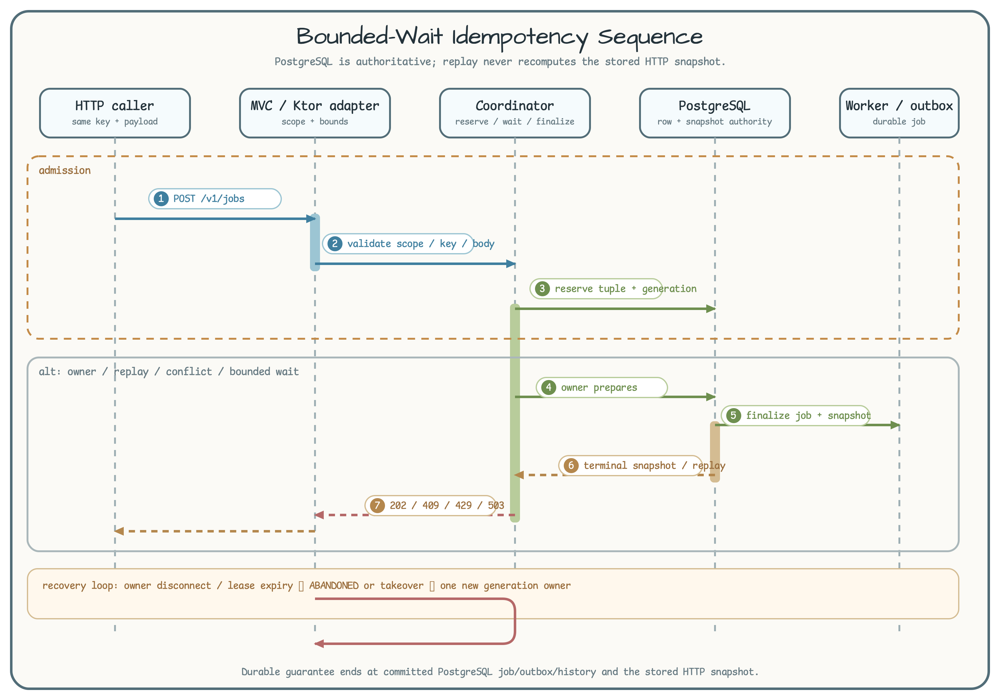

# Ktor Job Console Adapter

[한국어](README.ko.md) | English

This Java 25 adapter exposes the shared contract through Ktor Netty, Ktor SSE,
an application-owned poller/worker scope, and the shared operations UI.
Blocking JDBC and worker calls run on `Dispatchers.IO`, and coroutine
cancellation is rethrown.

## Safety boundary

Routes require `JOB_CONSOLE_DEMO=true`. `X-Demo-Tenant`,
`X-Demo-Submitter`, and `X-Demo-Operator` are trusted demo headers, not
production authentication. REST snapshots remain authoritative after every SSE
notification.

## Bounded-wait HTTP idempotency



The adapter delegates `POST /v1/jobs` to the shared PostgreSQL-owned request
row. Rollout is disabled by default (`JOB_CONSOLE_BOUNDED_WAIT_ENABLED=false`);
enable it only with one policy fingerprint across every instance. The policy is
2s waiter deadline, two waiters per key, 1h terminal retention, 64KiB
request/replay bodies, and a 255-byte idempotency key.

| Outcome | Status | Caller action |
| --- | ---: | --- |
| first owner or replay | `202` | store the response; replay uses the saved snapshot |
| key reused with another request | `409` | correct the key or payload |
| in-flight timeout | `409` + `Retry-After: 1` | retry the same key |
| waiter overflow | `429` + `Retry-After: 2` | back off and retry |
| abandoned owner / dependency failure | `503` | retry with backoff |
| invalid input / body too large | `400` / `413` | fix the request |

The contract is at-least-once and idempotent, not exactly-once. Legacy replay
uses the V001-compatible terminal path. On shutdown, admission closes, active
submissions drain for at most five seconds, and remaining owners are abandoned
for lease recovery. Readiness exposes PostgreSQL, Redis, bounded-wait state,
and policy fingerprint; Redis remains advisory. No test-only conformance route
is published by this adapter.

## Run

```bash
export POSTGRES_JDBC_URL=jdbc:postgresql://localhost:5432/postgres
export POSTGRES_USERNAME=postgres
export POSTGRES_PASSWORD=postgres
export JOB_CONSOLE_DEMO=true
# Optional advisory cancellation acceleration:
# export REDIS_URI=redis://localhost:6379
./gradlew :operations-job-console-ktor:run
```

## Verify

```bash
./gradlew :operations-job-console-ktor:test
./gradlew :operations-job-console-ktor:integrationTest --max-workers=1
```

## High-contention evidence


Run the shared core and Ktor adapter profiles with a running Docker daemon,
JDK 25, and at least 4 GiB of memory available to Gradle and the containers:

```bash
CI_RUN_ID=developer-ci-001
REFERENCE_RUN_ID=developer-reference-001
./gradlew highContentionCi -PhighContentionRunId="$CI_RUN_ID" --max-workers=1
./gradlew highContentionLocalReference -PhighContentionRunId="$REFERENCE_RUN_ID" --max-workers=1
```

The correctness gate is `highContentionCi`. `highContentionLocalReference`
records environment-specific execution observations; it does not rank
frameworks and does not establish production capacity. Canonical reports are
written under `build/reports/high-contention/<run-id>/`. Use a new run ID for
every command; local-reference execution also requires a clean worktree.

The Ktor adapter keeps blocking work on its application-owned dispatcher, while
PostgreSQL remains authoritative for leases, fencing, checkpoints,
deduplication, and terminal state. Toxiproxy cuts and restores only the advisory
Redis path, including old and newly opened connections; it does not replace
PostgreSQL authority or database failover.

## Business scenario and learning goals

Imagine a customer submitting a document export that takes longer than a
normal HTTP request. A browser can retry after a lost response, an operator can
inspect the tenant queue while a worker restarts, and an SSE connection can
disappear without warning. This module shows how Ktor exposes the same durable
job contract as Spring while keeping blocking JDBC and worker calls off the
event-loop dispatcher.

After reading this adapter, a reader should be able to explain:

1. why `POST /v1/jobs` stores a PostgreSQL request row before returning;
2. why an exact retry with the same `Idempotency-Key` replays the saved
   response, while a different payload is a conflict;
3. why an SSE event is only a refresh hint and `GET /v1/jobs/{jobId}` is the
   source of truth;
4. how Ktor's application-owned coroutine scope starts the outbox poller and
   worker, then closes them during `ApplicationStopped`; and
5. why `CancellationException` is rethrown instead of being converted to a
   generic `503` response.

The demo headers and `JOB_CONSOLE_DEMO=true` make the example easy to run. They
are trusted workshop inputs, not production authentication or authorization.

## Ktor boundary and request flow

| Concern | Ktor adapter does | Core/PostgreSQL does |
|---|---|---|
| HTTP input | validates one caller scope, one idempotency key, UTF-8 JSON, and the 64 KiB body limit | canonicalizes the request and decides owner, replay, or conflict |
| Blocking work | runs JDBC/service calls on `Dispatchers.IO` or an interruptible boundary | claims FIFO work, fences leases, checkpoints progress, and commits outcomes |
| Notifications | sends bounded SSE heartbeats/events and closes the subscription in `finally` | writes durable outbox rows that can be published again |
| Shutdown | closes admission, waits up to five seconds, cancels background jobs, and closes resources | allows abandoned owners to be reclaimed by a later worker |
| Error/cancellation mapping | maps stable problem codes to HTTP status and rethrows coroutine cancellation | keeps the committed state and retry/recovery semantics authoritative |

The application-owned scope starts an outbox cycle about every 100 ms and a
worker cycle about every 50 ms. The intervals are teaching defaults, not a
capacity promise. `Channel(capacity = 16)` and heartbeat timeouts make slow or
disconnected clients bounded; neither SSE nor Redis is allowed to become the
source of job correctness.

## A realistic HTTP walkthrough

Start Ktor with `JOB_CONSOLE_DEMO=true`, then submit and observe one export:

```bash
curl -i -X POST http://localhost:8080/v1/jobs \
  -H 'Content-Type: application/json' \
  -H 'X-Demo-Tenant: tenant-a' \
  -H 'X-Demo-Submitter: submitter-a' \
  -H 'Idempotency-Key: ktor-export-2026-001' \
  -d '{"jobType":"document_export","workUnits":3,"failureMode":"none"}'

# If the response is lost, replay the exact request.
curl -i -X POST http://localhost:8080/v1/jobs \
  -H 'Content-Type: application/json' \
  -H 'X-Demo-Tenant: tenant-a' \
  -H 'X-Demo-Submitter: submitter-a' \
  -H 'Idempotency-Key: ktor-export-2026-001' \
  -d '{"jobType":"document_export","workUnits":3,"failureMode":"none"}'

# Reconcile the current durable state after an SSE event or reconnect.
curl -s http://localhost:8080/v1/jobs/<job-id> \
  -H 'X-Demo-Tenant: tenant-a' -H 'X-Demo-Submitter: submitter-a'

# SSE gives notification and heartbeat, not replayable history.
curl -N http://localhost:8080/v1/jobs/<job-id>/events \
  -H 'X-Demo-Tenant: tenant-a' -H 'X-Demo-Submitter: submitter-a'
```

An owner or replay returns `202`. A key reused for a different request returns
`409`; an in-flight timeout returns `409` plus `Retry-After: 1`; waiter
overflow returns `429` plus `Retry-After: 2`; an abandoned owner or dependency
failure returns `503`. Retry the same key and canonical body only when the
response contract calls for it.

## Test-to-contract map

Read these tests as requirements for a Ktor deployment:

| Requirement | Representative Ktor evidence |
|---|---|
| exact header/body validation and stable problem responses | `JobConsoleKtorSubmissionHttpTest` |
| bounded-wait replay parity with the core fixture | `KtorBoundedWaitHttpIdempotencyConformanceTest` |
| route JSON/status/SSE and cancellation behavior | `KtorJobConsoleHttpTest`, `KtorJobConsoleHttpClientRetryTest` |
| coroutine startup, cancellation, and resource ownership | `KtorJobConsoleHttpTest` and the application lifecycle assertions in the Ktor fixture |
| high contention preserves queue and lease invariants | `KtorJobConsoleHighContentionProfileTest`, `KtorJobConsoleHighContentionSelectionTest` |

The Ktor tests intentionally reuse the core black-box contract. HTTP tests
prove adapter mapping; PostgreSQL/Redis container tests prove claim, fencing,
checkpoint, cancellation, outbox, and recovery. Do not interpret a local
profile report as a production throughput benchmark.

## Specification traceability

The design specification calls for a framework-neutral core with Ktor Netty,
SSE, coroutine lifecycle, PostgreSQL authority, advisory Redis cancellation,
and Spring/Ktor black-box parity. See
[`2026-07-21-issue-520-job-operations-console-design.md`](../../docs/superpowers/specs/2026-07-21-issue-520-job-operations-console-design.md),
especially the module boundary, HTTP/SSE, worker cancellation, failure matrix,
and acceptance sections. The follow-up
[`2026-11-18-issue-1052-operations-exposed-design.md`](../../docs/superpowers/specs/2026-11-18-issue-1052-operations-exposed-design.md)
documents the typed Exposed query boundary and the raw SQL probes retained for
migration, `EXPLAIN`, lock, retention, backup/restore, and compatibility
semantics.
