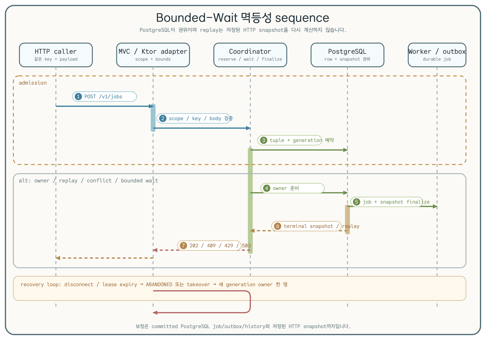

# Spring 작업 콘솔 어댑터

[English](README.md) | 한국어

이 Java 25 어댑터는 Spring Boot MVC, `SseEmitter`, scheduled outbox polling,
애플리케이션이 소유하는 virtual-thread worker executor, 공유 운영 UI를 통해
core 계약을 노출합니다.

## 안전 경계

route는 `demo` profile에서만 존재합니다. `X-Demo-Tenant`,
`X-Demo-Submitter`, `X-Demo-Operator`는 신뢰하는 데모 헤더이지 운영 인증이
아닙니다. 모든 SSE 알림 뒤에도 REST 스냅샷이 권위를 유지합니다.

## 제한된 대기 HTTP 멱등성



이 어댑터의 `POST /v1/jobs`는 공용 PostgreSQL request row에 위임합니다.
rollout은 기본적으로 비활성화(`job-console.bounded-wait.enabled=false`)되어
있으며 모든 인스턴스가 같은 policy fingerprint를 사용할 때만 켭니다. 정책은
waiter deadline 2초, key별 waiter 2개, terminal retention 1시간,
request/replay body 64KiB, idempotency key 255바이트입니다.

| 결과 | 상태 | 호출자 동작 |
| --- | ---: | --- |
| 최초 owner 또는 replay | `202` | response 저장, replay는 저장 snapshot 사용 |
| 다른 request로 key 재사용 | `409` | key 또는 payload 수정 |
| in-flight timeout | `409` + `Retry-After: 1` | 같은 key 재시도 |
| waiter overflow | `429` + `Retry-After: 2` | backoff 후 재시도 |
| abandoned owner / dependency failure | `503` | backoff 재시도 |
| 잘못된 입력 / body 초과 | `400` / `413` | request 수정 |

이 계약은 at-least-once 및 idempotent이며 exactly-once가 아닙니다. Legacy
replay는 V001 호환 terminal 경로를 사용합니다. Shutdown 시 admission을 닫고
active submission을 최대 5초 drain한 뒤 남은 owner를 abandon하여 lease recovery가
처리합니다. Readiness는 PostgreSQL, Redis, bounded-wait 상태와 policy
fingerprint를 노출하며 Redis는 보조 경로입니다. test-only conformance route는
이 어댑터에 공개하지 않습니다.

## 실행

```bash
export SPRING_DATASOURCE_URL=jdbc:postgresql://localhost:5432/postgres
export SPRING_DATASOURCE_USERNAME=postgres
export SPRING_DATASOURCE_PASSWORD=postgres
export SPRING_PROFILES_ACTIVE=demo
# 선택 사항인 취소 알림 가속 경로:
# export JOB_CONSOLE_REDIS_URI=redis://localhost:6379
./gradlew :operations-job-console-spring:bootRun
```

## 검증

```bash
./gradlew :operations-job-console-spring:test
./gradlew :operations-job-console-spring:integrationTest --max-workers=1
```

## 고경합 증거


Docker daemon이 실행 중이고 JDK 25를 사용하며 Gradle과 container가 사용할
수 있는 메모리가 최소 4 GiB인 환경에서 core와 Spring adapter profile을
실행합니다.

```bash
CI_RUN_ID=developer-ci-001
REFERENCE_RUN_ID=developer-reference-001
./gradlew highContentionCi -PhighContentionRunId="$CI_RUN_ID" --max-workers=1
./gradlew highContentionLocalReference -PhighContentionRunId="$REFERENCE_RUN_ID" --max-workers=1
```

정확성 게이트는 `highContentionCi`입니다. `highContentionLocalReference`는
해당 환경의 실행 관찰값을 기록할 뿐이며, 프레임워크 순위를 매기지 않는다.
또한 운영 용량을 입증하지 않는다. Canonical report는
`build/reports/high-contention/<run-id>/` 아래에 기록됩니다. 명령마다 새 run
ID를 사용해야 하며 local-reference 실행에는 clean worktree도 필요합니다.

Spring `DataSource`는 HikariCP를 사용하지만 lease, fencing, checkpoint,
deduplication, 종료 상태의 권위는 PostgreSQL이 유지합니다. Toxiproxy는
기존 connection과 새 connection을 포함한 보조 Redis 경로의 단절·복구에만
사용하며 PostgreSQL 권위나 database failover를 대체하지 않습니다.

## 업무 시나리오와 학습 목표

고객이 큰 문서를 export해 달라고 요청하는 상황을 생각해 보세요. export는
여러 worker checkpoint를 필요로 할 수 있지만 HTTP 요청은 빨리 반환되어야
합니다. 응답이 유실되면 고객은 재시도할 수 있고, worker가 재시작되는 동안
운영자는 queue를 조회할 수 있으며, browser의 SSE 연결은 언제든 끊길 수
있습니다. 이 어댑터는 요청 thread에서 export를 끝낼 때까지 기다리는 단순
controller가 아니라 이런 일반적인 운영 조건을 실행 가능한 Spring MVC
예제로 보여 줍니다.

이 모듈을 읽은 뒤 다음을 설명할 수 있어야 합니다.

1. `POST /v1/jobs`가 반환하기 전에 PostgreSQL request row를 commit하는 이유;
2. 같은 `Idempotency-Key`를 반복하면 새 job 대신 저장된 response를 replay하는
   이유;
3. SSE 연결이 끊겨도 `GET /v1/jobs/{jobId}`가 권위를 유지하는 이유;
4. scheduled outbox poller와 virtual-thread worker를 Spring application
   lifecycle이 소유하는 방식; 그리고
5. Ktor adapter도 같은 contract test를 통과하도록 `job-console-core`에 어떤
   책임을 남기는지.

Demo header는 tenant, submitter, operator를 식별해 identity provider에 가리지
않고 업무 규칙을 보여 주기 위한 것입니다. 운영 보안 설계가 아닙니다.

## Spring 경계와 요청 흐름

| 관심사 | Spring 어댑터의 역할 | Core/PostgreSQL의 역할 |
|---|---|---|
| HTTP 입력 | caller scope 하나, idempotency key 하나, UTF-8 JSON, 64 KiB body 제한을 검증 | request를 canonicalize하고 신규·replay·conflict를 결정 |
| Worker 실행 | application-owned virtual-thread executor에서 겹치지 않는 `runOnce`를 스케줄 | FIFO 작업을 claim하고 lease를 fencing하며 progress checkpoint와 retry/terminal 상태를 commit |
| 알림 | `SseEmitter`를 만들고 heartbeat를 보내며 timeout subscriber를 제거 | durable 상태 변경 뒤 outbox row를 기록하고 poller가 재발행할 수 있게 함 |
| Shutdown | admission을 닫고 submission drain을 최대 5초 기다림 | abandon된 owner를 다음 lease claim이 복구할 수 있게 함 |
| Readiness | health/readiness를 HTTP status로 변환 | PostgreSQL 권위를 검사하고 Redis를 보조 경로 degradation으로 보고 |

Scheduled outbox poller는 약 100 ms마다, worker trigger는 약 50 ms마다
실행됩니다. 이 값은 workshop에서 lifecycle을 관찰하기 위한 것이며 운영
용량 설정이 아닙니다. Scheduler와 executor는 Spring이 소유하지만 job 상태,
queue 순서, lease fencing, checkpoint, idempotency, outbox publication 상태의
권위는 PostgreSQL에 있습니다.

## 현실적인 HTTP walkthrough

`demo` profile로 application을 시작한 뒤 결정론적인 export를 제출합니다.
Response body에는 redacted `jobId`가 들어가며 tenant identity, submitter
identity, payload, stack trace는 되돌려 주지 않습니다.

```bash
curl -i -X POST http://localhost:8080/v1/jobs \
  -H 'Content-Type: application/json' \
  -H 'X-Demo-Tenant: tenant-a' \
  -H 'X-Demo-Submitter: submitter-a' \
  -H 'Idempotency-Key: spring-export-2026-001' \
  -d '{"jobType":"document_export","workUnits":3,"failureMode":"none"}'

# 첫 response가 유실되었다면 같은 key와 body를 replay합니다.
curl -i -X POST http://localhost:8080/v1/jobs \
  -H 'Content-Type: application/json' \
  -H 'X-Demo-Tenant: tenant-a' \
  -H 'X-Demo-Submitter: submitter-a' \
  -H 'Idempotency-Key: spring-export-2026-001' \
  -d '{"jobType":"document_export","workUnits":3,"failureMode":"none"}'

# event 또는 reconnect 뒤 PostgreSQL 기반 snapshot을 새로 읽습니다.
curl -s http://localhost:8080/v1/jobs/<job-id> \
  -H 'X-Demo-Tenant: tenant-a' -H 'X-Demo-Submitter: submitter-a'

# hint를 받고 snapshot을 읽습니다. SSE는 history가 아닙니다.
curl -N http://localhost:8080/v1/jobs/<job-id>/events \
  -H 'X-Demo-Tenant: tenant-a' -H 'X-Demo-Submitter: submitter-a'
```

최초 승인 request와 replay는 모두 `202`를 사용합니다. 다른 canonical
request로 key를 재사용하면 `409`, 제한된 waiter timeout은
`Retry-After: 1`과 함께 `409`, waiter 초과는 `Retry-After: 2`와 함께
`429`, abandon된 ownership 또는 dependency failure는 `503`입니다. 호출자는
response 계약이 허용하는 경우에만 같은 key를 재시도해야 합니다.

## 테스트와 계약의 대응

다음 테스트를 Spring API의 세부 구현이 아니라 업무 요구 사항으로 읽으세요.

| 요구 사항 | 대표 Spring 증거 |
|---|---|
| 정확한 header/body 검증과 redacted problem response | `JobConsoleSpringSubmissionHttpTest`, `JobConsoleProblemHandlerTest` |
| 같은 request가 replay에서 같은 HTTP response를 받음 | `SpringBoundedWaitHttpIdempotencyConformanceTest` |
| Spring route의 JSON/status/SSE field가 공용 계약과 일치 | `SpringJobConsoleHttpTest`, `JobConsoleV1LiveContractHeartbeatTest` |
| scheduled worker/outbox resource가 신규 작업을 받지 않고 종료 | `JobConsoleSpringLifecycleTest`, `SpringJobConsoleReplacementTest` |
| 고경합에서도 queue/lease 불변식 보존 | `SpringJobConsoleHighContentionProfileTest`, `SpringJobConsoleHighContentionSelectionTest` |

Conformance test는 의도적으로 Ktor와 같은 core fixture를 공유합니다. Spring
controller test만 통과했다고 PostgreSQL 권위가 증명되는 것은 아닙니다. claim,
fencing, cancellation, outbox, recovery의 증거는 container 기반 integration과
high-contention test에서 확인합니다.

## 사양 추적성

원래 설계는 교환 가능한 Spring/Ktor adapter, PostgreSQL 권위, 보조 Redis
cancellation, snapshot-only SSE, 제한된 shutdown, 동일한 black-box contract를
요구합니다. 자세한 내용은
[`2026-07-21-issue-520-job-operations-console-design.md`](../../docs/superpowers/specs/2026-07-21-issue-520-job-operations-console-design.md)의
module boundary, HTTP/SSE, worker lifecycle, failure matrix, acceptance 절을
참조하세요. 후속
[`2026-11-18-issue-1052-operations-exposed-design.md`](../../docs/superpowers/specs/2026-11-18-issue-1052-operations-exposed-design.md)
는 공용 core가 일반 CRUD를 typed query로 유지하는 이유와 migration, `EXPLAIN`,
lock, retention, backup/restore, compatibility probe에서 raw SQL을 의도적인
test boundary로 남기는 이유를 설명합니다.
