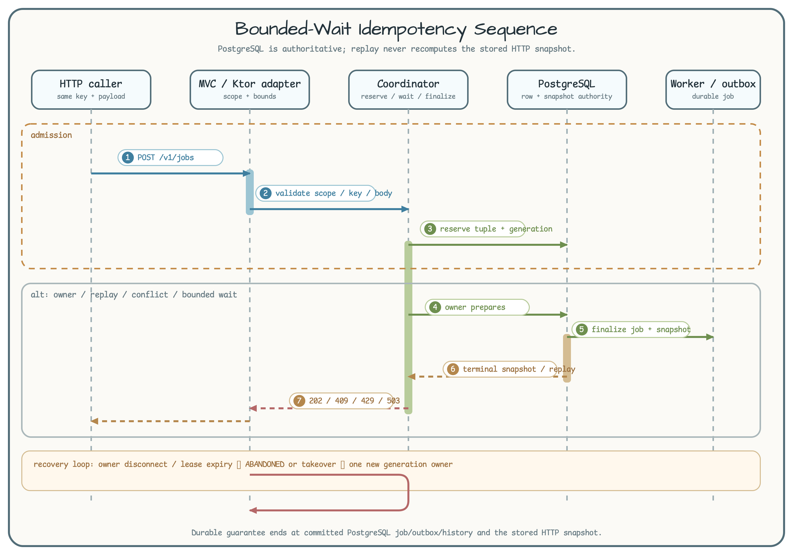

# Spring Job Console Adapter

[한국어](README.ko.md) | English

This Java 25 adapter exposes the shared contract through Spring Boot MVC,
`SseEmitter`, scheduled outbox polling, an application-owned virtual-thread worker executor, and the shared operations UI.

## Safety boundary

Routes exist only under the `demo` profile. `X-Demo-Tenant`,
`X-Demo-Submitter`, and `X-Demo-Operator` are trusted demo headers, not production authentication. REST snapshots remain authoritative after every SSE notification.

## Bounded-wait HTTP idempotency



The adapter delegates `POST /v1/jobs` to the shared PostgreSQL-owned request row. Rollout is disabled by default (`job-console.bounded-wait.enabled=false`); enable it only with one policy fingerprint across every instance. The policy is 2s waiter deadline, two waiters per key, 1h terminal retention, 64KiB request/replay bodies, and a 255-byte idempotency key.

| Outcome                              |                   Status | Caller action                                      |
|--------------------------------------|-------------------------:|----------------------------------------------------|
| first owner or replay                |                    `202` | store the response; replay uses the saved snapshot |
| key reused with another request      |                    `409` | correct the key or payload                         |
| in-flight timeout                    | `409` + `Retry-After: 1` | retry the same key                                 |
| waiter overflow                      | `429` + `Retry-After: 2` | back off and retry                                 |
| abandoned owner / dependency failure |                    `503` | retry with backoff                                 |
| invalid input / body too large       |            `400` / `413` | fix the request                                    |

The contract is at-least-once and idempotent, not exactly-once. Legacy replay uses the V001-compatible terminal path. On shutdown, admission closes, active submissions drain for at most five seconds, and remaining owners are abandoned for lease recovery. Readiness exposes PostgreSQL, Redis, bounded-wait state, and policy fingerprint; Redis remains advisory. No test-only conformance route is published by this adapter.

## Run

```bash
export SPRING_DATASOURCE_URL=jdbc:postgresql://localhost:5432/postgres
export SPRING_DATASOURCE_USERNAME=postgres
export SPRING_DATASOURCE_PASSWORD=postgres
export SPRING_PROFILES_ACTIVE=demo
# Optional advisory cancellation acceleration:
# export JOB_CONSOLE_REDIS_URI=redis://localhost:6379
./gradlew :operations-job-console-spring:bootRun
```

## Verify

```bash
./gradlew :operations-job-console-spring:test
./gradlew :operations-job-console-spring:integrationTest --max-workers=1
```

## High-contention evidence


Run the shared core and Spring adapter profiles with a running Docker daemon, JDK 25, and at least 4 GiB of memory available to Gradle and the containers:

```bash
CI_RUN_ID=developer-ci-001
REFERENCE_RUN_ID=developer-reference-001
./gradlew highContentionCi -PhighContentionRunId="$CI_RUN_ID" --max-workers=1
./gradlew highContentionLocalReference -PhighContentionRunId="$REFERENCE_RUN_ID" --max-workers=1
```

The correctness gate is `highContentionCi`. `highContentionLocalReference`
records environment-specific execution observations; it does not rank frameworks and does not establish production capacity. Canonical reports are written under `build/reports/high-contention/<run-id>/`. Use a new run ID for every command; local-reference execution also requires a clean worktree.

The Spring `DataSource` uses HikariCP, while PostgreSQL remains authoritative for leases, fencing, checkpoints, deduplication, and terminal state. Toxiproxy cuts and restores only the advisory Redis path, including old and newly opened connections; it does not replace PostgreSQL authority or database failover.

## Business scenario and learning goals

Imagine a customer asking the service to export a large document. The HTTP
request must return quickly, even though the export may need several worker
checkpoints. The customer may retry when a response is lost, an operator may
open the queue while a worker is restarting, and a browser may disconnect from
SSE at any time. This adapter is a runnable Spring MVC example of those
ordinary operational conditions, not a toy controller that keeps the export in
the request thread.

After reading this module, a reader should be able to explain:

1. why `POST /v1/jobs` commits a PostgreSQL request row before returning;
2. why repeating the same `Idempotency-Key` replays a stored response instead
   of creating another job;
3. why `GET /v1/jobs/{jobId}` remains authoritative after an SSE disconnect;
4. how the scheduled outbox poller and virtual-thread worker are owned by the
   Spring application lifecycle; and
5. which responsibilities stay in `job-console-core` so a Ktor adapter can
   pass the same contract tests.

The demo headers identify a tenant, submitter, and operator so the business
rules are visible without hiding them behind an identity provider. They are
deliberately not a production security design.

## Spring boundary and request flow

| Concern | Spring adapter does | Core/PostgreSQL does |
|---|---|---|
| HTTP input | validates one caller scope, one idempotency key, UTF-8 JSON, and the 64 KiB body limit | canonicalizes the request and decides whether it is new, a replay, or a conflict |
| Worker execution | schedules one non-overlapping `runOnce` call on the application-owned virtual-thread executor | claims FIFO work, fences leases, checkpoints progress, and commits retry/terminal state |
| Notifications | creates an `SseEmitter`, sends heartbeats, and removes timed-out subscribers | writes an outbox row after a durable state change; the poller may publish it again |
| Shutdown | closes admission and waits up to five seconds for submissions to drain | lets abandoned owners be recovered by a later lease claim |
| Readiness | maps health/readiness to HTTP status | checks PostgreSQL authority and reports Redis as advisory degradation |

The scheduled outbox poller runs approximately every 100 ms and the worker
trigger runs approximately every 50 ms. Those values make the lifecycle easy
to observe in the workshop; they are not production capacity settings. Spring
owns the scheduler and executor, while PostgreSQL remains the authority for
job state, queue order, lease fencing, checkpoints, idempotency, and outbox
publication state.

## A realistic HTTP walkthrough

Start the application with the `demo` profile, then submit a deterministic
export. The response body contains a redacted `jobId`; it does not echo tenant
identity, submitter identity, the payload, or stack traces.

```bash
curl -i -X POST http://localhost:8080/v1/jobs \
  -H 'Content-Type: application/json' \
  -H 'X-Demo-Tenant: tenant-a' \
  -H 'X-Demo-Submitter: submitter-a' \
  -H 'Idempotency-Key: spring-export-2026-001' \
  -d '{"jobType":"document_export","workUnits":3,"failureMode":"none"}'

# If the first response is lost, replay the exact key and body.
curl -i -X POST http://localhost:8080/v1/jobs \
  -H 'Content-Type: application/json' \
  -H 'X-Demo-Tenant: tenant-a' \
  -H 'X-Demo-Submitter: submitter-a' \
  -H 'Idempotency-Key: spring-export-2026-001' \
  -d '{"jobType":"document_export","workUnits":3,"failureMode":"none"}'

# Refresh the PostgreSQL-backed snapshot after an event or reconnect.
curl -s http://localhost:8080/v1/jobs/<job-id> \
  -H 'X-Demo-Tenant: tenant-a' -H 'X-Demo-Submitter: submitter-a'

# Listen for a hint, then fetch the snapshot; SSE is not history.
curl -N http://localhost:8080/v1/jobs/<job-id>/events \
  -H 'X-Demo-Tenant: tenant-a' -H 'X-Demo-Submitter: submitter-a'
```

The first accepted request and a replay both use `202`. A reused key with a
different canonical request is `409`; a bounded waiter timeout is `409` with
`Retry-After: 1`; waiter overflow is `429` with `Retry-After: 2`; abandoned
ownership or a dependency failure is `503`. The caller should retry the same
key only where the response contract says it is safe to do so.

## Test-to-contract map

Read the tests as business requirements rather than as Spring API trivia:

| Requirement | Representative Spring evidence |
|---|---|
| exact header/body validation and redacted problem responses | `JobConsoleSpringSubmissionHttpTest`, `JobConsoleProblemHandlerTest` |
| same request reaches the same HTTP response on replay | `SpringBoundedWaitHttpIdempotencyConformanceTest` |
| Spring route JSON/status/SSE fields match the shared contract | `SpringJobConsoleHttpTest`, `JobConsoleV1LiveContractHeartbeatTest` |
| scheduled worker/outbox resources close without accepting new work | `JobConsoleSpringLifecycleTest`, `SpringJobConsoleReplacementTest` |
| high contention preserves queue and lease invariants | `SpringJobConsoleHighContentionProfileTest`, `SpringJobConsoleHighContentionSelectionTest` |

The conformance tests deliberately share the core fixture with Ktor. A passing
Spring-only controller test is not enough to prove PostgreSQL authority; the
container-backed integration and high-contention tests are the evidence for
claim, fencing, cancellation, outbox, and recovery behavior.

## Specification traceability

The original design requires interchangeable Spring/Ktor adapters, PostgreSQL
authority, advisory Redis cancellation, snapshot-only SSE, bounded shutdown,
and identical black-box contracts. See
[`2026-07-21-issue-520-job-operations-console-design.md`](../../docs/superpowers/specs/2026-07-21-issue-520-job-operations-console-design.md),
especially the module boundary, HTTP/SSE, worker lifecycle, failure matrix,
and acceptance sections. The follow-up
[`2026-11-18-issue-1052-operations-exposed-design.md`](../../docs/superpowers/specs/2026-11-18-issue-1052-operations-exposed-design.md)
explains why the shared core keeps ordinary CRUD typed while migration,
`EXPLAIN`, lock, retention, backup/restore, and compatibility probes preserve
raw SQL as an intentional test boundary.
